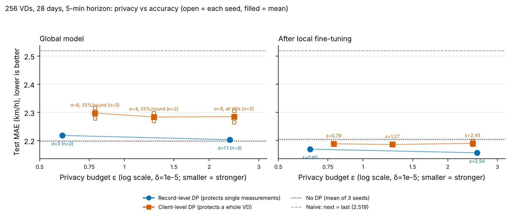
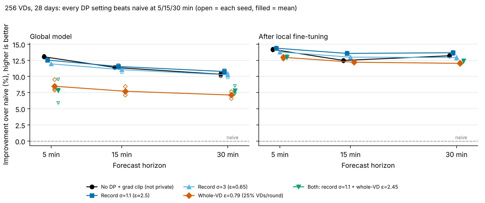
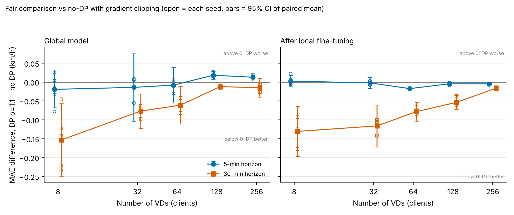

# 智慧交通可信任聯邦式學習（Flower + Opacus）

以**高公局國道 VD（車輛偵測器）真實資料**做 5 分鐘車速預測：每個 VD 是一個聯邦 client，
資料不出端；client 端以 **DP-SGD（Opacus）** 訓練，並正確累計、輸出各 client 的隱私預算 ε。
同一套程式碼可切換成**無 DP 對照組**，一鍵跑完並畫比較圖。

| 項目 | 設定 |
|---|---|
| 任務 | 過去 12 筆 5 分鐘平均車速（1 小時）→ 預測下一個 5 分鐘車速 |
| 模型 | 殘差 MLP 12→32→32→1：輸出 = 最後一筆車速 + MLP 修正量（Opacus 相容） |
| Client | 1 個 VD = 1 個 client（預設國道 1 號、資料最完整的 8 個 VD） |
| 切分 | 各 client 依時間前 80% 訓練、後 20% 測試；視窗不跨切點；標準化只用訓練段 |
| 聚合 | FedAvg，每輪全部 client 參與；SGD 學習率 0.2、MSE 損失 |
| 隱私 | record-level DP-SGD：逐樣本裁剪（C=1.0）+ 高斯雜訊（σ=1.1）+ Poisson 取樣；RDP accountant，δ=1e-5 |
| 通訊安全 | 上傳更新附 HMAC-SHA256、全域模型附 Ed25519 簽章（可關閉）；可選穩健聚合與攻擊模擬 |
| 框架 | Flower 1.26（Message API）、PyTorch、Opacus |

## 1. 安裝

需要 Python 3.11+。Windows 可直接用跨平台的 `python scripts/run_experiments.py`（不需 bash），
或點兩下 `scripts/run_all_windows.bat` 一次跑完安裝、測試、煙霧測試、下載、前處理與實驗
（進度寫在 `status.txt`、完整輸出在 `run_log.txt`）。

**Windows 注意**：PyTorch 需要 Microsoft Visual C++ Redistributable（x64）。若出現
`WinError 126 ... torch\lib\shm.dll`，請安裝 https://aka.ms/vs/17/release/vc_redist.x64.exe 後重開終端機。

```bash
python -m venv .venv && source .venv/bin/activate   # Windows: .venv\Scripts\activate
pip install -e ".[dev]"
```

## 2. 取得真實資料

資料來源：交通部高速公路局「交通資料庫」歷史 VD 動態資訊（MOTC v2.0，每分鐘一檔），
`https://tisvcloud.freeway.gov.tw/history/motc20/VD/YYYYMMDD/VDLive_HHMM.xml.gz`，
授權為政府資料開放授權條款－第 1 版。

```bash
# 下載 14 天、只保留 VDID 含 "N1"（國道 1 號）的偵測器；邊下載邊解析，只存 CSV
python scripts/download_vd.py --start 2024-03-04 --days 14 --vd-pattern "N1"

# 5 分鐘聚合、補短缺口、挑出資料最完整的 8 個 VD
python scripts/preprocess_vd.py --num-clients 8 --vd-pattern "^VD-N1-[NS]-[0-9.]+-M-"   # 只取主線（-M-），排除匝道
```

- 一天約 1,440 個檔案，下載可中斷，重跑會跳過已完成的日期（`.done` 標記）。
- 單日缺檔超過 `--max-failed`（預設 30 分鐘）不會標記完成，重跑即可補抓。
- 想指定特定 VD：`python scripts/preprocess_vd.py --vd-ids <VDID> <VDID> ...`
- 建議避開春節、連假與颱風日，或在報告中說明期間。

**資料清理規則**：車道車速 ≤0 或 ≥200、或 Status≠0 視為無效；VD 車速 = 有效車道的流量加權平均
（流量皆為 0 時取平均）；每 5 分鐘至少 3 分鐘有效才算數；連續 ≤3 格（15 分鐘）的缺口線性內插，
更長的缺口保留空值，含空值的訓練視窗直接捨棄；只挑有效率 ≥80% 的 VD。
（內插在時間切分前進行，切點兩側 ≤15 分鐘的缺口會互相參考鄰近值，影響至多 3 個點，可忽略。）

輸出：`data/processed/<VDID>.csv`（time, speed, volume, occupancy）與 `manifest.json`
（client 編號 ↔ VDID、期間、有效率、篩選條件）。

## 3. 跑實驗（DP + 無 DP 對照組）

```bash
bash scripts/run_experiments.sh                          # 20 輪；無 DP + DP σ=1.1
ROUNDS=30 SIGMAS="0.8 1.1 1.5" bash scripts/run_experiments.sh   # 多個隱私等級
EXTRA="learning-rate=0.02 local-epochs=2" bash scripts/run_experiments.sh
SIGMAS="0.8 1.1 1.5" SEEDS="1 2 3" bash scripts/run_experiments.sh   # 每個設定重複 3 個 seed
# Windows / 不用 bash：
python scripts/run_experiments.py --sigmas 0.8 1.1 1.5 --seeds 1 2 3
```

腳本會：
1. 依 `manifest.json` 的 VD 數，在專案內 `.flwr_home/config.toml` 寫入 `num-supernodes`
   （Flower 1.26 起 client 數只能寫在 Flower 設定檔，`--federation-config` 會被忽略；
   用專案專屬的 `FLWR_HOME` 不會動到你家目錄的設定）；
2. 以相同數字傳 `num-clients` 給 ServerApp，三者不一致時會直接報錯，而不是卡住等待；
3. 以絕對路徑傳 `data-dir`、`results-dir`；
4. 依序跑無 DP 與各 σ 的 DP，最後執行 `scripts/plot_results.py`。

單獨跑一次（需自行確保 Flower 設定檔的 `num-supernodes` = VD 數）：

```bash
flwr run . local --run-config "num-clients=8 use-dp=false data-dir='/abs/path/data/processed' results-dir='/abs/path/results'"
```

所有可調參數在 `pyproject.toml` 的 `[tool.flwr.app.config]`。

### 輸出

```
results/<批次時間>/
├── nodp/            metrics.csv  clients.csv  config.json  final_model.pt
├── dp_sigma1.1/     （同上）
├── comparison.png         左：各設定每輪測試 MAE（多 seed 時畫平均）；右：DP 累計 ε
├── summary.csv            各 run 最終／最佳 MAE、RMSE、最終 ε、naive 基準與改善幅度
└── summary_by_config.csv  同設定跨 seed 的最終 MAE 平均 ± 標準差
```

- `metrics.csv`：每輪實際回覆的 client 數（不足時會發出警告）、train_loss、eval_loss、mae_kmh、rmse_kmh、epsilon_max、epsilon_mean、
  naive_mae_kmh（「下一筆 = 最後一筆」的 MAE，模型至少要贏過它才算有學到東西）、
  local_mae_kmh（各 client 本輪本地訓練完、聚合前的模型在自己測試集的 MAE，相當於全域模型再多 1 輪本地訓練，可作為個人化的粗略參考；
  它就是 DP 訓練的輸出，不多花隱私預算）、
  ft_mae_kmh／ft_epsilon_max（只在最後一輪有值：各 VD 拿最終全域模型在本地再訓練 `finetune-epochs` 個 epoch 後的 MAE，
  以及把這幾步也算進去的 ε，見下方「個人化微調」）
- `summary.csv` 的 `best_mae_kmh` 是在測試集上挑最好的一輪，只供參考；報告請用 `final_mae_kmh`
- `clients.csv`：每輪每個 client（含 VDID）的樣本數、loss、MAE、RMSE、累計 ε、DP 步數與 q
- `config.json`：本次完整 run config、套件版本、資料期間與 client 清單

## 4. 隱私預算 ε 怎麼算

Flower 每輪都會重新建立 ClientApp，若每輪新建 `PrivacyEngine` 並呼叫 `get_epsilon()`，
accountant 會歸零，得到的只是「單輪」ε（舊版程式與 Flower 官方 Opacus 範例都是這樣）。

本專案每輪把 `(σ, q, 步數)` 存進該 client 的 `context.state`，每次以全部歷史計算 RDP 總和再轉成
(ε, δ)，與 Opacus `RDPAccountant` 使用同一組 orders 與同一個函式（`privacy.py`）。
q 取自 Opacus `DPDataLoader.sample_rate`（Poisson 取樣的真實機率 = 1/每 epoch 批次數）；
每輪的步數與 q 也寫進 `clients.csv`（`dp_steps`、`sample_rate`），可自行驗算。
ε 是**每個 client 對其本地資料**的 record-level 保證；`epsilon_max` 為所有 client 中最大者。

**ε 涵蓋的範圍（報告中請註明）**
- 受保護的只有 client 上傳的**模型參數**。DP 模式下 client 仍回報未加雜訊的 `train-loss`、
  訓練／測試樣本數與測試 MAE，這些是研究用診斷資訊，**不在 (ε, δ) 保證內**；
  實際部署若要完整保證，應拿掉或另行加噪並計入預算。
- 為了可重現，取樣與雜訊使用固定 seed 的亂數產生器（未開 Opacus `secure_mode`）；
  形式上的 DP 假設雜訊不可預測，這是研究用設定。

以預設 14 天資料估算（每 client 約 3,200 個訓練視窗、批次 64 → q≈1/50、每輪 1 個 local epoch、δ=1e-5），約為：

| σ | 1 輪 | 5 輪 | 10 輪 | 20 輪 |
|---|---|---|---|---|
| 0.8 | 2.85 | 4.20 | 5.37 | 7.20 |
| 1.1 | 1.27 | 1.93 | 2.58 | 3.59 |
| 1.5 | 0.62 | 1.08 | 1.51 | 2.16 |

（實際值會隨資料量而變，以 `metrics.csv` 為準。）

### 真實資料調參結果（2026-10-30，國道 1 號北向 8 個主線 VD，2024-03-04～03-17，20 輪 × 3 seed）

| 設定 | 無 DP MAE | DP σ=1.1 MAE | naive MAE |
|---|---|---|---|
| 舊版：直接預測車速、lr=0.05 | 2.755 ± 0.018 | 2.918 ± 0.039 | 2.916 |
| 殘差模型、lr=0.05 | 2.740 ± 0.023 | 2.786 ± 0.011 | 2.916 |
| **殘差模型、lr=0.2（新預設）** | 2.743 ± 0.033 | **2.712 ± 0.015** | 2.916 |

- 舊版 DP 模型的 MAE 和「下一筆 = 最後一筆」差不多，等於沒學到東西；改成殘差模型後，模型一開始就等於 naive，
  只需學修正量，裁剪造成的慢收斂不再拖累結果。
- 新預設下 DP 甚至略優於無 DP：只裁剪、不加雜訊（σ=0）也有 2.709 ± 0.011，表示**逐樣本裁剪**對交通資料的
  極端值（事故、壅塞突變）有穩定作用。若無 DP 改用 L1 損失（`loss="l1"`、lr=0.05）可到 2.721 ± 0.026，
  與 DP 相當。結論：在這組設定下，DP 的準確度代價在隨機波動範圍內。
- 學習率 0.3～0.4、裁剪上限 C=0.5 或 2、隱藏層 64、Huber 損失、30 輪、批次 32／128、伺服器動量、
  加時間特徵（時段、假日）或流量／佔有率特徵、回看 24 筆，都沒有比新預設更好。
- 回看 6 筆（30 分鐘）在 5 個 seed 下：DP 2.703 ± 0.013（與 12 筆的 2.708 相當），無 DP 2.707 ± 0.014
  （12 筆為 2.752 ± 0.038）。若想讓無 DP 對照組更強，可用 `--extra "lookback=6"`。
- 本地模型參考（各 client 最後一輪聚合前的模型，`local_mae_kmh`，Flower 實跑 3 seed）：DP σ=1.1 2.690、無 DP 2.710，比全域模型再好約 0.02～0.03。
- 隱私與準確度取捨（σ 加大）：第一晚快速實驗得到 σ=2（ε≈1.46）2.744、σ=3（ε≈0.89）2.804、σ=5（ε≈0.50）3.08；
  第二晚用 Flower 端到端重跑（3 seed）為 2.725、2.745、2.833，較好且以 Flower 為準（見下方第二晚表格）。
  可用 `--sigmas 2 3 5 --seeds 1 2 3` 重現。
- 不同 VD 差異大：國道 1 號北向 10 公里附近的 3 個 VD，模型與 naive 幾乎一樣（約 3.5～3.8），其他 VD 都明顯較好。
- 新預設已用 Flower 端到端重跑（3 seed）：無 DP 2.744 ± 0.036；DP σ=0.8/1.1/1.5 為 2.711/2.712/2.719（± 0.01），
  ε=7.20/3.59/2.16；無 DP 改用 L1 損失 2.720 ± 0.026。RMSE 方面無 DP（4.45）略優於 DP（4.47），
  表示 DP 的裁剪讓大誤差稍多、平均誤差稍少。

### 選用：client-level DP（保護整個 VD）

```bash
python scripts/run_experiments.py --sigmas --skip-nodp --client-sigmas 2 4 --extra "client-dp-clip=0.05"
```

以 Flower 內建的 `DifferentialPrivacyServerSideFixedClipping` 包住 FedAvg：伺服器把每個 client 的更新量
裁剪到 `client-dp-clip`，平均後加高斯雜訊（倍率 `client-dp-noise`），ε 以每輪 q=1 的高斯機制累計，
寫在 `config.json` 的 `client_level_dp` 與 `summary.csv` 的 `final_epsilon`。
注意威脅模型不同：伺服器必須可信（它看得到未裁剪的更新），保護的是對外發布的全域模型。
只有 8 個 client 時代價很大（真實資料、Flower 實跑、C=0.05、20 輪 × 3 seed）：

| client-level σ | ε（整個 VD） | 全域模型 MAE | 本地微調後 MAE（2026-10-31） |
|---|---|---|---|
| 1 | 30.1 | 2.872 ± 0.021 | — |
| 2 | 12.3 | 2.908 ± 0.044（≈ naive 2.916） | 2.759 ± 0.037 |
| 4 | 5.4 | 3.231 ± 0.312（輸給 naive） | 2.777 ± 0.036 |

全域模型要實用需要更多 VD 參與（雜訊依參與的 client 數平均掉）。但各 VD 在本地微調 3 epoch 後，
σ=4 也能回到 2.78（贏 naive）：微調在本地進行、不上傳，不影響對外發布的全域模型的 client-level ε。
這組 run 沒有開 record-level DP，所以微調本身沒有 record-level 保證。

### 第二晚實驗（2026-10-31）：預測更遠、個人化微調、成員推論攻擊

大量比較設定用 `scripts/quick_ablation.py`（同一行程內做 FedAvg + Opacus，與 Flower 流程相同，DP σ=1.1 seed 1 兩者
都是 2.70），有效的再用 Flower 端到端驗證。以下 Flower 數字皆為 20 輪 × 3 seed。

**預測更遠（`horizon`）**：`--extra "horizon=3"` 預測 15 分鐘後、`horizon=6` 預測 30 分鐘後。

| 預測 | naive MAE | 無 DP | DP σ=1.1（ε 3.59） |
|---|---|---|---|
| 5 分鐘後 | 2.916 | 2.742 ± 0.034 | 2.712 ± 0.010 |
| 15 分鐘後 | 3.812 | 3.734 ± 0.028 | 3.624 ± 0.020 |
| 30 分鐘後 | 4.859 | 4.983 ± 0.017（輸給 naive） | 4.740 ± 0.015 |

5 分鐘時 DP 與無 DP 的差距在隨機波動內；15、30 分鐘時 DP 明顯較好，無 DP 在 30 分鐘時已比「沿用最後一筆」差。
推測是逐樣本裁剪的正則化效果，加上測試期間比訓練期間塞車多（未另外驗證）。

**個人化微調（`finetune-epochs`，預設 3、`finetune-lr` 0.05）**：最後一輪各 VD 拿全域模型在本地再訓練幾個 epoch，
只在本地使用、不上傳。用的是同一份私有資料，DP 時這幾步也算進 ε（`ft_epsilon_max`）。

| 設定 | 全域模型 MAE | 微調後 MAE | 微調後 ε |
|---|---|---|---|
| 無 DP | 2.742 ± 0.034 | 2.670 ± 0.005 | — |
| DP σ=1.1 | 2.712 ± 0.010 | 2.669 ± 0.002 | 3.85（原 3.59） |
| DP σ=1.1、15 分鐘後 | 3.623 ± 0.021 | 3.597 ± 0.009 | 3.85 |
| DP σ=2 | 2.725 ± 0.016 | 2.680 ± 0.015 | 1.57（原 1.46） |
| DP σ=3 | 2.745 ± 0.017 | 2.700 ± 0.024 | 0.96（原 0.89） |
| DP σ=5 | 2.833 ± 0.038 | 2.771 ± 0.025 | 0.53（原 0.50） |

微調後 DP σ=1.1 與無 DP 一樣準（2.669 vs 2.670）；ε 不到 1（σ=3）時 2.700，只差 0.03（約 1 個標準差）。
對照（快速實驗，DP σ=1.1）：同樣 ε=3.85 下，聯邦多訓練 3 輪為 2.706 ± 0.009、只在本地訓練 23 epoch 為 2.738 ± 0.010，
都不如聯邦 + 微調（2.668 ± 0.005），所以效果不只是多走幾步。只在本地用 DP 訓練 20 epoch（ε 3.59）為 2.727 ± 0.018。

微調設定的檢查：只用訓練期間（前 80% 訓練、後 20% 驗證，`quick_ablation.py --val`）時，全域模型 2.543 → 微調 3 epoch 2.465
（1 epoch 2.494、5 epoch 2.452），σ=3 時 2.595 → 2.518，改善不是靠看測試集挑參數。
限制：預測越遠幫助越小
（15 分鐘 DP 3.623 → 3.597、無 DP 不變；30 分鐘 DP 4.740 → 4.728、無 DP 4.986 → 5.113 反而變差）。

**成員推論攻擊（`--mia`）**：訓練期間每 4 天留 1 天不訓練，攻擊者用「誤差越小越可能是訓練資料」猜測。
AUC 0.5 代表亂猜。3 seed 結果：無 DP 0.515、DP σ=1.1（此設定訓練資料較少，ε=4.10）0.515；加大模型、拉長訓練
（隱藏層 256、3 層、每輪 10 epoch、30 輪）無 DP 也只有 0.523，且成員與非成員誤差仍接近（2.47 vs 2.51），沒有真的過擬合。
這個攻擊對本模型無效，**無法用來判斷 DP 有沒有作用**；隱私保證以 ε 為準。

**沒有幫助的嘗試**（快速實驗，DP σ=1.1、3 seed，基準 2.712）：cosine 學習率 2.727、FedProx μ=0.01 2.712、
3 層 MLP 2.733、動量 0.5 2.723、每輪 2 epoch 2.730（ε 5.13）、DP-GRU 2.793、加入下游／上游／兩側相鄰 VD 車速
2.766／2.752／2.790；30 分鐘預測改 L1 或回看 24 筆也沒有改善。

### 第三晚實驗（2026-11-01）：時段特徵

**時段特徵（`calendar`，預設 `"tod"`）**：在輸入前面加上「要預測的那個時間點」的時段，以 sin/cos 編碼
（23:55 與 00:00 相鄰）。時間是公開資訊，不是私有量測，也不改變取樣率，ε 完全不變。
Flower、20 輪、5 seed（1–5），同一批跑的基準對照，數字是本地微調後 MAE：

| 設定 | 基準（無時段） | 加時段特徵 | 差異（配對） | 微調後 ε |
|---|---|---|---|---|
| 無 DP | 2.674 ± 0.006 | **2.658 ± 0.012** | −0.016，4/5 seed 較好（p=0.08） | – |
| DP σ=1.1 | 2.665 ± 0.006 | **2.642 ± 0.016** | −0.023，5/5 seed 較好（p=0.01） | 3.85 |
| DP σ=3 | 2.696 ± 0.019 | **2.679 ± 0.033** | −0.017，4/5 seed 較好（p=0.34） | 0.96 |

全域模型（未微調）幾乎不變（DP σ=1.1 都是 2.712）：每個 VD 的尖峰時段不同，共用的全域模型用不太到時段，
各 VD 微調後才學到自己的日型態。σ=1.1 的改善穩定；σ=3 方向相同但雜訊大，還不能下定論。
調參只用驗證集（`quick_ablation.py --val`）：DP σ=1.1 2.465 → 2.436、σ=3 2.518 → 2.485。

**預測更遠時（Flower、5 seed、DP σ=1.1、微調後 MAE）**：時段特徵幫助更大，但 5 seed 還不到顯著。

| 預測距離 | naive | 無 DP（無時段 → 有時段） | DP σ=1.1（無時段 → 有時段） |
|---|---|---|---|
| 15 分鐘 | 3.812 | 3.743 → 3.814（5/5 seed 變差） | 3.589 → **3.556**（4/5 較好，p=0.09） |
| 30 分鐘 | 4.859 | 5.093 → 5.143（5/5 變差） | 4.755 → **4.660**（4/5 較好，p=0.09） |

無 DP 在測試期間反而變差（30 分鐘時甚至不如 naive）：沒有逐樣本裁剪，多出的輸入讓它更容易對訓練期間過擬合；
只用訓練期間的驗證集時無 DP 也會變好（30 分鐘 4.543 → 4.261），所以差別來自訓練與測試期間的落差，不是程式錯誤。
DP 的裁剪＋雜訊在這裡有正則化效果，30 分鐘預測時 DP + 時段特徵（4.660）同時贏過無 DP（5.093）與 naive（4.859）。

**昨天同一時刻的車速（`lag-day`，預設關閉）**：驗證集上很有效（30 分鐘 DP 4.366 → 4.116），
但 Flower 5 seed 在測試期間反而變差（DP σ=1.1 微調後：5 分鐘 2.642 → 2.657、15 分鐘 3.556 → 3.597、
30 分鐘 4.660 → 4.759，ε 也因訓練視窗變少升到 4.10）。原因是期間切法：

| 期間 | 日期 | 週末比例 |
|---|---|---|
| 訓練（調參時） | 03-04～03-12 | 22% |
| 驗證 | 03-12 晚～03-15 清晨 | 0% |
| 測試 | 03-15 清晨～03-17 | **71%** |

測試期間大多是週末，「昨天」是週五時對週六沒有參考價值；訓練資料只有一個週末，模型也學不到週末型態。
這也解釋了無 DP 在測試期間較容易過擬合。**要做更可靠的比較，需要更長的資料（建議 4 週以上，含多個週末）**，
目前所有結論都只在這兩週資料上成立。

**5 折區塊交叉驗證（`quick_ablation.py --fold 0..4`）**：為了不受單一測試期間的週末偏差影響，
把兩週切成 5 個連續區塊，每塊輪流當測試、其餘訓練（訓練視窗不碰測試區塊）。DP σ=1.1、微調 3 epoch、每折 3 seed：

| 設定 | 5 分鐘（5 折平均） | 30 分鐘（5 折平均） |
|---|---|---|
| 基準 | 2.488 | 4.374 |
| **＋時段特徵** | **2.459（5/5 折較好，p<0.001）** | **4.197（5/5 折較好，p=0.001）** |
| 時段＋昨天同一時刻 | 2.492（1/5 折比時段好） | 4.355（1/5） |
| 時段＋weight decay 0.01 | 2.483（1/5） | 4.249（1/5） |
| 時段＋週末旗標 | 2.459（2/5） | 4.211（2/5） |

時段特徵在每一折都有效，是這次最可靠的改進；其他三個都不穩定，不採用。
σ=3 時時段特徵 2.523 → 2.514（4/5 折，p=0.04）。同樣用 5 折檢查其他調整（5 分鐘、DP σ=1.1，時段特徵 2.459 為基準）：
學習率 0.3 2.449（5/5 折較好，但只差 0.01；σ=3 時 2.517 沒改善、30 分鐘 4.187 4/5 折），微調 lr 0.1 2.454（4/5）、
回看 6 筆 2.456（2/5）、隱藏層 64 2.464（1/5）、回看 24 筆 2.503（0/5）。改善都在 0.01 以內，預設維持不變。
CV 下無 DP＋時段特徵 2.444，DP σ=1.1 2.459，隱私成本約 0.015 km/h。

**4 週資料驗證（2024-03-04～03-31，同樣 8 個 VD）**：資料在桌機下載後放在 `data/vd-28d` 分支的
`data/processed_28d/`（`run_experiments.py --data-dir data/processed_28d`）。測試期間 03-26～03-31，週末比例 36%，
訓練期間有 3 個週末。Flower 20 輪 × 5 seed，微調後 MAE（naive 3.008）：

| 設定 | 基準 | ＋時段特徵 | 配對比較 | 微調後 ε |
|---|---|---|---|---|
| 無 DP | 2.737 ± 0.020 | **2.693 ± 0.027** | 5/5 seed 較好，p=0.005 | – |
| DP σ=1.1 | 2.719 ± 0.004 | **2.685 ± 0.011** | 5/5，p<0.001 | 2.54 |
| DP σ=3 | 2.778 ± 0.012 | **2.750 ± 0.013** | 4/5，p=0.05 | 0.65 |

資料多一倍後 ε 也降低（σ=1.1 從 3.85 降到 2.54，σ=3 從 0.96 降到 0.65），因為每筆資料被抽到的機率變小。
時段特徵在三種設定都顯著有效；DP σ=1.1（2.685）與無 DP（2.693）一樣準。
昨天同一時刻在 4 週資料上仍沒有幫助（DP σ=1.1 2.685 → 2.689，ε 2.62）。
30 分鐘預測（naive 5.471）：無 DP 5.390 → **4.995**、DP σ=1.1 5.053 → **4.865**（都是 5/5 seed，p<0.001），
時段特徵讓 30 分鐘誤差降約 0.2～0.4 km/h，而且 DP 模型比無 DP 準。
週末旗標 2.681（4/5 seed，p=0.31）、學習率 0.3 2.679（3/5，p=0.20），改善不顯著，預設不變。
4 週資料的 5 折交叉驗證（快速實驗、DP σ=1.1、時段特徵 2.474，ε 2.56）：隱藏層 64 2.484（0/5 折較好）、
3 層 2.478（1/5）、30 輪 2.466（5/5，但 ε 升到 3.08）；30 輪並把 σ 調到 1.25 讓 ε 相同（2.49）時 2.469，只好 0.005，預設不變。

**更多 VD（32 個國道 1 號北向主線 VD，0.6～160 km，4 週，`data/vd-28d` 分支的 `data/processed_28d_32/`）**：
Flower、時段特徵、3 seed。不同 VD 組合的 MAE 不能直接相比，所以和各自的 naive 比較：

| 設定 | 8 個 VD（naive 3.008） | 32 個 VD（naive 2.429） |
|---|---|---|
| 無 DP，全域 | 2.888 | 2.265 |
| record-level DP σ=1.1，全域／微調後 | 2.803／2.685 | 2.183／2.116 |
| record-level DP σ=3，全域／微調後 | 2.894／2.750 | 2.214／2.135 |
| client-level DP σ=2（ε 12.3，保護整個 VD），全域 | 3.073（**輸給 naive**） | **2.353（贏 naive 3%）** |
| client-level DP σ=4（ε 5.4），全域 | 3.817 ± 0.685（輸給 naive） | **2.390（贏 naive 2%）** |

client-level DP 的雜訊加在「平均後的更新量」上，參與的 VD 越多、平均掉的雜訊越多：8 個 VD 時全域模型被雜訊毀掉，
32 個 VD 時 σ=4 仍能贏過 naive。這是聯邦學習規模的直接證據：**要保護整個 VD，需要更多 VD 參與**。
record-level DP 則不需要很多 VD，在重疊的 VD 上 32 個與 8 個差不多（各 VD 交通型態不同，多 VD 不會讓單一 VD 更準）。
32 個 VD 時一次 Flower run 約 2 分鐘（8 個約 30 秒）。

client-level DP 再加上**逐樣本裁剪**（`--extra "use-dp=true noise-multiplier=0 ..."`，只裁剪不加噪，ε 仍以 client-level 為準）
更穩也更準：32 個 VD、σ=4（ε 5.4）全域模型 2.390 → **2.318 ± 0.036**（client 更新量裁剪 0.05；0.1 時 2.323），
本地微調後 2.164／2.130。沒有逐樣本裁剪時，標準差很小的 VD（例如 142.2 km，車速標準差 3.2 km/h，壅塞時標準化後輸入到 −22）
可能讓本地訓練梯度爆掉：現在 client 偵測到參數出現 NaN／inf 會改回傳收到的全域模型（更新量 0），並記在 `clients.csv` 的
`diverged` 與 `metrics.csv` 的 `n_diverged`。σ=8（ε 2.45、未裁剪）全域 2.548 ± 0.112，輸給 naive。
注意：Flower 模擬中 client 回覆的順序不固定，浮點加總順序會變，同一個 seed 重跑結果略有不同（client-level 雜訊大時差異會被放大）。
32 個 VD、client-level DP＋逐樣本裁剪（client 更新量裁剪 0.05）的隱私–準確度曲線，5 seed（naive 2.429、無 DP 全域 2.265／微調 2.153）：

| client-level σ | ε（整個 VD） | 全域模型 MAE | 本地微調後 MAE |
|---|---|---|---|
| 2 | 12.3 | 2.281 ± 0.020 | 2.163 ± 0.012 |
| 4 | 5.4 | 2.309 ± 0.029 | 2.166 ± 0.009 |
| 8 | 2.45 | 2.423 ± 0.116（≈ naive） | 2.173 ± 0.008 |

ε 越小全域模型越差，σ=8 時已接近 naive；但各 VD 本地微調後都回到 2.16～2.17，接近無 DP 的 2.153。
微調只在本地使用、不上傳，不影響全域模型的 client-level ε；這組沒有 record-level 雜訊，所以微調本身沒有 record-level 保證。

**VD 數量與 client-level DP**（4 週、時段特徵、client-level DP＋逐樣本裁剪；64／128 個 VD 為國道 1 號雙向主線，
各 2 seed；32 個 VD 5 seed；8 個 VD 為未加逐樣本裁剪的結果）。全域模型 MAE（括號為比 naive 好多少）：

| VD 數 | naive | 無 DP | client σ=4（ε 5.4） | client σ=8（ε 2.45） |
|---|---|---|---|---|
| 8 | 3.008 | 2.888（4.0%） | 3.817（輸 27%） | – |
| 32 | 2.429 | 2.265（6.8%） | 2.309（4.9%） | 2.423（0.2%） |
| 64 | 2.548 | 2.324（8.8%） | 2.341（8.1%） | 2.379（6.6%） |
| 128 | 2.436 | 2.135（12.4%） | 2.204（9.5%） | 2.216（9.0%） |
| 256（3 seed） | 2.519 | 2.199（12.7%） | – | 2.285（9.3%） |

VD 越多，無 DP 的全域模型越好（聯邦學習的好處），保護整個 VD 的代價也越小：ε=2.45 時 32 個 VD 只和 naive 打平，
128 個 VD 仍比 naive 好 9%。每組 VD 不同，MAE 不能跨列直接比，請看相對 naive 的百分比。
128 個 VD 一次 Flower run 約 8 分鐘，256 個約 15 分鐘（256 個 VD：國道 1 號雙向主線，北 132／南 124；
3 seed 彙整：record-level σ=1.1 全域 2.203（12.5%）；微調後無 DP 2.205、record σ1.1 2.157（14.4%）、
client σ8 2.190（13.1%）。無 DP 的本地微調在 seed 3 有 1 個 VD 發散成 NaN（沒有逐樣本裁剪），
現在微調發散時會改用全域模型並記在 n_ft_diverged 欄）。
256 個 VD 每輪只抽 25%（client-fraction=0.25）、client σ=4：整個 VD 的 ε 降到 1.27，全域 2.284（9.3%）、
微調後 2.186（13.2%），2 seed 平均，和全部參與、ε 2.45 的結果一樣好，而且每輪計算量只有 1/4。
再把 σ 提高到 6：整個 VD 的 ε 降到 0.79（< 1），全域 2.298（8.8%）、微調後 2.189（13.1%），2 seed 平均，
準確度幾乎不變。
256 個 VD 預測 30 分鐘後（naive 3.447）：無 DP 訓練發散，3 個 seed 都一樣（沒有逐樣本裁剪，MAE 爆到 10^17、inf、10^26）；
DP 為 2 seed 平均：record σ1.1 全域 3.079（10.7%）、微調後 2.977（13.6%）；整個 VD ε0.79（每輪抽 25%、σ6，3 seed）
全域 3.201（7.1%）、微調後 3.032（12.0%）。長預測下 DP 的裁剪反而是讓訓練穩定的關鍵。只裁剪不加噪（σ=0，沒有隱私保證，2 seed）：全域 3.080、微調後 2.969，和 record σ1.1（3.079／2.977）幾乎一樣：
穩定訓練的是逐樣本裁剪，加噪幾乎不花準確度。
公平的無 DP 對照（`nodp-grad-clip=1.0`：一般的整批梯度裁剪，穩定但沒有隱私，3 seed 配對）：全域 3.091（10.3%）、
微調後 2.992（13.2%），反而略差於 record σ1.1（3 seed 3.076／2.976；全域差 −0.015，CI [−0.040, +0.010]，p=0.12；
微調後 −0.016，CI [−0.023, −0.010]，p=0.009，3/3 seed）。record σ3 3 seed：3.094／3.001：在 30 分鐘預測上，DP 不但不花準確度，還稍微好一點。
5 分鐘預測的同一組對照（3 seed 配對）：無 DP＋梯度裁剪 全域 2.191（13.0%）、微調後 2.162（14.2%）；record σ1.1 為 2.203／2.157。
DP 全域差 +0.013（95% CI [+0.003, +0.022]，配對 t p=0.03），微調後反而好 −0.005（CI [−0.008, −0.002]，p=0.02，3/3 seed）。
同批 seed 3 另補：record σ3（ε0.65）3 seed 全域 2.218（12.0%）／微調 2.172（13.8%）；
整個 VD ε0.79（每輪抽 25%）3 seed 全域 2.305（8.5%）／微調 2.193（13.0%）。
15 分鐘（3 seed 配對）：無 DP＋梯度裁剪 2.636／2.604，record σ1.1 2.632／2.572：全域差 −0.005（CI [−0.011, +0.003]，p=0.11），微調後 DP 好 0.032（CI [−0.040, −0.025]，p=0.003，3/3 seed）。
30 分鐘 record σ3（ε0.65，2 seed）：全域 3.099（10.1%）、微調後 3.003（12.9%），和 σ1.1 只差約 0.02。
預測 15 分鐘後（3 seed 平均，naive 2.975；全域／微調後）：record σ1.1 2.632（11.5%）／2.572（13.6%）；
record σ3（ε0.65）2.646（11.1%）／2.589（13.0%）；整個 VD ε0.79（每輪抽 25%）2.746（7.7%）／2.612（12.2%）；
無 DP（seed 1，沒有裁剪，沒有發散）2.628／2.609。
256 個 VD record-level σ3（單筆量測 ε0.60，含微調 0.65；2 seed）：全域 2.218（11.9%）、微調後 2.170（13.9%），
只比 σ1.1 差 0.015，ε 小 4 倍。
兩層一起保護（record σ3＋整個 VD σ6、每輪抽 25%、client 裁剪 0.2，2 seed）：全域 2.912，輸給 naive；
微調後 2.319（7.9%）。client 裁剪放大反而更差（1 seed：0.5 → 全域 3.328／微調 2.406；1.0 → 5.709／3.087），
因為 client 雜訊和裁剪值成正比，每輪只有 64 個 VD 平均，雜訊壓過訊號。改用 record σ1.1（含微調 ε1.99）＋整個 VD ε0.79（1 seed）：client 裁剪 0.1 → 全域 2.640（仍輸 naive）、
微調後 2.237；裁剪 0.2 → 2.871／2.211（12.2%）。結論：每輪只抽 25% 時兩層一起保護的全域模型贏不了 naive，
但各 VD 微調後仍比 naive 好 11～12%。全部 VD 參與（client σ8，整個 VD ε2.45）＋record σ1.1（含微調 ε2.54）、client 裁剪 0.2（3 seed）：
全域 2.323 ± 0.046（7.8%）、微調後 2.192 ± 0.004（13.0%），兩層保護都在時全域模型仍贏 naive（128 個 VD 時是 2.263，好 7.1%）。
同設定預測 30 分鐘後（3 seed，naive 3.447）：全域 3.178（7.8%）、微調後 3.019（12.4%）。
record 改成 σ3（ε0.65）＋整個 VD σ8、client 裁剪 0.2（1 seed）：全域 2.595 輸給 naive，微調後 2.287（9.2%）；裁剪 0.1 → 2.635／2.342、0.05 → 2.671／2.373，更差；0.3 → 2.594／2.252、0.5 → 2.685／2.227。record σ3 搭配整個 VD σ8 時，全域模型怎麼調裁剪都贏不了 naive（微調後仍好 5.8～11.6%）；兩層一起保護要用 record σ1.1。record σ2（含微調 ε1.06）＋整個 VD σ8（1 seed）：裁剪 0.2 → 2.498／2.233、0.3 → 2.500／2.208；裁剪 0.3 補到 3 seed：全域 2.420 ± 0.075（3.9%，seed 間差很大）、微調後 2.213 ± 0.004（12.1%）。record σ1.1 改用 client 裁剪 0.3（2 seed）：全域 2.336（7.3%）、微調後 2.182（13.4%），和裁剪 0.2 差不多。
（每輪只抽 25% 的 VD，所以每個 VD 實際訓練的輪數少，record-level ε 含微調只有 0.48～0.50。）

**隱私與準確度取捨圖（256 個 VD）**：`python scripts/plot_privacy_tradeoff.py results docs/figures/privacy_tradeoff_256.png`



空心點是每個 seed，實心點是平均；顏色加形狀區分 record-level（藍圓）、client-level（橘方）和兩層一起（綠菱形，x 軸為整個 VD 的 ε 2.45，record ε 2.54）。

**各預測距離總覽（256 個 VD）**：`python scripts/plot_horizon_summary.py results docs/figures/horizon_summary_256.png`
（y 軸是比各自 naive 好多少 %；無 DP 用一般梯度裁剪版，因為不裁剪的無 DP 在 30 分鐘會發散；缺的組合留空不內插）



**seed 配對檢定**（`scripts/seed_stats.py`：配對 t 檢定＋Wilcoxon 精確檢定、效果量 d_z、平均差的 95% CI；
抽樣單位是 seed，n 很小，僅供參考）。28 天、8 個 VD、5 seed，微調後 MAE，加入時段特徵前→後：

| 設定 | 差值（km/h） | 95% CI | d_z | 配對 t p | Wilcoxon p | 變好 |
|---|---|---|---|---|---|---|
| 無 DP | −0.043 | [−0.065, −0.022] | −2.48 | 0.005 | 0.063 | 5/5 |
| DP σ1.1 | −0.035 | [−0.046, −0.024] | −3.94 | 0.0009 | 0.063 | 5/5 |
| DP σ3 | −0.028 | [−0.056, −0.001] | −1.26 | 0.048 | 0.125 | 4/5 |

n=5 時 Wilcoxon 雙尾 p 最小只能到 0.0625，所以 5/5 全部變好也到不了 0.05；CI 不含 0 的結論以 t 檢定為準。
同批次無 DP 與 DP σ1.1 微調後差 −0.009（95% CI [−0.037, +0.020]，p=0.44）：兩者沒有顯著差異。

**128 個 VD 公平無 DP 對照**（`nodp-grad-clip=1.0`，seed 1～4 配對）：全域 2.119（13.0%）、微調後 2.101（13.7%）。
record σ1.1 全域差 +0.018（95% CI [+0.008, +0.028]，p=0.01），微調後反而好 −0.005（CI [−0.009, −0.000]，p=0.05，4/4 seed），
和 256 個 VD 的 5 分鐘結果一致：DP 讓全域模型略差，但微調後比無 DP 好。
128 個 VD 預測 30 分鐘後（4 seed 配對，naive 3.430）：無 DP＋梯度裁剪 3.098（9.7%）／微調 3.051（11.0%）；
record σ1.1 3.085（10.0%）／2.997（12.6%）（全域 −0.012，CI [−0.016, −0.008]；微調後 −0.054，CI [−0.073, −0.035]）：長預測時 DP 全域和微調後都比較好（沒有裁剪的無 DP 是 3.718，輸 naive）。
64 個 VD（3 seed 配對）：5 分鐘（naive 2.548）無 DP＋梯度裁剪 2.257／2.225，record σ1.1 2.249／2.208
（全域 −0.008，p=0.54；微調後 −0.017，p=0.002）；30 分鐘（5 seed，naive 3.716）3.453／3.354 vs 3.391／3.278
（全域 −0.062，CI [−0.079, −0.044]；微調後 −0.076，CI [−0.088, −0.064]）。32 個 VD（3 seed 配對）：5 分鐘（naive 2.429）2.197／2.119 vs 2.183／2.116（差異不顯著，p≈0.6）；
30 分鐘（5 seed，naive 3.661）3.446／3.343 vs 3.362／3.231（全域 −0.084，CI [−0.104, −0.064]；微調後 −0.112，CI [−0.134, −0.089]）。
8 個 VD（5 seed 配對）：5 分鐘（naive 3.008）2.822／2.682 vs 2.803／2.684（差異不顯著）；
30 分鐘（naive 5.471）5.247／4.996 vs 5.094／4.865（全域 −0.153，CI [−0.249, −0.057]；微調後 −0.131，CI [−0.197, −0.064]）。
預測 15 分鐘（3 seed 配對）：32 個 VD（5 seed，naive 3.036）無 DP＋梯度裁剪 2.795／2.720 vs record σ1.1 2.758／2.673
（全域 −0.038，CI [−0.047, −0.028]；微調後 −0.047，CI [−0.057, −0.036]）；64 個 VD（naive 3.115）2.830／2.784 vs 2.791／2.734
（全域 −0.039，p=0.01；微調後 −0.050，p=0.001）；8 個 VD（5 seed，naive 4.164）3.987／3.873 vs 3.877／3.741
（全域 −0.110，CI [−0.141, −0.079]；微調後 −0.132，CI [−0.152, −0.111]）；128 個 VD（naive 2.919）2.600／2.582 vs 2.591／2.543（全域 −0.010，微調後 −0.040）；
256 個 VD 全域 −0.004（不顯著）、微調後 −0.032。15 分鐘時所有 VD 數微調後 DP 都顯著較好。
VD 越少，DP（逐樣本裁剪＋雜訊）相對無 DP 的優勢越大，長預測時特別明顯。



`python scripts/plot_dp_vs_nodp.py results docs/figures/dp_vs_nodp_by_vd.png`：y 軸是 DP σ1.1 減無 DP（梯度裁剪版）的 MAE 差，
空心點是每個 seed 的配對差、誤差線是 95% CI；零線以下代表 DP 較好。30 分鐘微調後，所有 VD 數 DP 都顯著較好。

**128 個 VD 主要設定（4 seed 彙整，naive 2.436）**：

| 設定 | 保護對象（ε） | 全域 MAE（比 naive 好） | 微調後 |
|---|---|---|---|
| 無 DP | – | 2.129 ± 0.010（12.6%） | 2.125 |
| record-level σ=1.1 | 單筆量測（2.54） | 2.137 ± 0.007（12.3%） | 2.097 |
| client-level σ=4＋裁剪 0.05 | 整個 VD（5.4） | 2.216 ± 0.018（9.0%） | 2.133 |
| client-level σ=8＋裁剪 0.05 | 整個 VD（2.45） | 2.225 ± 0.017（8.7%） | 2.133 |
| 兩層：record σ=1.1＋client σ=4、裁剪 0.2 | 兩者（2.54／5.4） | 2.263 ± 0.040（7.1%） | 2.137 |

**128 個 VD 的 30 分鐘預測**（2 seed，naive 3.430）：無 DP 全域 3.718（**輸 naive**）／微調 3.272；
record-level σ=1.1 全域 **3.085（好 10.1%）**／微調 2.995；client-level σ=8＋裁剪（ε 2.45）全域 3.178（好 7.3%）／微調 3.048。
預測越遠，沒有逐樣本裁剪的無 DP 模型越不穩，DP 的裁剪反而讓模型更準。
「只裁剪不加噪」（σ=0，2 seed）可以把裁剪與雜訊的影響分開：5 分鐘 2.130／微調 2.090（DP σ=1.1 為 2.137／2.097），
30 分鐘 3.084／2.987（DP 3.085／2.995）。所以 DP 贏無 DP 是**逐樣本裁剪**的功勞，128 個 VD 時**雜訊本身幾乎不花準確度**（< 0.01 km/h）。
更小的 ε 也撐得住（128 個 VD、record-level、2 seed）：σ=3（微調後 ε 0.65）全域 2.149／微調 2.111（比 naive 好 11.8%），
σ=5（ε 0.36）2.177／2.139（10.6%）。

**每輪只抽部分 VD 參與（`client-fraction`）**：128 個 VD、每輪抽 25%（32 個），client-level ε 以 q=0.25 的取樣放大計算
（Poisson 取樣的近似，Flower 實際每輪固定抽 32 個）。2 seed、client-level DP＋逐樣本裁剪：

| 設定 | client-level ε | 全域 MAE（比 naive 2.436 好） | 微調後 |
|---|---|---|---|
| 全部參與 σ=8 | 2.45 | 2.216（9.0%） | 2.125 |
| 抽 25%、σ=2.4 | 2.43 | 2.220（8.9%） | 2.126 |
| 全部參與 σ=14 | 1.32 | 2.242（8.0%） | 2.129 |
| 抽 25%、σ=4 | 1.27 | 2.252（7.5%） | 2.130 |

同樣 ε 下抽樣與全部參與準確度相當，但每輪只有 1/4 的 VD 要訓練與上傳。128 個 VD 時，保護整個 VD、ε≈1.3 仍比 naive 好約 8%。

**兩層 DP 同時開**（128 個 VD、2 seed；record-level σ=1.1 保護單筆量測，ε 2.54；client-level σ=4 保護整個 VD，ε 5.4）：

| 設定 | 全域 MAE（naive 2.436） | 微調後 |
|---|---|---|
| 只有 record-level σ=1.1 | 2.132 | 2.094 |
| 兩層，client 更新量裁剪 0.05 | 2.438（≈ naive） | 2.258 |
| 兩層，裁剪 0.2 | **2.268（好 6.9%）** | 2.132 |
| 兩層，裁剪 0.5 | 2.338 | 2.121 |
| 兩層，裁剪 0.05、client σ=8（ε 2.45） | 2.462（輸 naive） | 2.261 |

record-level 雜訊讓每個 VD 的更新量變大，client 裁剪 0.05 會把訊號裁掉，所以兩層同時開時裁剪值要放大（0.2 最好）。
128 個 VD 時兩層保護都開，全域模型仍比 naive 好約 7%。
自適應裁剪（`client-dp-adaptive=true`，初始 0.05，目標中位數）沒有比固定裁剪好：只有 client-level σ=4 時 2.355（固定 0.05 為 2.204），
兩層同開時 2.507（固定 0.2 為 2.268），可能是 20 輪不夠讓裁剪值收斂，且計數查詢也要分掉一部分隱私預算。預設維持固定裁剪。


32 個 VD 上時段特徵同樣有效（record-level DP σ=1.1、3 seed 都較好，微調後）：5 分鐘 2.130 → 2.116、
30 分鐘 3.323 → 3.231（naive 2.429／3.661）。

**σ=3（ε≈1）的改善嘗試**（快速實驗、驗證集、時段特徵，基準 2.485 ± 0.028）：只微調最後一層 2.524、
微調模型與全域模型預測 7:3 混合 2.494、微調 1 epoch 2.515、微調 lr 0.02／0.1 2.497／2.513、
隱私預算重新分配（聯邦 σ=3.5＋微調 σ=2，ε 1.06）2.488、（σ=4＋σ=2，ε 0.97）2.502、隱藏層 16 2.481、
裁剪 0.5 2.522、回看 24 筆 2.593。都在 seed 波動內或更差，σ=3 目前維持原設定。

**這晚沒有幫助的嘗試**（快速實驗、驗證集、DP σ=1.1、微調 3 epoch，基準 2.465）：加週末旗標 2.435（同時段特徵）、
本 VD 流量＋佔有率當輸入 2.468、最後 5 輪全域模型平均 2.468、線性模型 2.659、回看 6 筆 2.465、
時段＋隱藏層 64 2.435、時段＋batch 128 2.470（ε 6.63）。週末旗標在 Flower 測試期間也沒幫助
（DP σ=1.1 微調後 5 分鐘 2.642 → 2.653、30 分鐘 4.660 → 4.714，5 seed）。時段＋學習率 0.3 在 σ=1.1 稍好（2.419）但 σ=3 變差（2.496 vs 2.485），未採用。

### 解讀：為什麼不同 σ 的 MAE 幾乎一樣？

雜訊確實有加上（ε 隨 σ 明顯不同就是證據），只是在這個設定下影響很小：DP-SGD 每步加在平均梯度上的
雜訊標準差是 σ·C / 批次大小 ≈ 1.1 × 1.0 / 64 ≈ 0.017，再經 8 個 client 平均。
以下是合成資料（8 個 client、20 輪、2026-10-30）的觀察，**真實資料需另外確認**：
- σ=0.8/1.1/1.5 之間的最終 MAE 差約 0.0005～0.002 km/h，小於換 seed 造成的差異（約 0.03 km/h）。
- 只裁剪、不加雜訊（σ=0）的結果與加雜訊幾乎相同 → DP 與無 DP 的差距主要來自**逐樣本梯度裁剪**，而非雜訊。
- 裁剪上限 C=10 明顯變差；C=3～5 與 C=1 沒有一致的優劣。
- 學習率 0.05→0.2（各 3 個 seed）：DP σ=1.1 的 MAE 從 1.684±0.015 降到 1.652±0.010，
  反而略優於無 DP（lr=0.05 為 1.668±0.014）；無 DP 用 lr=0.2 則變差且不穩定（1.725±0.069）。
  裁剪把步長限住，所以 DP 能承受較大的學習率；兩組最好各自調學習率再比較。

因此報告比較 σ 時請用 `--seeds` 跑多個 seed、看 `summary_by_config.csv` 的平均 ± 標準差，
並在真實資料上用相同學習率比較 DP 與無 DP。

## 依課程講義補強（2026-11-02）：用 IoT 架構與 IoT 安全的角度看本專案

### 用講義的「五個問題」拆解本系統

| 講義的問題 | 本專案的答案 |
|---|---|
| 1. 感知什麼？ | 高速公路 VD（車輛偵測器）每分鐘的車速、車流量、佔有率；整理成每 5 分鐘一筆 |
| 2. 在哪裡算？ | **Edge**：每個 VD（或路側 Edge Gateway）在本地訓練模型；**Cloud**：伺服器只做聚合。原始資料不離開 VD |
| 3. 怎麼連？ | 每輪只上傳模型參數，每個 VD 約 6 KB／輪；量化成 4 位元後只要 **0.79 KB／輪**、準確度不變，LoRaWAN SF7 只要 4 包、1.4 秒空中時間（見下）；上傳量不隨資料天數增加；伺服器下發的全域模型也可壓成 4 位元（`download-bits`），閘道器逐台送 32 台的時間從 56 分鐘降到 8 分鐘（SF7）；下行要能逐包補送或用 FEC，否則掉一包就得整份重送 |
| 4. 如何變聰明？ | 聯邦學習（講義「進階 AI」列出的技術）＋ 各 VD 本地微調，預測 5／15／30 分鐘後車速 |
| 5. 如何保護？ | 隱私：差分隱私（ε）；完整性：HMAC 與數位簽章；可用性：斷線 VD 不影響其他 VD；攻擊：穩健聚合（見下表） |

### CIA 與其他資安要求的對照

| 講義的資安要求 | 威脅（本專案情境） | 做法 | 設定 |
|---|---|---|---|
| 機密性／隱私 | 從模型參數反推某一筆車速、某個 VD 的資料 | 差分隱私：record-level DP-SGD；選用 client-level DP | `use-dp`、`client-dp-noise` |
| 完整性 | 網路上的中間人竄改 VD 上傳的模型更新 | 每個 VD 用自己的金鑰算 **HMAC-SHA256**（講義的 MAC），涵蓋參數和回報的所有指標（筆數、train-loss；評估回覆的誤差也簽，以前評估回覆完全沒驗），伺服器驗不過就不聚合、不記錄；指標用 JSON 序列化（不能併欄位偽造），多夾帶紀錄或格式不對的回覆在驗簽前就拒絕、不會讓伺服器當掉，評估每個節點只算一份（`n_eval_rejected` 記被拒數） | `verify-updates=true`（預設） |
| 鑑別性 | 冒充別的 VD 上傳 | 各 VD 金鑰不同，拿到一台 VD 的金鑰也偽造不了另一台的更新 | 同上 |
| 防重送 | 把舊一輪的更新再送一次；或把上一次執行同一輪的更新、全域模型拿到這次執行用（金鑰跨執行沿用） | 簽章內容包含執行編號、輪次與 VD 編號（執行編號 11-11 第 52 項補上，伺服器的模型簽章也綁） | 同上；模擬用 `replay-rate` |
| 完整性（下發） | 講義案例：智慧集線器被騙安裝假更新 | 伺服器用 **Ed25519 數位簽章**簽全域模型，VD 驗證通過才使用 | `sign-models=true`（預設） |
| 完整性（裝置被入侵） | 講義的 botnet／攻擊面：VD 被入侵後持有合法金鑰，送出惡意更新，MAC 擋不住；或只針對塞車時段下手（隱藏壅塞） | **穩健聚合**：逐參數中位數、截尾平均；或 FedAvg 加更新長度上限（`norm-cap`，擋放大型攻擊、可和驗證檢查搭配）；另看塞車時段的誤差（`jam_bias_kmh`）才看得出針對性攻擊 | `aggregator=median／trimmed`、`norm-cap` |
| 完整性（針對性攻擊、單台看起來正常） | 被入侵的 VD 只在塞車時段把車速標籤改高（隱藏壅塞），串通偵測抓不到 | **伺服器用自己的參考 VD 檢查每份更新**：塞車時段誤差明顯偏高就不聚合；傷害大的攻擊每輪都擋下，很小的會漏一部分；代價是沒塞車經驗的路段較常被誤擋（公平性） | `validation-dir`、`validation-z`、`validation-margin`、`validation-vds`、`validation-match` |
| 入侵偵測（裝置被入侵、攻擊很隱蔽） | 多台被入侵的 VD 串通，每次只往同一方向偏一點，大小看起來正常，穩健聚合擋不住 | **跨輪串通偵測**：一直和別台特別像的 VD 被標記、不進入聚合 | `collusion-filter=true`、`collusion-z` |
| 機密性（傳輸中）、裝置鑑別 | 網路上偷聽 VD 和伺服器之間的流量；沒註冊的假 VD 連上來（講義 TLS、RFID 偽造標籤） | **TLS**（自建 CA 簽的伺服器憑證）＋ **SuperNode 認證**：伺服器只接受事先註冊過公鑰的 VD | 部署模式：`scripts/run_tls_deployment.py` |
| 撤銷（RFID 標籤撤銷） | 確認被入侵的 VD 還持有合法金鑰，可以繼續連線 | 撤銷它的註冊：現有連線立刻被切斷，用原本的金鑰也連不回來；應用層同時撤銷 HMAC／簽章金鑰（重開後仍有效、舊金鑰刪除），VD 編號綁定節點、偷到的金鑰換台機器也不能用 | `flwr supernode unregister`（同上腳本示範）；`scripts/revoke_vd.py`；編號綁定在 `GuardedStrategy` |
| 機密性（伺服器不可信） | 伺服器或偷看伺服器的人想看單一 VD 的更新 | **安全聚合**：成對遮罩（X25519 金鑰交換），伺服器只還原得出所有 VD 的加總；斷線復原請求（要在線 VD 交出和斷線 VD 之間的種子）也由伺服器 Ed25519 簽章，簽章和成對種子都綁執行編號（上一次執行交出的種子、簽過的請求不能用在這次），VD 驗不過就不回答，`secure-agg` 一定要開 `sign-models`；中間人不能假造「某台斷線」來解開它已送達的更新（實跑 10% 斷線：19 輪有斷線、復原 19 次、0 次失敗）。交出的種子用 VD 和伺服器的 X25519 共享金鑰做認證加密（ChaCha20-Poly1305，伺服器另有一把 `server/agree.x25519`）：中間人自己攔下某台的更新、再讀復原回覆也拿不到種子；改過的密文驗不過，這輪復原放棄，不會默默算錯遮罩毀掉模型。剩下的限制：中間人把某台的更新拖到逾時之後才送達，好奇的伺服器仍可能解開它（完整 SecAgg+ 的雙重遮罩才擋得住）；VD 拿到的 `x25519_server.pub` 要經過可信的安裝流程 | `secure-agg=true` |
| 可用性 | VD 斷線、當機、網路中斷 | 伺服器略過沒回應的 VD，其他 VD 照常聚合 | `dropout-rate`（模擬用） |
| 可用性（壞掉的更新） | 被入侵或故障的 VD 用合法金鑰送 NaN／inf、形狀不對、非浮點數的參數，或把資料筆數（FedAvg 的加權）報成 NaN、0、負數、10 億：全域模型變 NaN、聚合當掉，或一台 VD 蓋過全部；字串陣列甚至不需要金鑰就能讓 HMAC 驗證本身當掉 | 驗 HMAC 之前先檢查格式（編號與筆數是正整數、參數是浮點數）；再檢查參數名稱、形狀，轉成 float32 後是否有限；筆數超過這輪中位數 10 倍或超過 2³¹ 不聚合；筆數簽進 HMAC，中間人改它會驗不過。評估回覆筆數壞掉的不記錄；訓練與評估回覆少欄位或 MSE 為負的跳過不記錄（以前紀錄程式會讓整個伺服器當掉）。限制：數值有限但很大的惡意更新（例如 3×10³⁸）仍要靠穩健聚合或驗證檢查 | 一律開啟（以前只有開串通偵測時才檢查形狀與 NaN）；`tests/test_malformed_update.py` 10 個測試、`tests/test_results_log.py` |
| 不可否認性 | VD 事後否認送過某份（有問題的）更新；HMAC 做不到，因為伺服器也有同一把金鑰、可以假造 | 改用 **VD 自己的 Ed25519 簽章**，伺服器只有公鑰 | `update-auth='ed25519'` |
| 可稽核性／可歸責性 | 事後查哪一輪、哪個 VD 送了什麼 | 每份上傳一行稽核紀錄：輪次、VD、內容 SHA-256、簽章、是否採用（所有檢查跑完才寫，被格式、筆數、串通、驗證檢查擋掉的也記成沒採用；以前只反映 HMAC 與編號綁定）；另有每輪被拒絕、被竄改、斷線、被縮的 VD 數 | `audit.jsonl`、`metrics.csv` |

金鑰說明：第一次執行時會在 `keys/` 產生金鑰（不進 git）。每個 VD 一把隨機金鑰（`vd-<編號>.key`），
加上伺服器公鑰 `server.pub`；伺服器的簽章私鑰與 VD 金鑰驗證表放在 `keys/server/`，VD 端程式只讀自己的那把。
系統裡沒有共用的主密鑰，所以一台 VD 被入侵，也算不出別台 VD 的金鑰，更拿不到伺服器的簽章私鑰。
模擬時所有檔案在同一台電腦上；實際部署時 `vd-*.key` 要在 VD 安裝時寫入該設備（例如 TPM），`keys/server/` 只留在伺服器。
HMAC 用的是標準的 HMAC 結構，不是講義投影片上的 H(K||M)，因為後者有長度延伸攻擊的問題。

這個金鑰設計是用 `security-review` 檢查後修正的：第一版讓所有 VD 從同一個設定值推導金鑰，
任何一台 VD 都能反推別台 VD 的金鑰和伺服器私鑰，等於簽章形同虛設。

### 攻擊與可用性實驗（32 個 VD，28 天，record-level DP σ=1.1，3 seeds）

跑法：`python scripts/run_experiments.py --data-dir data/processed_28d_32 --sigmas 1.1 --skip-nodp --seeds 1 2 3 --extra "<設定>"`
（字串值要加引號，例如 `aggregator='median'`）。圖：`python scripts/plot_security.py results docs/figures/security_32.png`。
naive 基準 2.429 km/h。

下表「重送」那兩列的同版無攻擊對照（`results/night5/replay/`）是 2.183／2.117。同 seed 配對差值：沒驗證 +0.004、+0.005、+0.006，
三個 seed 都變差，但小於 seed 之間的差距（0.015），不顯著；有驗證 +0.010、−0.004、−0.006，平均 0.000。
重送的舊更新只落後一輪，所以傷害很小；這個實驗要證明的是 HMAC 把「輪次」簽進去之後，合法但過期的訊息一份都進不來。
重送真正的風險在組合攻擊，例如把被撤銷前的 VD 的舊訊息再送進來，或替已經斷線的 VD 冒充出席。

| 情境 | 設定 | 全域模型 MAE | 微調後 MAE | 紀錄 |
|---|---|---|---|---|
| 沒有安全檢查（舊程式） | – | 2.183 | 2.116 | – |
| HMAC＋模型簽章 | 預設 | 2.183 | 2.116 | 與舊程式差 0.0001，準確度不受影響 |
| 25% 上傳被竄改，沒驗證 | `tamper-rate=0.25 verify-updates=false` | **2.465（輸給 naive）** | 2.183 | 每個 seed 約 148 份竄改更新全被聚合 |
| 25% 上傳被竄改，有 HMAC | `tamper-rate=0.25` | 2.186 | 2.117 | 148 份竄改全部被拒絕 |
| 25% 上傳被換成上一輪的舊訊息（重送），沒驗證 | `replay-rate=0.25 verify-updates=false` | 2.188 | 2.120 | 每個 seed 146～164 份舊更新全被聚合 |
| 25% 上傳被重送，有 HMAC | `replay-rate=0.25` | 2.184 | 2.117 | 舊訊息的簽章本身合法，但簽的是上一輪，全部被拒絕 |
| 3 個 VD 被入侵，FedAvg | `attack-clients=3` | **251**（模型完全壞掉） | 92 | HMAC 擋不住：它們有合法金鑰 |
| 3 個 VD 被入侵，中位數 | `+ aggregator='median'` | 2.232 | 2.128 | 仍贏 naive 8% |
| 3 個 VD 被入侵，截尾平均 | `+ aggregator='trimmed'` | 2.236 | 2.130 | 仍贏 naive 8% |
| 沒有攻擊，中位數 | `aggregator='median'` | 2.189 | 2.117 | 正常情況下的代價：+0.005（不顯著） |
| 沒有攻擊，截尾平均 | `aggregator='trimmed'` | 2.186 | 2.116 | +0.002（不顯著） |
| 每輪 30% VD 斷線 | `dropout-rate=0.3` | 2.194 | 2.118 | 每個 seed 約 193 次斷線，訓練照常完成 |
| **全部防禦一起開**，沒有攻擊 | `update-auth='ed25519' upload-bits=4 aggregator='median' client-dp-noise=0.01 client-dp-clip=0.2` | 2.275 | 2.161 | 每 VD 每輪只上傳 0.79 KB |
| **全部防禦一起開**，同時 3 個 VD 被入侵＋10% 竄改＋10% 斷線 | `+ attack-clients=3 tamper-rate=0.1 dropout-rate=0.1` | **2.295** | 2.164 | 竄改 63 份全被拒絕、54 次斷線；仍贏 naive 5.5% |

| 6 個 VD 被入侵，中位數／截尾平均 | `attack-clients=6` | 2.356／2.397 | 2.148／2.157 | 仍贏 naive |
| 10 個 VD 被入侵，中位數 | `attack-clients=10` | 2.469（略輸 naive） | 2.160 | 微調後仍贏 naive 11% |
| 10 個 VD 被入侵，截尾平均 | `attack-clients=10 aggregator='trimmed'` | **約 8×10⁵**（壞掉） | 5×10⁵ | 截尾只去掉頭尾各 20%（各 6 個），擋不住 10 個 |
| 伺服器端裁剪更新量（C=0.2），沒有攻擊 | `client-dp-noise=0.01 client-dp-clip=0.2` | 2.269 | 2.160 | 正常情況代價 +0.09 |
| 伺服器端裁剪，3／10 個 VD 被入侵 | `+ attack-clients=3／10` | 2.291／**2.395** | 2.164／2.209 | 10 個時比中位數（2.469）還好，仍贏 naive |
| 10 個 VD 被入侵，裁剪＋中位數 | `attack-clients=10 aggregator='median' client-dp-noise=0.01 client-dp-clip=0.2` | **2.371** | 2.195 | 兩種防禦疊加最好 |
| 14 個 VD 被入侵（44%），裁剪／中位數 | `attack-clients=14` | 2.511／2.838（都輸 naive） | 2.349／2.190 | 接近一半時全域模型守不住；微調後兩者都還贏 naive（中位數較好） |
| 3 個 VD 送隨機雜訊，FedAvg／中位數 | `attack-type='noise' attack-scale=1.0` | 2.882／2.210 | 2.232／2.120 | 中位數幾乎不受影響 |

（3 個 seed 平均；與「沒有安全檢查」配對比較的差值都在 ±0.011 以內，只有竄改後被拒絕那組的全域模型
多 0.0025，因為每輪少用了約 1/4 的更新。）

兩列「全部防禦」在 2026-11-03 用目前的程式重跑一次，確認數字可重現（`results/night5/full32`）：
沒有攻擊 2.2734／2.2510／2.3087（平均 2.278，微調後 2.161）；
3 個 VD 被入侵＋10% 竄改＋10% 斷線 2.3031／2.2551／2.3271（平均 2.295，微調後 2.163，仍贏 naive 5.5%），
竄改的 63～65 份更新全部被拒絕，斷線 54～72 次，每 VD 每輪上傳 0.79 KB。和表中數字的差距在 0.003 以內。

結論：

1. **HMAC 只擋得住「網路上」的竄改**，加上去不影響準確度。沒有它時，25% 的更新被改就讓全域模型輸給 naive。
2. **被入侵的 VD 要靠穩健聚合**。3/32 個 VD 送出反向放大 10 倍的更新，就能讓 FedAvg 的誤差變成 100 倍；
   中位數或截尾平均把誤差壓回 2.23（只比正常多 0.05），而且沒有攻擊時幾乎沒有代價。
   另一種做法是伺服器把每個 VD 的更新量裁剪到固定長度（client-level DP 的裁剪那一步）：平常要多付 0.09，
   但被入侵的 VD 很多時（10/32）反而比中位數穩（2.395 vs 2.469）。
   兩者一起用在 10/32 時最好（2.371）；到 14/32（44%）時兩種方法的全域模型都輸 naive，這是穩健聚合的理論極限（不到一半）。
   被入侵的比例越高，代價越大：中位數撐到 10/32（31%）時全域模型才略輸 naive；
   截尾平均只要攻擊者超過它去掉的比例（20%）就完全失效。所以要依「最多可能有幾台被入侵」選方法。
3. **斷線不影響可用性**：每輪隨機 30% 的 VD 不回應，結果和全部參與幾乎一樣。

**256 個 VD 驗證**（28 天、DP σ=1.1、3 seeds，naive 2.519；全部防禦＝Ed25519 簽章＋4 位元上傳＋中位數＋伺服器裁剪 C=0.2）：

| 情境 | 全域 MAE | 微調後 MAE |
|---|---|---|
| 沒有攻擊、沒有防禦（舊結果） | 2.203（好 12.5%） | 2.157 |
| 26 個 VD（10%）被入侵，FedAvg | 156～624（壞掉） | 19～74 |
| 全部防禦，沒有攻擊 | 2.279（好 9.5%） | 2.193 |
| 全部防禦，26 個 VD 被入侵＋10% 竄改＋10% 斷線 | **2.305（好 8.5%）** | 2.198 |

VD 多的時候結論一樣：沒有防禦時 10% 的 VD 被入侵就讓模型完全失效；全部防禦打開後，
同時面對三種攻擊只比沒攻擊時多 0.026，平常的代價是 0.08（主要來自伺服器裁剪），每 VD 每輪上傳 0.79 KB。

> 註：伺服器裁剪借用 client-level DP 的裁剪機制，但只加 σ=0.01 的雜訊，所以 CSV 的 `final_epsilon` 欄位會顯示約 110111，代表這一層**不提供** client-level 隱私，只用來限制被入侵 VD 的影響。隱私保證仍是 record-level DP σ=1.1（ε 約 2.37），中位數聚合、量化都是後處理，不改變這個 ε。「平常代價 0.08」已用同一版程式補跑對照組確認：無防禦、無攻擊 3 seed 為 2.2030／2.2035／2.2036（平均 2.203），同 seed 配對的代價是 0.078／0.057／0.092，平均 0.076。

**串通小幅偏移攻擊（`attack-type='collude'`，2026-11-03）**：前面的攻擊都是「大到很明顯」的更新。
這裡改成講義所說較隱蔽的版本：被入侵的 VD 先正常訓練，再在自己的更新量上加一個同樣大小的偏移，
所有攻擊者同一輪用**同一個方向**（共用隨機種子），所以每份更新的大小和誠實 VD 差不多，看起來不像異常值。
32 VD、DP σ=1.1、`attack-scale=1.0`、3 seeds，對照組用同一版程式補跑（`results/night5/base32`）：

| 聚合方式 | 沒有攻擊 | 6 個 VD 串通（19%） | 10 個 VD 串通（31%） |
|---|---|---|---|
| FedAvg | 2.183 | 2.187（+0.004） | 2.197（+0.014） |
| 中位數 | 2.188 | 2.197（+0.008） | 2.195（+0.006） |
| 裁剪＋中位數（全部防禦的聚合部分） | 2.270 | 2.298（+0.028） | **2.322（+0.052）** |

（括號是和同 seed 無攻擊配對的差值平均；三個 seed 之間的差距約 0.02。）

結果有兩點值得注意：

1. 這種攻擊**對準確度的傷害很小**：最壞的一組也只多 0.05，仍贏 naive（2.429）4%。攻擊者為了不被發現，只能把更新量控制在正常範圍內，能造成的傷害也跟著變小。
2. 但**防禦最多的那組反而受傷最大**，10 個 VD 時三個 seed 都變差（+0.065／+0.021／+0.069）。
   可能的原因是伺服器裁剪已把誠實 VD 的更新也壓短，同方向的小偏移相對變得更顯眼；中位數又只看每個參數的中間值，
   擋不住「很多台一起往同一邊偏一點」。這說明穩健聚合不是萬能的：它擋得住明顯的異常值，擋不住小而一致的偏移。
   要偵測這類攻擊，需要看**跨輪的行為**（例如同一批 VD 是否一直往同一方向偏），而不只是單輪的大小。

**跨輪串通偵測（`collusion-filter=true`）**：照上面的想法實作（概念同 FoolsGold）。伺服器每輪算每個 VD 的更新量
和其他 VD 最像的那一個的餘弦相似度，跨輪平均；明顯高於多數 VD（中位數＋3 倍 MAD）的就標記，之後不進入聚合。
被標記的名單寫在 metrics.csv 的 `flagged` 欄。同樣 32 VD、3 seeds：

| 情境 | 偵測結果 | 全部 VD 的 MAE | 只算誠實 VD 的 MAE |
|---|---|---|---|
| 沒有攻擊，FedAvg＋偵測 | 3 個 seed 都沒有誤判 | 2.183（與不開相同） | – |
| 6 個 VD 串通，FedAvg＋偵測 | 3 個 seed 在第 2～4 輪抓到全部 6 台，沒有誤判 | 2.227（不偵測 2.187） | 1.989（不偵測 1.974，無攻擊 1.969） |
| 10 個 VD 串通，FedAvg＋偵測 | 3 個 seed 在第 2～5 輪抓到全部 10 台，沒有誤判 | 2.227（不偵測 2.197） | 1.913（不偵測 1.914，無攻擊 1.901） |
| 10 個 VD 串通，裁剪＋中位數＋偵測 | **抓不到**（一個 seed 第 2 輪短暫標記後又解除） | 2.317（不偵測 2.322） | 2.053（不偵測 2.058） |
| 3 個 VD 反向放大 10 倍，FedAvg＋偵測 | 來不及：第 1 輪模型就壞了 | 約 257（壞掉） | – |

結論要分開講：

1. **偵測本身有效**：用 FedAvg 時，串通的 VD 全部被找出來，而且沒有攻擊時不會誤判。這對應講義的「入侵偵測」：
   能指出是哪幾台 VD 被入侵，就能去現場檢修或撤銷它的金鑰（搭配 Ed25519 稽核紀錄，事後也能證明是它送的）。
2. **但剔除它們沒有讓模型變好**：這種攻擊本來就只造成 0.005～0.013 的傷害，剔除後少了 6～10 個路段的資料，
   誠實 VD 的誤差反而持平或略差。所以這個功能的價值是「知道誰被入侵」，不是提高準確度。
3. **和裁剪＋中位數一起用時（門檻 z=3）抓不到**。原本猜是誠實 VD 的更新方向都很像，**實測推翻了這個猜測**：
   把每輪的相似度記下來（seed 1），兩種設定下串通者的最大相似度都約 0.37，誠實 VD 只有 0.05～0.21，訊號一樣明顯。
   真正的差別在誠實 VD 的分散程度：FedAvg 收斂後誠實 VD 的相似度降到 0.02～0.08，門檻（中位數＋3 倍 MAD）跟著變低，
   第 4 輪起就抓得到；裁剪＋中位數下誠實 VD 一直維持在 0.05～0.21，加上 10 個串通者把 MAD 也拉大，
   門檻剛好落在 0.37 附近，所以抓不到。也就是**門檻太保守**，不是串通者藏得好。
4. **擋不住大幅攻擊**：反向放大 10 倍的攻擊第 1 輪就把 FedAvg 弄壞，而偵測要累積 2 輪才判斷。大幅攻擊仍要靠中位數或裁剪。

**放寬門檻（`collusion-z=2.0`）**：門檻是看了上面 seed 1 的診斷之後選的，所以另外用 3 個 seed、含無攻擊的情境驗證
（`results/night5/cfz2`）：

| 情境（z=2） | 偵測結果 | 只算誠實 VD 的 MAE |
|---|---|---|
| 沒有攻擊，FedAvg | **誤判**：3 個 seed 中 2 個在後段標記了 1～2 台誠實 VD | 全部 VD 2.181（不偵測 2.183，幾乎沒差） |
| 沒有攻擊，裁剪＋中位數 | 2 個 seed 在第 2 輪短暫誤判後自動解除，最後都沒標記 | 2.270（不偵測 2.270） |
| 6 個 VD 串通，裁剪＋中位數 | 3 個 seed 在第 2～3 輪抓到全部 6 台 | **2.056**（不偵測 2.096，無攻擊 2.070） |
| 10 個 VD 串通，裁剪＋中位數 | 2 個 seed 在第 2 輪抓到全部 10 台；1 個 seed 到第 15 輪只抓到 3 台 | **2.018**（不偵測 2.058，無攻擊 1.998） |

和 z=3 不同，這裡剔除串通者**確實讓誠實 VD 的誤差變小**（約 0.04），因為在裁剪＋中位數下這個攻擊的傷害比較大。
代價是偶爾會把 1～2 台誠實 VD 誤判（對準確度幾乎沒影響，但被誤判的 VD 等於被排除在聯邦之外）。
所以門檻要依情境選：要「寧可錯殺」（例如發現攻擊跡象之後）用 z=2；平常要避免誤判就用預設 z=3，
被標記的 VD 也應該先由管理者確認，再決定要不要撤銷它的金鑰（上面 TLS 部署的撤銷流程）。

**針對性攻擊：隱藏壅塞（`attack-type='hidejam'`，2026-11-03）**：前面的攻擊都想把整個模型弄壞；
這個攻擊只想讓模型「看不到塞車」，對交通應用更危險（號誌、匝道儀控、事故偵測都靠塞車預測）。
3 個被入侵的 VD 把實際車速低於 60 km/h 的訓練標籤改高 30 km/h，照常做 DP 訓練，再把更新放大 3 倍上傳
（`attack-clients=3 attack-type='hidejam' attack-scale=3.0`）。新增兩個指標，只算塞車時段（實際 <60 km/h）的樣本：
`jam_mae_kmh`，以及 `jam_bias_kmh`（正值＝預測得比實際快，等於沒看到塞車）。
32 VD、DP σ=1.1、3 seeds，每組都有同版無攻擊對照（`results/night5/hidejam/`），報同 seed 配對差值：

| 聚合方式 | 全域 MAE 變化 | 塞車時段 MAE 變化 | 塞車時段偏差（無攻擊 → 有攻擊） | 微調後 MAE 變化 |
|---|---|---|---|---|
| FedAvg | +0.19（+0.17～+0.21） | +3.5 | +3.6 → **+9.0 km/h** | +0.02 |
| 中位數 | +0.06（+0.05～+0.07） | +1.0 | +3.8 → +5.8 | +0.01 |
| 裁剪＋中位數 | +0.03（+0.02～+0.04） | +0.7 | +3.6 → +5.1 | +0.003 |

三種聚合的偏差都是三個 seed 一致變大，配對差值（+1.3～+6.0）遠大於 seed 之間的差距（約 0.6），顯著。
結論：
1. 這個攻擊很隱蔽。看全域 MAE，中位數下只多 0.06，看起來沒事；但塞車時段的預測平均快了 2 km/h，FedAvg 下快了 5.4 km/h。
   **只看整體 MAE 會漏掉針對性攻擊**，評估時要另外看關鍵情境（這裡是塞車）的誤差。
2. 中位數、裁剪＋中位數能擋掉大半，但擋不完：被放大 3 倍的更新還不夠極端，中位數不會完全把它剔除。
3. 各 VD 用自己的資料微調後幾乎復原（微調後 MAE 只多 0.003～0.02），個人化微調同時也是防禦。
4. 就算沒有攻擊，模型在塞車時段也已經平均快了 3.6 km/h（塞車時段 MAE 約 6 km/h，整體約 2.2），
   代表塞車本來就是這個模型的弱點，攻擊者正好挑這裡下手。

**串通偵測抓得到隱藏壅塞嗎？抓不到。** 同樣 3 個攻擊者（VD 29～31），加上 `collusion-filter=true`，門檻 z=3 與 z=2、
FedAvg 與裁剪＋中位數各 3 seed，並用同版程式補跑「開偵測、沒攻擊」的對照（`results/night5/hidejam_cf/`；FedAvg z=3 的 seed 3 中途因讀檔鎖住中斷，補跑在 `fedavg_z3_seed3/`）：

| 情境 | 被標記的 VD | 塞車時段偏差 | 全域 MAE |
|---|---|---|---|
| FedAvg＋偵測 z=3 | 3 個 seed 都沒有 | +9.0 km/h（不偵測 +9.0） | 2.37（同不偵測） |
| FedAvg＋偵測 z=2 | 2 個 seed 標記 VD 19（誠實） | +9.0 | 2.38 |
| 裁剪＋中位數＋偵測 z=3 | 都沒有 | +5.1（同不偵測，數字完全相同） | 2.30 |
| 裁剪＋中位數＋偵測 z=2 | 1 個 seed 標記 VD 19、24（誠實） | +5.1 | 2.30 |
| 沒攻擊，FedAvg／裁剪＋中位數＋偵測 z=2 | 2 個 seed 標記 VD 19、20、24 | +3.6 | 2.18／2.27 |

三個攻擊者一次都沒被標記；z=2 標記的 19、20、24 號在沒有攻擊時也會被標記，是誤判。
原因是這個偵測看的是「更新方向彼此是否一直很像」：串通攻擊的 VD 共用同一個偏移方向，所以抓得到；
隱藏壅塞的 VD 各自用自己路段的資料訓練，只是標籤被改高，更新方向和誠實 VD 一樣分散。
**偵測方法要對應攻擊的特徵**：擋這種攻擊要看「更新對塞車樣本的影響」，例如伺服器用一小份公開的塞車資料檢查每份更新，
這需要伺服器看得到個別更新，和安全聚合又是二選一。

**伺服器用自己的參考 VD 檢查更新（`validation-dir`，2026-11-04）**：照上面的想法實作（概念同 Zeno／FLTrust）。
伺服器手上有 4 個**不在聯邦裡**的 VD（從 256 個 VD 的資料夾挑塞車樣本最多的 4 個南向 VD，只用訓練段，
例如高公局自己管的路段），每輪把每份上傳的模型在這些 VD 的塞車時段（實際 < 60 km/h）算 MAE，
比這一輪多數 VD 明顯差的（中位數＋3 倍 MAD）不聚合，記在 `val_rejected` 欄。
`validation-dir='<processed_28d_256 的絕對路徑>'`，同樣 32 VD、3 個攻擊者、3 seeds（`results/night5/hidejam_val/`），
沒有驗證的數字取自上面的 `hidejam/`（同版程式、同 seed 結果完全可重現）：

| 情境 | 全域 MAE | 塞車時段偏差 | 微調後 MAE | 攻擊者被擋的輪數 | 誠實 VD 被誤擋（每輪平均） |
|---|---|---|---|---|---|
| FedAvg，沒攻擊，沒驗證 | 2.183 | +3.6 | 2.117 | – | – |
| FedAvg，有攻擊，沒驗證 | 2.377 | **+9.0** | 2.136 | – | – |
| FedAvg，有攻擊，**有驗證** | **2.194** | **+3.8** | 2.123 | 20／20（3 個 seed 都是） | 0.6 台 |
| FedAvg，沒攻擊，有驗證 | 2.178 | +3.6 | 2.118 | – | 1.3 台 |
| 裁剪＋中位數，沒攻擊，沒驗證 | 2.270 | +3.6 | 2.158 | – | – |
| 裁剪＋中位數，有攻擊，沒驗證 | 2.301 | +5.1 | 2.161 | – | – |
| 裁剪＋中位數，有攻擊，**有驗證** | **2.255** | **+3.1** | 2.152 | 20／20 | 0.7 台 |
| 裁剪＋中位數，沒攻擊，有驗證 | 2.256 | +2.9 | 2.154 | – | 1.5 台 |

結論：
1. **三個攻擊者每一輪都被擋下**（3 seed × 20 輪，一次都沒漏），平均塞車偏差接近沒攻擊的水準。
   FedAvg 下有攻擊＋驗證比沒攻擊多 0.011（三個 seed 分別 +0.005、+0.017、+0.011），偏差平均多 0.15 km/h，但三個 seed 分別 −0.03、+0.07、+0.40，方向不一致、主要來自 seed 3；串通偵測做不到的事，這裡做到了。
2. 平常（沒攻擊）開著平均沒有變差：FedAvg 2.183 → 2.178（配對差 −0.010、+0.000、−0.005），裁剪＋中位數 2.270 → 2.256（−0.025、+0.019、−0.036），方向不一致，不顯著。
3. 代價是**誤擋**：每輪平均有 1～2 台誠實 VD 被擋（32 台的 2～5%），而且集中在 15～24 號附近
   （國道 1 號北向中段，可能是交通型態和參考 VD 比較不像的路段）。被擋的那一輪等於沒參與，長期可能讓這些路段在全域模型裡被低估，
   這是用「多數 VD 的標準」判斷異常的固有問題。
4. 限制：(a) 伺服器要有自己的資料，而且要看得到個別更新，不能和安全聚合一起用；
   (b) 攻擊者若知道參考 VD 是哪幾個，可以只在其他路段的塞車樣本下手（自適應攻擊），這裡沒測；
   (c) 參考 VD 是從聯邦以外的 VD 依塞車樣本數挑前 4 個（程式沒有限定方向），這次剛好全是南向，聯邦是北向，兩邊交通型態不完全一樣，換成同方向的參考 VD 誤擋可能更少。

**低調的攻擊者躲得過嗎？（2026-11-05）**：上面的攻擊者會把更新放大 3 倍，容易顯眼。改成不放大（`attack-scale=1.0`，只用竄改過的標籤正常訓練）
或只放大 1.5 倍，FedAvg、3 seed，與同一版的無攻擊對照配對：

| 設定 | 全域 MAE | 配對差 | 塞車偏差 | 攻擊者被擋 |
|---|---|---|---|---|
| 沒攻擊 | 2.183 | – | +3.6 | – |
| 不放大，無驗證 | 2.247 | +0.067、+0.067、+0.056 | +5.9 | – |
| 不放大，有驗證 | 2.194 | +0.005、+0.017、+0.011 | +3.8 | 60／60 |
| 放大 1.5 倍，無驗證 | 2.276 | +0.099、+0.093、+0.088 | +6.7 | – |
| 放大 1.5 倍，有驗證 | 2.194 | +0.005、+0.017、+0.011 | +3.8 | 60／60 |
| 放大 3 倍（上表），有驗證 | 2.194 | +0.005、+0.017、+0.011 | +3.8 | 60／60 |

結論：不放大的攻擊者在沒有驗證時仍讓塞車偏差多 2 km/h 以上（三個 seed 都是），但它的模型在參考 VD 的塞車時段誤差一樣明顯偏高，
所以三種強度都是每一輪都被擋下，結果也幾乎一樣。有驗證時剩下的 +0.011 不像是攻擊漏網（攻擊者每輪都被擋），可能是少了 3 個 VD 的資料；有驗證但沒攻擊的對照組沒有變差（約 −0.005），所以誤擋不是主因。這點沒有直接用實驗驗證。
限制：這裡的攻擊者每個塞車樣本都改高 30 km/h；只改一小部分樣本或改得更少、或針對參考 VD 以外路段下手的攻擊者沒測，
那種攻擊造成的偏差也會比較小，擋與不擋之間會有一段灰色地帶。
（第一次跑「不放大，無驗證」時 seed 1 在第 7 輪因 Windows 鎖住 metrics.csv 而中斷，結果放在 `s1_crashed/` 沒採用；
已改成寫檔遇到鎖住會重試，重跑的 3 個 seed 都完整。）

**灰色地帶：塞車標籤只改高 10 或 5 km/h（`attack-shift-kmh`，2026-11-05）**：攻擊者不放大更新，只把塞車樣本改高較少。
FedAvg、3 seed，與無攻擊對照配對；「被擋」是 3 台攻擊者 × 20 輪 = 60 次中被擋的次數：

| 設定 | 全域 MAE | 配對差 | 塞車偏差配對差 | 被擋（每個 seed，滿分 60） | 誠實 VD 被誤擋（3 seed 平均每輪） |
|---|---|---|---|---|---|
| 改高 10，無驗證 | 2.207 | +0.027、+0.029、+0.014 | +1.06、+1.08、+1.07 | – | – |
| 改高 10，有驗證 | 2.194 | +0.004、+0.016、+0.010 | −0.01、+0.07、+0.76 | 50、50、43 | 0.65 |
| 改高 5，無驗證 | 2.194 | +0.013、+0.016、+0.005 | +0.56、+0.66、+0.57 | – | – |
| 改高 5，有驗證 | 2.189 | +0.001、+0.013、+0.002 | +0.28、+0.20、+0.38 | 10、5、7 | 0.95 |

結論：攻擊越小越難抓。改高 30 時 60 次全擋；改高 10 時擋下約 8 成，塞車偏差在兩個 seed 回到無攻擊水準，
但漏最多的 seed 3（43／60）仍多 0.76 km/h；改高 5 時只擋下約 1 成，偏差從 +0.6 降到 +0.3 左右，大約減半，三個 seed 方向一致（只有 3 個 seed，僅描述趨勢）。
也就是說，伺服器驗證擋得住「傷害大的」攻擊，傷害小的會有一部分漏過去，漏過去的對 MAE 影響很小（0.001～0.03，和對照組本身的變動差不多），但對塞車偏差仍有一部分（+0.3，最差的 seed 3 在改高 10 時 +0.76）。
要再壓低，可以把 `validation-z` 調小或用更多參考 VD。

**門檻調嚴（`validation-z=2`，預設 3）**：同樣 FedAvg、3 seed，與同一組無攻擊對照配對：

| 設定 | z | 攻擊者被擋（3 seed 合計，滿分 180） | 誠實 VD 被誤擋（每輪） | 全域 MAE | 塞車偏差配對差 |
|---|---|---|---|---|---|
| 沒攻擊 | 3 | – | 1.25 | 2.178 | −0.17、−0.21、+0.44 |
| 沒攻擊 | 2 | – | 2.42 | 2.174 | −0.47、−0.40、+0.22 |
| 改高 10 | 3 | 143（79%） | 0.65 | 2.194 | −0.01、+0.07、+0.76 |
| 改高 10 | 2 | 165（92%） | 1.58 | 2.192 | −0.11、+0.04、+0.63 |
| 改高 5 | 3 | 22（12%） | 0.95 | 2.189 | +0.28、+0.20、+0.38 |
| 改高 5 | 2 | 51（28%） | 1.92 | 2.187 | +0.25、−0.09、+0.62 |

結論：z=2 多擋下不少攻擊（改高 10：79%→92%；改高 5：12%→28%），誤擋的誠實 VD 也變成約兩倍（1.9～2.4 倍；沒攻擊時每輪 1.25→2.42 台）。
MAE 幾乎沒變（平均差 0.002 以內）；塞車偏差在 z=2 時略低（和 z=3 同 seed 比，沒攻擊和改高 10 三個 seed 都低 0.03～0.30，改高 5 方向不一），
但幅度小於偏差本身的 seed 間差距（約 0.5），只有 3 個 seed 無法下定論。對照來看：改高 10 時「有沒有驗證」差很多（偏差 +1.07 → +0.27），
z 從 3 調到 2 只再多改善約 0.09。多誤擋的誠實 VD 在 3 個 seed 內看不出準確度變差（不等於證明無害）。
推測門檻主要影響的是哪些 VD 常被排除（公平性），但這裡沒有直接量公平性；預設維持 z=3，誤擋較少。

**參考 VD 改用同方向（`validation-match='-N-'`）**：預設挑到的 4 個參考 VD 全是南向，聯邦是北向。改成只從北向挑
（VD-N1-N-361.100、208.260、164.517、200.120，仍然不在聯邦裡），z=3、FedAvg、3 seed：

| 設定 | 參考 VD | 攻擊者被擋（滿分 180） | 誠實 VD 被誤擋（每輪） | 誤擋落在 15～24 號的比例 | 全域 MAE |
|---|---|---|---|---|---|
| 沒攻擊 | 南向 | – | 1.25 | 62／75 | 2.178 |
| 沒攻擊 | 北向 | – | 0.83 | 39／50 | 2.178 |
| 放大 3 倍 | 南向 | 180 | 0.63 | 32／38 | 2.194 |
| 放大 3 倍 | 北向 | 180 | 0.47 | 24／28 | 2.195 |
| 改高 10 | 南向 | 143（79%） | 0.65 | 33／39 | 2.194 |
| 改高 10 | 北向 | 123（68%） | 0.42 | 21／25 | 2.195 |

結論：同方向的參考 VD 讓誤擋少了約四分之一到三分之一，但效果和把門檻放寬類似，灰色地帶的攻擊也少擋了一些（79%→68%），MAE 不變。
誤擋仍然八成集中在 15～24 號，可見那幾台常被擋主要不是因為參考 VD 方向不同。
預設仍不限方向；要誤擋少一點可以用 `validation-match`。

**為什麼總是 15～24 號？** 這 10 台（國道 1 號北向 132～160 公里）在 28 天的訓練資料裡幾乎沒塞過車：車速低於 60 km/h 的比例
只有 0.0～0.5%（15 號 1.7%），其他 VD 多在 1～34%。它們的本地模型沒看過塞車，更新會把模型往「一路順暢」推，
在參考 VD 的塞車時段誤差偏高，和隱藏壅塞攻擊的訊號同一個方向，只是小很多。
各 VD 被誤擋的次數和它的塞車比例呈負相關（沒攻擊、z=3：Spearman ρ = −0.71；北向參考 −0.66；z=2 −0.78；32 台），
塞車比例低於 0.6% 的 10 台占了約八成的誤擋（63／76、40／51、110／146）。
所以這個方法本質上是在懲罰「沒塞車經驗的路段」：它們被排除不會讓塞車預測變差，但這些路段自己的特性在全域模型裡的份量會變少。
若要改善，可以只在攻擊嫌疑重的輪次啟用，或只檢查「本地有塞車樣本」的 VD，這裡沒測。

**TLS 與 VD 裝置認證（部署模式，2026-11-03）**：上面的實驗都是模擬模式，所有 VD 在同一個行程裡，沒有網路，也就沒有 TLS。
`scripts/run_tls_deployment.py` 改用 Flower 的部署模式：一個 SuperLink（伺服器）加上 8 個 SuperNode（各代表一個 VD），
彼此用 gRPC over TLS 連線（自建 CA、ECDSA P-256 伺服器憑證），並開啟 SuperNode 認證（每個 VD 一把 P-384 金鑰，伺服器只接受註冊過的公鑰）。
在桌機（i5-14500，只有 CPU）實測：

| 測試 | 結果 |
|---|---|
| 8 個註冊過的 VD，經 TLS 訓練 3 輪 | 完成，全域 MAE 2.915（naive 3.008），約 80 秒；修正後連跑 3 次，每輪都是 8／8 台（修正前第 1 輪只收到 5／8、7／8，見下） |
| 沒註冊的假 VD（自己產生的合法格式金鑰） | 被拒絕：`FAILED_PRECONDITION: No SuperNode found with the given public key` |
| 不用 TLS 的明文連線 | 連不上：伺服器只講 TLS，連線直接被斷（`UNAVAILABLE ... End of TCP stream`） |
| 撤銷 vd-0 的註冊（`flwr supernode unregister`），再用它原本合法的金鑰重連 | 被拒絕（同上 `No SuperNode found`）；原本還在線上的 vd-0 也立刻被踢掉（`UNAUTHENTICATED: Invalid node ID`） |

最後一列把前面的**串通偵測**和這裡的**裝置認證**接成一個流程：伺服器標記出可疑的 VD →
管理者撤銷它的註冊 → 它連現有連線都被切斷，換回原本的金鑰也連不回來，要重新安裝金鑰並註冊才能再加入
（對應 RFID 講義的標籤撤銷）。2026-11-03 第二次實測（8 VD、3 輪）訓練約 79 秒完成。

**應用層也要撤銷、而且編號要綁節點（2026-11-07）**：上面的撤銷只在傳輸層切斷節點，伺服器的 HMAC 驗證表裡那台 VD 的金鑰仍然有效；
再加上原本只檢查「訊息裡的 VD 編號和它的 HMAC 對得上」，沒有檢查是哪個節點送的，所以偷到 0 號金鑰的另一台被入侵 VD（或被撤銷的 0 號換一台機器）可以繼續用 0 號的身分送更新，等於 RFID 講義的「複製標籤」。
改法（`GuardedStrategy`）：VD 編號第一次通過 HMAC 時和送出它的節點綁定（trust on first use），之後別的節點用同一編號、或同一節點換編號都拒絕；被拒絕的訊息不會留下綁定，同一輪有多個節點搶同一個還沒綁的編號時全部拒絕。`revoke(pid)` 把金鑰從驗證表移除並清掉綁定，之後即使 HMAC 正確也拒絕。
測試 `tests/test_node_binding.py`（偷金鑰從別的節點送、撤銷後重送、同節點換編號、被拒絕的冒用不能搶先綁走別人的編號、同輪搶同一編號）。第一版會讓被拒絕的冒用訊息留下綁定、鎖住真正的 VD，是自動資安檢查抓到的，已修正。32 VD、1 seed 的正常訓練沒有誤擋（拒絕 0 份，MAE 2.1764，改之前同設定 2.1763）。
另外：已綁定的編號只認綁定的節點，別的節點來搶不會連帶擋掉真正的 VD；同一節點同一輪多送的只算第一份。（第二版把「同輪搶編號全部拒絕」也套到已綁定的編號上，反而讓攻擊者可以每輪指定擋掉一台誠實 VD，資安檢查抓到後改正。）
限制：綁定是 TOFU，而且每個編號在「第一次被接受」之前都還開著：真正的 VD 前幾輪斷線時，偷到它金鑰的節點可以先綁走它（比較好的做法是安裝時就預先登記編號和節點公鑰）；
`src_node_id` 可信的前提是 SuperLink 開了節點驗證（上面 TLS 部署那種），否則誰都能註冊新節點；綁定只存在記憶體裡，伺服器重開就重新 TOFU；撤銷則可以用 `python scripts/revoke_vd.py keys <VD 編號>` 寫進 `keys/server/revoked.json`，之後伺服器載入的 HMAC 驗證表和 Ed25519 公鑰表都不含它、重新配發金鑰也不會加回來；舊金鑰同時刪除，就算之後把它從清單拿掉，也只能用新配發的金鑰重新加入（第一版沒刪舊金鑰、拿掉清單就讓可能外洩的金鑰復活，是資安檢查抓到的；`tests/test_security.py` 的 PersistentRevocationTest），但要下次啟動才生效，執行中撤銷要用 `GuardedStrategy.revoke`；
開安全聚合時任何一份被拒絕都會讓那一輪放棄（和原本 HMAC 錯誤時相同）；實際部署若 VD 重新註冊換了節點編號，需要管理者重設綁定，目前沒有實作（模擬裡節點編號固定）；只在開 `verify-updates` 時生效。

**金鑰輪替（11-11，第 55 項，講義 TLS／金鑰管理）**：撤銷用在「確定被入侵」，但金鑰平常也該有使用期限。
原本 `provision_keys` 只補沒有的金鑰、從不換新，一把 VD 金鑰外洩後在被發現之前一直有效。
現在 `python scripts/rotate_vd.py keys <VD 編號>…`（`security.rotate_vd`）會換新那台 VD 的 HMAC 金鑰和 Ed25519 簽章金鑰，但不撤銷它。
伺服器的驗證表、公鑰表先改，再寫 VD 的金鑰檔；之後再跑 `provision_keys` 也不會換回舊的；已撤銷的 VD 不能用輪替加回來（會報錯，要走撤銷清單的流程）。
測試先寫（改之前失敗：沒有 `rotate_vd`）：兩把都換新且和 VD 拿到的一致、舊 HMAC 簽的更新驗不過、別台不受影響、撤銷的不能輪替（`tests/test_security.py` 的 KeyRotationTest）。
實跑（1 seed、3 輪）：
- 換新 VD 0 和 5 的金鑰後正常訓練，每輪 32 台都進聚合、拒絕 0 份，MAE 和第 54 項同設定相同（2.269356，`results/night11/rotate/`）。
- 再把 VD 0 的金鑰檔換回輪替前的舊金鑰，模擬「偷到舊金鑰的人」：每輪它的訓練更新和評估回覆都被拒絕（拒絕 1、1），其餘 31 台照常（`results/night11/rotate_old/`）。
- 審查後補強：從未配發或負數的編號會報錯（不會憑空加一台）；有安全聚合時連 X25519 金鑰一起換；伺服器表改成先寫暫存檔再整檔替換，覆寫金鑰檔時也把權限設回 600。補測試後共 351 個通過。換新 VD 0 三把金鑰後開安全聚合跑 3 輪，每輪 32 台、拒絕 0、安全聚合失敗 0（`results/night11/rotate_sa/`）。
限制：新金鑰要另外安全地安裝到 VD 上（和第一次配發一樣，這裡沒有自動派送）；伺服器下次啟動才載入新的表；
伺服器自己的 Ed25519 金鑰輪替見第 57 項；沒有自動排程，多久換一次由管理者決定。

**金鑰有效期限（11-11，第 56 項，講義 TLS：憑證有到期日）**：第 55 項能輪替，但沒有東西逼人去輪替。
TLS 憑證有 notAfter，過期就不能用；這裡照做：`server/key_issued.json` 記每台 VD 金鑰的簽發時間（配發、輪替時寫入，撤銷時刪除），
設 `key-max-age-days=N`（要搭配 `verify-updates=true`）後，伺服器啟動時不載入超過 N 天沒輪替的金鑰，那台 VD 的更新和評估回覆都會被拒絕，直到輪替。
沒有紀錄、不是數字、NaN、過大的數字、或簽發時間在未來超過一天的都當作過期（fail closed）；預設 0 不檢查。
測試先寫（改之前失敗：載入函式沒有 `max_age_days`）：過期丟掉、未過期保留、重跑配發不延期、輪替會延期、各種壞紀錄都拒絕（`tests/test_security.py` 的 KeyExpiryTest，5 個）。

實跑（1 seed、3 輪，`key-max-age-days=30`）：
- 把 VD 5 的簽發時間改成 40 天前：每輪它的訓練更新和評估回覆都被拒絕（拒絕 1、1），其餘 31 台照常（`results/night11/expiry_on/`）。
- 輪替 VD 5 後重跑：32 台都進聚合、拒絕 0，MAE 2.269356，和第 54、55 項同設定相同（`results/night11/expiry_rotated/`）。

審查（security-auditor 子代理）沒找到繞過：訓練更新、評估回覆、安全聚合斷線復原都只用過濾後的金鑰表。補強兩處（先寫測試，改前分別失敗在「[0, 1] != [1]」和 OverflowError）：
舊版本配發、還沒有紀錄的金鑰，原本會在伺服器重開時被補成「現在」等於自動延期，改成用金鑰檔的寫入時間；過大的整數原本讓伺服器啟動當掉，改成當作過期。
另外設了 `key-max-age-days` 卻沒開 `verify-updates` 時直接報錯。補完共 356 個測試通過，重跑實跑 32 台、拒絕 0（`results/night11/expiry_fix/`）。
限制：（跑到一半到期的見第 58 項）只補了 Ed25519 簽章檔、沒換 HMAC 金鑰的情況，新簽章金鑰會沿用舊的簽發時間（可能提早被擋，方向是安全的）；
時間來自伺服器時鐘，時鐘被調快會讓全部金鑰提早過期。

**伺服器簽章金鑰輪替（11-11，第 57 項，講義 TLS 憑證鏈／數位簽章）**：第 55 項只換 VD 的金鑰，伺服器簽全域模型的 Ed25519 金鑰一直沒換，換它原本要每台 VD 重新安裝 `server.pub`。
現在 `python scripts/rotate_server.py keys`（`security.rotate_server`）用舊私鑰簽新公鑰，接在公開的 `server_chain.json` 後面，像憑證鏈：VD 從安裝時釘住的 `server.pub` 一路驗到最新的，驗過就把最新公鑰寫回 `server.pub`。
任何一段簽章對不上，VD 就拒用這次的全域模型（fail closed）；VD 跟上新金鑰後，偷到舊私鑰的人不能從舊金鑰另外接一條鏈。`provision_keys` 不再改寫 `server.pub`（不然釘住的公鑰每次啟動都被換掉）。
測試先寫（改之前失敗：沒有 `rotate_server`）：VD 跟得上（連換兩次也行）且舊私鑰簽的模型驗不過、竄改的鏈被拒、VD 跟上後用舊私鑰接的分支被拒（`tests/test_security.py` 的 ServerKeyRotationTest）。

實跑（1 seed、3 輪，開模型簽章、更新驗證、安全聚合）：
- 換新伺服器金鑰後，每輪 32 台都進聚合、拒絕 0、安全聚合失敗 0，MAE 2.269348，和第 55 項同設定完全相同（`results/night11/srvrot2/`）；再換第二次也一樣（`results/night11/srvrot3/`）。
- 把鏈上的簽章改壞、VD 釘回舊公鑰：每台 VD 都拒用全域模型，3 輪都沒有完成訓練（`results/night11/srvrot_forged/`）。
- 第一次實跑第 1 輪少 1 台：模擬時 32 台 VD 共用一個資料夾，Windows 上一台在換 `server.pub` 時另一台讀到會 PermissionError；改成讀不到稍等重讀，重跑就 32 台全到（上面 srvrot2 就是修好後的結果）。

審查（security-auditor 子代理）沒找到偽造、回滾或分支的繞過，抓到一個中風險：原本先寫鏈再存新私鑰，中間當掉的話新私鑰遺失，重跑會接出一段驗不過的鏈，全部 VD 永久卡住。
改成新私鑰先存成 `ed25519.key.next`、再寫鏈、最後換上；重跑時發現 `.next` 已在鏈上就接續完成，不在就丟掉重來。測試先寫（模擬換私鑰那一步斷電，改之前重跑後 VD 驗不過「金鑰鏈驗不過」）。
另外暫存檔名改成每次不同，避免多個行程同時寫同一個暫存檔。自動資安審查再指出：VD 把新公鑰寫回 `server.pub` 失敗時原本被忽略，VD 會一直釘在舊公鑰、舊私鑰仍能接分支；改成重試後仍失敗就報錯、不用新公鑰（先寫測試，改前沒有報錯）。第三次換金鑰實跑仍是 32 台、拒絕 0、MAE 不變（`results/night11/srvrot4/`）。補完共 361 個測試通過。
限制：伺服器要重開才會用新私鑰；`server_chain.json` 要派送到每台 VD（公開資料，不用保密，但要送到）；舊私鑰外洩時，還沒跟上新金鑰的 VD 仍可能被騙，這是所有「舊金鑰簽新金鑰」做法都有的空窗；鏈只會越來越長，沒有截短。

**金鑰執行中到期也擋（11-13，第 58 項，補第 56 項的限制）**：第 56 項只在伺服器啟動時看有效期限，一次執行跑很久時，中途到期的金鑰要等重開才失效。
現在伺服器啟動時算好每台 VD 的到期時間（`security.key_expiry`），每輪聚合訓練更新和評估回覆之前檢查一次，到期的從驗證表移除（和撤銷一樣），之後它的更新和評估回覆都拒絕。
測試先寫（改之前失敗：GuardedStrategy 沒有 `key_expiry`）：第 1 輪收、時間過了期限後第 2 輪拒；沒開驗證時設期限報錯（`tests/test_node_binding.py` 的 KeyExpiryMidRunTest）。

實跑（1 seed、6 輪，`key-max-age-days=30`）：把 VD 5 的簽發時間設成「再 60 秒就滿 30 天」再開始跑，第 1 輪 32 台都收，第 2～6 輪每輪拒絕 VD 5 的訓練更新和評估回覆各 1 份，其餘 31 台照常（`results/night13/expiry_mid/`）。
全部金鑰都有效時 3 輪 32 台、拒絕 0，MAE 2.269348，和之前同設定相同（`results/night13/expiry_ok/`）。實跑也抓到一個測試沒抓到的錯：新加的一行插在 if／elif 中間讓 server_app 語法錯誤（測試沒有載入 server_app），已修正。

審查（security-auditor 子代理）沒找到繞過：訓練與評估兩條驗證路徑都先檢查到期，節點綁定在驗證通過後才檢查，不會讓過期編號繼續用。修了兩處（先寫測試，改前分別失敗在「[] != [0, 1]」和「ValueError not raised」）：
啟動那一刻剛好跨過期限的金鑰原本會載入了卻不列入到期表、整次執行都不過期，改成已過期的也列入（第一輪就移除）；
基本版安全聚合不容許少人，一台中途到期會讓之後每輪都作廢、模型停住，改成設了期限又開基本版安全聚合就直接報錯（要開 `secagg-shamir`）。補完共 365 個測試通過。
限制：（Shamir 版公告名單的問題見第 59 項）時間來自伺服器時鐘，時鐘被調慢會延長金鑰壽命。

**安全聚合公告名單只收有效金鑰、核對節點綁定（11-14，第 59 項，補第 58 項審查）**：Shamir 版安全聚合每輪先有公告回合，伺服器收齊各 VD 的臨時公鑰後才發訓練訊息。
原本金鑰到期或撤銷的 VD 也照樣列進公告名單：它訓練完上傳、被拒，再被當成斷線、伺服器還要從別人的份還原它的臨時私鑰。現在開 `verify-updates` 時，驗證表裡沒有的編號不收它的公告，公告前也先做一次到期檢查。
這台 VD 收不到別人的公鑰，會拒絕遮罩、不上傳。測試先寫（改之前失敗：沒有金鑰的 2 號仍拿到公鑰）。

實跑（3 seed、3 輪，Shamir 版安全聚合＋更新驗證＋`key-max-age-days=30`，VD 5 的金鑰設成 40 天前簽發），同一份資料、同一個 seed 跑改前和改後：

| | seed 1 MAE | seed 2 MAE | seed 3 MAE | VD 5 每輪 | 安全聚合失敗 |
|---|---|---|---|---|---|
| 改前 | 2.282409 | 2.268825 | 2.302680 | 上傳 6.1 KB 後被拒（拒絕 1） | 0 |
| 改後 | 2.282409 | 2.268825 | 2.302680 | 不上傳（斷線 1） | 0 |

三個 seed 的 MAE 一模一樣（差值 0）：VD 5 的更新本來就被拒，模型不受影響；省下的是它每輪 6.1 KB 的上行（LPWAN）和伺服器還原它臨時私鑰的工作（`results/night14/adv_before/`、`adv_after/`）。
審查（security-auditor 子代理）確認這個改動沒有新的攻擊面，另外指出一個原本就有的問題（中風險，可用性）：公告回合沒核對「編號 ↔ 節點」綁定，先到的公告就算數，
被入侵的節點可以搶先用誠實 VD 的編號公告，讓那台 VD 這輪拿不到公鑰、不能參與。現在公告也要符合訓練時的綁定（和第 25 項同一套），不符就不收。
測試先寫（節點 105 搶先冒用 1 號：改之前真的 1 號拿不到公鑰）。補完共 367 個測試通過；全部金鑰有效時 3 輪 32 台、拒絕 0、MAE 2.269348，和之前同設定相同（`results/night14/adv_bind/`）。
限制：VD 是訓練完才發現沒有公鑰，訓練的運算白做了（Edge 資源），把檢查移到訓練前可以省；第一次出現的節點仍是「先到先綁」（TOFU，和第 25 項相同）。

**第 1 輪少幾台 VD 的原因（可用性）**：修正前兩次實測，第 1 輪訓練只收到 5／8 和 7／8 台，之後每輪都是 8 台。
查 VD 的紀錄是兩個不同原因，都是「8 台 VD 擠在同一台電腦」才有的問題：
(1) 8 個 SuperNode 共用同一個 Flower 資料夾，第 1 輪同時解壓伺服器送來的 app，一台讀到寫一半的檔案（`BadZipFile`）；
(2) 8 個行程同時載入 PyTorch／SciPy，Windows 分頁檔不夠（`DLL load failed ... 分頁檔太小`）。
改成每台 VD 用自己的資料夾後（實際部署本來就是每台設備各一份），連跑 3 次每輪都是 8／8，MAE 三次相同（2.915）。
第 (2) 個原因只在單機模擬時出現，這 3 次沒再發生，但 VD 數再多時仍可能遇到。
不論哪個原因，少掉的 VD 都只是那一輪沒貢獻，伺服器照常聚合其他 VD（可用性設計有發揮作用）。

這一層補上了講義 TLS 的「傳輸中機密性」，以及 RFID 講義的「偽造標籤」情境；它和訊息層的 HMAC／Ed25519 是互補的：
TLS 保護線路、SuperNode 認證決定誰能連線，HMAC／簽章則保證就算連線端點被入侵，個別更新仍可驗證、可歸責。

**VD 數位簽章**（`update-auth='ed25519'`，同樣設定）：全域 2.183，和 HMAC 一樣；每個 run 寫出 640 行稽核紀錄
（32 VD × 20 輪）。簽章 64 bytes，比 HMAC 的 32 bytes 多一點，對上傳量影響可以忽略。

**安全聚合**（`secure-agg=true`，同樣 32 VD、DP σ=1.1、3 seeds）：全域 2.183、微調後 2.117，
和不加的版本差 0.0001，遮罩全部抵銷（`secagg_failed` 0 次）。代價是上傳量從 6.1 KB 變 12.3 KB（遮罩用 float64）；11-07 改成整數遮罩後回到 6.1 KB，見下方「有限體遮罩」。
限制：伺服器看不到個別更新，所以不能和中位數聚合或伺服器端裁剪（client-level DP）一起用，
「防竄改的穩健聚合」和「伺服器看不到更新」要二選一。示範版的遮罩用 numpy 的 PCG64 產生、在浮點數上相加，
這兩點都不是密碼學等級：正式系統要用 CSPRNG（例如 AES-CTR）在有限體上做整數運算，遮罩才不會洩漏統計資訊。可以和 record-level DP 一起用，因為雜訊是在 VD 本地加的。

**安全聚合容許 VD 斷線**（可用性與機密性兼顧）：第一版只要有一台 VD 斷線，它和其他 VD 之間的遮罩就抵銷不掉，整輪作廢。
現在改成 Bonawitz 等人（2017）的斷線復原：伺服器發現少了 VD，就請還在線的 VD 交出「自己和斷線 VD 之間」的成對種子，
自己算出那些遮罩扣掉，再照常聚合。在線 VD 之間的種子不會交出，所以伺服器仍然只看得到加總。
32 VD、10% 斷線（`secure-agg=true dropout-rate=0.1`）、3 seeds，對照組是同樣斷線的一般 FedAvg（`results/night5/secagg_drop/`）：

| 情境 | 全域 MAE | 微調後 MAE | 斷線次數（3 seeds） | 復原成功的輪數 |
|---|---|---|---|---|
| 一般 FedAvg，10% 斷線 | 2.187 | 2.117 | 54／72／61 | – |
| 安全聚合，10% 斷線 | 2.187 | 2.117 | 54／72／61（同一批） | 19／19／20 輪（其餘輪次剛好沒人斷線），沒有一輪作廢 |

同 seed 配對差值都在 ±0.0001 以內，等於安全聚合在斷線時也不損準確度；改之前這 60 輪會全部作廢。
VD 端也限制了惡意伺服器（`security-review` 檢查後補上）：只回答自己這一輪真的送過遮罩的請求、每輪只回答一次、
自己不能在斷線名單裡、在線 VD 至少要 2/3；伺服器端只把「完全沒回覆」的 VD 當斷線（有回覆但被拒絕的整輪放棄，否則交出種子就等於解開它已送達的更新），並檢查每份復原回覆來自它自稱的 VD、涵蓋整份名單、種子格式正確。限制：這是簡化版，伺服器仍可謊稱「某一台」斷線來解開那一台的遮罩，
或在交出種子後又收到那台遲到的更新；完整的 SecAgg+ 用雙重遮罩與秘密分享防止，這裡沒有做。
11-07 補強（沒有 TLS 的中間人）：復原請求由伺服器 Ed25519 簽章（含執行編號、輪次、斷線名單），VD 驗不過就不回答；
成對種子綁執行編號；VD 交出的種子用和伺服器的 X25519 共享金鑰做 ChaCha20-Poly1305 認證加密，中間人讀不到也改不了。
`secure-agg` 一定要開 `sign-models`。改完後 10% 斷線實跑：復原 19／19、MAE 2.17611 與改之前相同（seed 1）。

**雙重遮罩（11-07，`secagg-self-mask`，預設開）**：每台 VD 除了成對遮罩，再加一層只有自己知道的自我遮罩（種子從自己的私鑰導出），
在線時才在復原回覆裡交出（同樣加密給伺服器）。這樣伺服器宣布某台斷線、拿到所有和它配對的種子之後，就算那台的更新遲到送達，
仍然被自我遮罩蓋住、解不開（上面「遲到的更新」那個限制）。代價：沒人斷線的輪次也要多一次往返。

| 安全聚合＋10% 斷線（同一版程式） | seed 1 | seed 2 | seed 3 | 復原成功／失敗 |
|---|---|---|---|---|
| 雙重遮罩關 | 2.176115 | 2.185476 | 2.200147 | 19／0、19／0、20／0（只在有斷線的輪次） |
| 雙重遮罩開 | 2.176115 | 2.185476 | 2.200147 | 每輪 20／0 |

同 seed 配對差值在小數第 6 位都是 0：準確度完全不受影響。

雙重遮罩的附帶好處（資安檢查後補上）：被拒絕的更新（例如傳輸中被竄改、HMAC 驗不過）可以當成斷線處理，
因為那台的自我遮罩種子不會交出，交出成對種子也解不開它已送達的更新。沒有雙重遮罩時只能整輪作廢。
VD 會在（HMAC 涵蓋的）指標裡回報自己的 `secagg-self-mask`，和伺服器不一致就整輪放棄，避免默默扣錯遮罩。

| 安全聚合＋傳輸中竄改 10%（`tamper-rate=0.1`，同一版程式） | seed 1 | seed 2 | seed 3 | 作廢輪數 |
|---|---|---|---|---|
| 雙重遮罩關 | 2.388 | 2.489 | 2.418 | 19、20、19／20 |
| 雙重遮罩開 | 2.173 | 2.183 | 2.196 | 0、0、0 |
| 配對差值（開 − 關） | −0.215 | −0.306 | −0.221 | |

被竄改並擋下的更新每次 66～72 份，兩組一樣。沒有雙重遮罩時幾乎每輪都作廢、模型幾乎沒訓練（naive 基準 2.43）；
開了之後和沒竄改的安全聚合（2.176／2.185／2.200）差不到 0.005。改用 HKDF 導出自我遮罩種子後，10% 斷線那組重跑結果和上表相同。
限制：沒有秘密分享，所以復原時「在線 VD 交出自我遮罩種子」之後才斷線的 VD 會讓這輪作廢；伺服器若對不同 VD 送不同的斷線名單
（惡意伺服器，不是好奇的伺服器）仍可能同時拿到某台的兩種種子，完整 SecAgg+ 用 Shamir 秘密分享加門檻擋這點。

**Shamir 秘密分享自我遮罩種子（11-08，`secagg-shamir=true`）**：做法和 SecAgg 一樣。VD 上傳時把自我遮罩種子切成 32 份（門檻 17，過半），
每份用它和持有者之間的 X25519 金鑰加密（ChaCha20-Poly1305，AAD 綁執行、輪次、擁有者、持有者），經伺服器轉交。
復原時 VD 不再直接交出自己的種子，改交出「名單上在線」那些 VD 的份，對名單上斷線的 VD 只交成對種子、不交份。
伺服器湊滿 17 份就能還原，所以復原時才沉默的 VD 不會讓這輪作廢。為了模擬這種情況，新增 `secagg-recover-dropout`：已經上傳、卻在復原時斷線的 VD 比例。

實驗設定：訓練時不斷線，5% 的 VD 復原時沉默，3 seed，同一版程式。

| 設定 | seed 1 | seed 2 | seed 3 | 20 輪裡作廢的輪數 |
|---|---|---|---|---|
| 沒人沉默（基準） | 2.176307 | 2.182230 | 2.191771 | 0、0、0 |
| 5% 沉默、不分享 | 2.231229 | 2.231423 | 2.239416 | 16、16、15 |
| 5% 沉默、Shamir 分享 | 2.176307 | 2.182230 | 2.191771 | 0、0、0 |
| 配對差（不分享 − 分享） | +0.0549 | +0.0492 | +0.0476 | |

32 台裡每輪只要有 1 台沉默，不分享時那輪就作廢，所以 20 輪有 15～16 輪白跑。分享之後和基準完全一樣：
還原出的遮罩精確抵銷，連小數第 6 位都相同。

資安審查找到的問題與修正：
- **高風險**：VD 每次收到訓練請求都會把「這輪已回答過復原」的紀錄重設。惡意伺服器只要重送同一輪的訓練請求，就能用兩份不同名單各問一次，拿到同一台的兩種種子。這是舊版就有的漏洞，不分享時一樣能利用。現在同一輪或更舊的輪次一律拒絕重新遮罩（`claim_mask_round`）。
- **高風險**：惡意伺服器可對不同 VD 送不同的斷線名單。VD 要求份的名單必須剛好是斷線名單的補集，11-08 再加上名單一致性回合補完（見下一段）。
- **中風險**：被入侵的 VD 交出錯的份，會讓還原出的種子默默錯掉，模型變成雜訊。現在 VD 上傳時在 HMAC 涵蓋的指標裡附上種子的承諾（SHA-256 前 6 bytes，因為指標會經過 float，2^53 以內才不失真；第一版用 7 bytes，結果每輪都誤判作廢）。還原後比對不符就放棄整輪；份數不足時直接回傳 None，不再截成一顆錯的種子。
- **低風險**：Shamir 係數改由種子經 HKDF 導出，重算不會用同一個 nonce 加密不同的明文；份數不完整的 VD 在寫稽核紀錄前就判為被拒絕。

成本與限制：
- 每台 VD 每輪多上傳 32 份 × 82 B ≈ 2.6 KB（二進位），比 16 位元環的上傳本身（3.06 KB）還略小一點，在 LPWAN 上不能忽略。SecAgg+ 只分享給 log n 個鄰居來省這個成本，這裡沒做。
- 沉默的 VD 和訓練時就斷線的 VD 之間，成對遮罩原本沒人能交出，兩種斷線同一輪都發生時作廢；第 41 項改用每輪臨時金鑰後已解決。
  第 40 項（11-08）量化了這個限制。3 seed，Shamir＋一致性回合，訓練時 5% 斷線：

  | | seed 1 | seed 2 | seed 3 | 作廢輪數 |
  |---|---|---|---|---|
  | 只有訓練斷線 5% | 2.177425 | 2.183634 | 2.197429 | 0、0、0 |
  | 再加復原時沉默 5% | 2.190127 | 2.216514 | 2.208826 | 11、12、10 |
  | 配對差 | +0.0127 | +0.0329 | +0.0214 | |

  32 台、5% 訓練斷線時，每輪約 8 成會有人斷線（1−0.95^32），再遇到有人復原時沉默，那輪就作廢，所以 20 輪作廢一半。
  配對差三個 seed 都是正的，比 seed 間差距（約 0.02）相當，算是「方向一致、幅度不大」。第 41 項（下一段）已經補上。
  數字在 `results/night8/both/`。
- 一份解不開的密文（被入侵的 VD 或中間人改的）會讓這輪作廢，但不會指出是誰。

**每輪臨時金鑰分享（11-09，第 41 項，秘密分享模式自動啟用）**：照 SecAgg 的做法，訓練前多一個「公告」回合。
每台 VD 從長期私鑰導出這輪的臨時 X25519 金鑰，公告臨時公鑰。公鑰附上給每台 VD 的 HMAC（兩兩長期金鑰），伺服器調包會被發現。
臨時私鑰切成 32 份加密給每台，伺服器保管密文。成對遮罩改用臨時金鑰，自我遮罩仍用長期私鑰。
復原時，在線 VD 交出斷線 VD 的臨時私鑰份（擁有者要剛好等於斷線名單），伺服器還原臨時私鑰、比對公告的公鑰，
再自己算出它和每台在線 VD（包括沉默的）的成對種子。所以同一輪「訓練斷線」加上「復原沉默」也救得回來。
兩種份的 AAD 不同（share／eshare），伺服器不能拿一種冒充另一種；每台 VD 只會交出 b 或 e 其中一種（名單一致性回合保證）。

| 3 seed，訓練斷線 5% | seed 1 | seed 2 | seed 3 | 作廢輪數 |
|---|---|---|---|---|
| 對照：只有訓練斷線（同版程式） | 2.177425 | 2.183634 | 2.197429 | 0、0、0 |
| 再加復原時沉默 5% | 2.177425 | 2.183634 | 2.197429 | 0、0、0 |
| 第 40 項（臨時金鑰之前）同條件 | 2.190127 | 2.216514 | 2.208826 | 11、12、10 |

配對差三個 seed 都是 0，作廢輪數從 10～12 輪降到 0（`results/night9/eph/`）。

成本：公告回合每台 VD 上傳臨時公鑰＋31 個 HMAC＋32 份臨時私鑰密文，約 3.7 KB；下行收到 32 把公鑰＋31 個 HMAC 約 2 KB。
第 42 項（11-09）把這些從十六進位改成二進位傳（原本各多一倍），3 seed 結果和改之前完全相同（`results/night9/bin/`），伺服器只收二進位的公告回覆（字串可能不是合法十六進位，會在設定訓練時當掉）。加上自我遮罩份（2.6 KB），以二進位計秘密分享模式每輪每台多約 8 KB（上傳 6.3、下傳 2），在 LPWAN SF12 上不能忽略。

資安審查（11-09）沒有高、中風險；三個低風險都先寫測試再修：
- 惡意 VD 公告全零公鑰（低階點）時，別台算共享金鑰會丟例外、整輪當掉。現在驗證公鑰時先試算，失敗就當成驗證失敗。
- VD 原本相信伺服器給的設定，在「秘密分享但沒自我遮罩」時也交出臨時私鑰的份，伺服器謊稱它斷線就能解開它。現在 VD 拒絕這種組合。
- 伺服器端「斷線 VD 沒公告過」的檢查放錯位置，現在在送出查詢前就檢查。
限制（第 45 項已改善）：原本少了任何一台的公告，這輪就作廢；現在只在公告過的 VD 之間遮罩，見下方第 45 項。
臨時金鑰由長期私鑰導出（不是每輪重新亂數），所以沒有前向保密，安全性依賴每次執行的 run_id 不同（自我遮罩種子本來就這樣）。

**SecAgg+ 鄰居分享（11-09，第 43 項，`secagg-neighbors = k`，k=0 維持全部）**：秘密分享模式下每台 VD 只和 k 個鄰居做成對遮罩，
自我遮罩份、臨時私鑰份、公鑰 MAC 也只給這 k 台，門檻 k/2+1。鄰居圖是環，每輪由 (run, 輪次) 重新洗牌，伺服器據此檢查份數和公告格式。
| 3 seed，32 台，訓練斷線 5%＋復原沉默 5% | seed 1 | seed 2 | seed 3 | 作廢輪數 |
|---|---|---|---|---|
| 對照：k=0（全部分享，同版程式） | 2.177425 | 2.183634 | 2.197429 | 0、0、0 |
| k=8 | 2.176910 | 2.187198 | 2.197429 | 1、3、0 |

配對差 −0.0005、+0.0036、0，小於 seed 間差距（約 0.02），不顯著（`results/night9/nb2/`）。k=8 偶爾某台的 8 個持有者裡斷線＋沉默超過 4 台而作廢（20 輪 0～3 輪）。
成本：每台每輪從約 9.4 KB 降到 4.8 KB，LoRaWAN SF12 每輪從 14.4 小時降到 7.3 小時（`scripts/lpwan_budget.py`）。
資安審查（11-09）一高一中一低，都先寫測試再修：
- 高：原本的環固定，攻擊者事先知道誰是誰的鄰居，收買某台旁邊 k/2+1 台就每輪看得到它的更新。現在每輪洗牌一次。
- 中：k 原本沒被 MAC 保護，惡意伺服器可以只給某台較小的 k（門檻跟著變小）。現在 k 綁進公鑰 MAC 和名單 MAC，對不上就拒絕；VD 也可以在本地設 `secagg-min-neighbors`。
- 低：k=2 時門檻等於全部持有者，斷一台就整輪失敗，現在拒絕 k<4。
- 中（自動審查追加）：伺服器可以跳著選輪次編號，挑一張對它有利的圖。現在 VD 的公告回合只接受上一輪＋1（第一次是 1），重送、跳輪、倒退都拒絕。
  再補（自動審查第二輪）：訓練的輪次要等於剛公告的那輪，不能回頭挑之前公告過的。曾試過「公告過的輪次要訓練過才能公告下一輪」，
  但模擬斷線的 VD 丟例外時狀態不會存，1 seed 實跑第 3 輪起全部 VD 被鎖住（MAE 停在 2.33），所以撤掉；伺服器仍可只公告不訓練一輪一輪試（每試一次廢一輪，看得出來）。
  修完重跑 seed 1：20 輪 0 輪作廢，MAE 2.177425（和 k=0 相同，`results/night9/nb3/`、`nb4/`）。圖由 run_id 決定、每次執行不同，所以作廢輪數會隨執行變動（上表 seed 1 是 1 輪）。
限制：可容忍的勾結數從全體約 n/3 變成「每台的 k 個鄰居裡最多 k/2 台」；洗牌種子由 run、輪次公開推得，輪次已鎖成連續，但能挑 run_id 的伺服器仍可離線試（要更強要改用 VD 共同產生的亂數）。

**公告回合斷線不再整輪作廢（11-10，第 45 項，可用性，`secagg-advertise-dropout` 模擬）**：公告回合沒回的 VD 這輪當作「不在場」：
收不到公鑰、不遮罩、不分份給它，其他 VD 只和在場的鄰居遮罩。伺服器把在場名單 A 附在訓練訊息裡，VD 核對 A 和收到的公鑰一致、
自己在 A 裡、|A| 至少一致性門檻（2n/3+1），再把 A 綁進名單一致性 MAC；復原時「在線」改算 A − 斷線名單。
VD 允許連續漏收 2 次公告（輪次可以跳 1～3）。
| 3 seed，32 台，k=8，訓練斷線 5%＋復原沉默 5% | seed 1 | seed 2 | seed 3 | 作廢輪數（共 20 輪） |
|---|---|---|---|---|
| 對照：公告斷線 0%（同版程式） | 2.175997 | 2.183712 | 2.199894 | 1、2、1 |
| 公告斷線 5% | 2.186814 | 2.197857 | 2.191555 | 5、5、3 |

配對差 +0.011、+0.014、−0.008，小於 seed 間差距（約 0.024），不顯著（`results/night10/adv2/`）。
改之前任何一台沒公告就整輪作廢：32 台各 5% 時整輪都到齊的機率 0.95^32 ≈ 19%，預期 20 輪作廢約 16 輪（算的，沒實跑）。
還會作廢，是因為 k=8 的門檻 5 只容許一個鄰居圈少 3 台，缺席、訓練斷線、復原沉默都算在內（單元測試重現過：某台 8 個持有者少了 4 台）。要更耐斷線就得加大 k。
資安審查（11-10）一高二中一低：
- 高：在場名單原本沒人作證，伺服器可以對某台謊稱它的誠實鄰居都沒公告、同時對那些鄰居謊稱它沒公告，讓它只和共謀者遮罩，而且不用花「斷線名單最多 n/3」的額度。
  現在 A 綁進一致性 MAC（不同 VD 拿到不同的 A 就湊不成同一份證明），VD 要求 |A| 和 |A − 斷線| 都至少 2n/3+1。
- 中：某台在場鄰居不夠門檻時會拒絕遮罩，但它仍算在場、被當成斷線，它的份湊不滿，整輪作廢。現在伺服器先反覆剔除這種 VD（`prune_present`）。修完後 seed 2 作廢從 11 輪降到 5 輪（`results/night10/adv/` vs `adv2/`）。
- 中：輪次可以跳 1～3，伺服器每輪最多能在 3 張鄰居圖裡挑。照原本的取捨保留（每跳一輪就廢一輪，看得出來）。
- 低：「在線數」原本用 n − 斷線數，把缺席的也算進去，現在改成 |A − 斷線|。
第二次審查又找到兩個低風險，也都先寫測試再修：作證者必須在 A 裡；秘密分享模式下沒有在場紀錄就拒絕（原本當成全部在場）。
這兩項只影響惡意伺服器的路徑，誠實執行時不會走到，所以沒有重跑實驗。
限制：
- 每輪最多 n/3 台誠實 VD 可被說成缺席，代價只是少了它們這輪的更新。
- 在場鄰居剛好 k/2+1 台的 VD，只要再有一台復原時沉默，這輪就救不回來。

**加大鄰居數 k 換可用性（11-10，第 46 項，LPWAN／可用性）**：第 45 項還會作廢，是因為 k=8 只容許每個鄰居圈少 3 台。同樣的斷線設定（公告斷線 5%＋訓練斷線 5%＋復原沉默 5%）下：
| 3 seed，32 台 | seed 1 | seed 2 | seed 3 | 作廢輪數（共 20 輪） | 每輪上傳 | SF12 每輪 |
|---|---|---|---|---|---|---|
| k=8（第 45 項，`results/night10/adv2/a5/`） | 2.186814 | 2.197857 | 2.191555 | 5、5、3 | 4.8 KB | 7.3 小時 |
| k=12 | 2.184626 | 2.184048 | 2.189542 | 0、1、1 | 5.6 KB | 8.5 小時 |
| k=16 | 2.184626 | 2.185388 | 2.201290 | 0、1、0 | 6.3 KB | 9.7 小時 |

MAE 對 k=8 的配對差都在 ±0.014 內，小於 seed 間差距，不顯著（`results/night10/kk/`）。
作廢輪數從 13 輪降到 2 輪和 1 輪，代價是上傳多 16%～33%。勾結容忍度跟著變大：每個鄰居圈要 k/2+1 台共謀者，k=8 是 5 台，k=12 是 7 台，k=16 是 9 台。
對這個 32 台的設定，k=12 是比較划算的點。
自動資安審查（第 45 項 commit 後）兩點，都先寫測試再修：
- 伺服器可以把某台的鄰居集中說成缺席，讓它只剩分份門檻數的遮罩對象。現在 VD 可以在本地設 `secagg-min-present`（建議介於門檻 k/2+1 和 k 之間），在場的成對遮罩對象少於這個數就拒絕，伺服器改不了這個設定。這個下限和 k 本身的下限 `secagg-min-neighbors` 分開。
- 每步可以跳 1～3 輪，但原本沒有總額。現在加了本地設定：最近 `secagg-skip-window` 輪（預設 20）內最多跳 `secagg-max-skips` 輪（預設 6），超過就拒絕公告。用滑動視窗是第二次審查的建議：如果算整次執行的總額，誠實斷線的 VD 會一路累積，最後被永久鎖住。
這兩項的預設值不影響上表的實驗：下限預設 0；20 輪裡一台 VD 漏收超過 6 次的機率極小。

**一致性回合斷線（11-10，第 47 項，可用性，`secagg-consist-dropout` 模擬）**：原本只模擬公告、訓練、復原三個階段斷線，一致性回合（復原前互相作證）假設大家都回。
現在一致性回合沒回的 VD 沒有作證，復原時也會拒絕交份，等同沉默；其他人的證明和份夠就照常還原。單元測試確認平均仍完全正確。
| 3 seed，32 台，k=12，公告／訓練／復原各斷線 5% | seed 1 | seed 2 | seed 3 | 作廢輪數（共 20 輪） |
|---|---|---|---|---|
| 對照：一致性回合斷線 0%（同版程式） | 2.184626 | 2.185213 | 2.189542 | 0、2、1 |
| 一致性回合斷線 5% | 2.188306 | 2.188900 | 2.202871 | 3、3、3 |

配對差 +0.004、+0.004、+0.013，三個 seed 方向一致，但兩個小於對照組 seed 間差距（約 0.005），算不顯著、偏差的趨勢（`results/night10/cs/`）。
作廢從 3 輪增加到 9 輪（3 seed 合計），可能是每個鄰居圈又多一種損失來源（k=12 門檻 7，最多少 5 台），這點沒有逐輪查證。
到這裡四個階段（公告、訓練、一致性、復原）各 5% 斷線同時發生時，20 輪約作廢 3 輪。

**一致性回合改用二進位（11-11，第 48 項，LPWAN）**：一致性回合每台 VD 要替其他 31 台各做一個 32 bytes 的 MAC，原本用十六進位字串傳（1,984 B），現在和公告回合一樣改成二進位（992 B）。
伺服器轉交給每台的證明也一樣改成二進位，所以每台每輪上傳、下載各省約 1 KB，伺服器只收二進位。
同設定（k=12，公告、訓練、復原各斷線 5%，一致性回合不斷線）實跑 3 seed：MAE 2.183345、2.185621、2.201290，作廢 1、3、0 輪；十六進位版（第 47 項對照組）是 2.184626、2.185213、2.189542，作廢 0、2、1 輪。
傳輸格式不影響計算，差異來自每次執行的鄰居圖不同（圖由 run_id 決定），作廢的輪次跟著不同（`results/night11/bin/`）。

**安全聚合訊息長度檢查（11-11，第 49 項，攻擊類型：資源耗盡／Edge 資源）**：公告回合裡每台 VD 送來的格子長度都是固定的（臨時公鑰 32 bytes、MAC 32 bytes、加密份 82 bytes＝66 bytes 的份加 16 bytes 認證標籤），但伺服器原本只檢查型別。
一台持有合法金鑰的惡意 VD 可以在某一格塞 100 KB，伺服器會存下來，再轉發給所有鄰居，等於用一台的上傳灌爆 LPWAN 下行和其他 VD 的記憶體。
現在公告回覆、一致性回合的 MAC、訓練時附的加密份都要長度正確才收（空格子例外），不對就當這台這輪沒回；復原回覆也改成先核對名單再解密。
先寫 3 個測試（公告塞超大 MAC、加密份少 1 byte、一致性 MAC 多 1 byte），改之前都失敗、改之後通過；獨立資安審查確認長度和實際產生的值一致，不會誤擋誠實 VD。
同設定（k=12，四個階段各斷線 5%）實跑 3 seed：MAE 2.186525、2.197855、2.206094，作廢 1、7、4 輪，訓練份被擋 0 次；
改之前（第 47 項同設定）是 2.188306、2.188900、2.202871，作廢 3、3、3 輪。配對差值 −0.0018、+0.0090、+0.0032，小於 seed 間差距（約 0.015），不顯著；作廢輪次的差異來自每次執行的鄰居圖不同（`results/night11/len/`）。

**跨次執行的重送（11-11，第 52 項，攻擊類型：重送）**：VD 更新的 HMAC／Ed25519 簽章和伺服器的全域模型簽章原本只涵蓋「第幾輪、哪台 VD」，沒有「哪一次執行」；
金鑰在 `keys/` 跨執行沿用，所以中間人可以把上一次執行第 5 輪的全域模型（舊的，甚至是當時被下毒的）原封不動送給這次執行第 5 輪的 VD，VD 驗得過就會載入；
VD 上一次執行的更新也一樣能塞進這次執行（安全聚合的種子和遮罩早就綁了執行編號，這兩個簽章漏了）。
現在兩邊都把 Flower 的執行編號（`run_id`）簽進去：VD 用 `context.run_id`，伺服器用 grid 的 `run.run_id`。
測試先寫（改之前失敗）：上一次執行的更新標籤、模型簽章驗不過；伺服器在訓練和評估的模型簽章都綁本次執行編號；伺服器拒絕別次執行簽的更新（`tests/test_run_binding.py`、`tests/test_security.py`）。
實跑 3 seed（預設設定）：被拒絕的更新 0 份、評估回覆 0 份，VD 也沒有拒絕任何全域模型（兩邊算出的執行編號一致）；MAE 2.176130、2.182003、2.191792，
同設定改之前 2.176427、2.181859、2.191797，配對差 −0.0003、+0.0001、−0.000005，是執行間的非決定性，簽章不影響計算（`results/night11/run/`、`run0/`）。
限制：執行編號由伺服器端的 Flower 指定，沒有防止伺服器自己重用；部署時伺服器重開會換新的執行編號，上一次執行的訊息自然失效。
獨立安全審查（子代理，唯讀）：所有正式呼叫點都帶執行編號；`_grid` 在簽章、驗證前一定已設定；表頭的整數欄位在自由字串之前，沒有欄位注入；取不到執行編號時退回 0 會讓兩邊驗不過（安全的失敗）。沒有可利用的問題。

**先查形狀再驗簽章（11-11，第 53 項，Edge 資源／攻擊類型：資源耗盡）**：VD 原本收到全域模型就把所有陣列轉成 numpy、算完 SHA-256 才知道簽章對不對，
沒有伺服器私鑰的中間人塞一個大陣列，VD 也要先全部雜湊完；另外簽章是把浮點數轉成 float32 才雜湊，換成 float64 的同一份模型簽章仍驗得過。
現在 `_check_global_signature` 先用陣列標頭比對名稱、形狀和 float32（和 VD 自己的模型結構一致才繼續），不讀資料內容；沒開模型簽章時也照樣檢查。
測試先寫（改之前失敗：壞掉的版面照樣進到簽章驗證）：多一個陣列、形狀不對、float64、少一個陣列都在驗簽章之前就拒絕（`tests/test_model_layout.py`）。
量測（筆電，`hidden-size=64`，各 5 次平均）：塞 4 MB 假陣列，直接驗簽章 4.5 ms、先查形狀 0.25 ms；64 MB 時 62.4 ms 對 0.38 ms。
實跑 3 seed（預設設定）：MAE 2.176297、2.181845、2.191823，和第 52 項同設定 2.176130、2.182003、2.191792 的配對差 +0.0002、−0.0002、+0.00003，是執行間的非決定性，不顯著；被拒絕的更新 0 份（`results/night11/layout/`）。
獨立安全審查（子代理）抓到一個繞過：`Array.shape`／`dtype` 是傳送方自己填的欄位，`numpy()` 實際讀的是資料裡的 npy 標頭，標頭寫小、資料塞大就能通過比對、照樣被雜湊。
已補：每個陣列的資料長度不得超過「形狀元素數 × 4 + 256 bytes」（測試先寫、改之前失敗：`test_header_that_lies_about_a_large_payload_is_rejected`）；長度合格但 npy 標頭改成別的形狀或型別時，簽章涵蓋實際形狀與位元組，仍驗不過。
接著自動資安檢查又抓到更嚴重的一點：`np.load` 會先照資料裡 npy 標頭寫的形狀配置記憶體，再讀資料，所以只有一百多 bytes、標頭寫 2^40 個元素的陣列就會要 4 TB（測試先寫，改之前在 VD 上真的丟出「Unable to allocate 4.00 TiB」）。
現在改成自己解析每個陣列的 npy 標頭（`_npy_matches`）：形狀等於 VD 模型的形狀、型別剛好是 little-endian float32、C 順序、總長度剛好是標頭加元素數 × 4，全部符合才交給 `np.load`，上面的長度上限就不需要了。
實跑 1 seed、3 輪：每輪 32 台 VD 都正常訓練，沒有誤擋（`results/night11/npy/`）。
限制：大陣列已經傳進 VD 的記憶體，這裡省的是 CPU 時間；真正擋住頻寬和記憶體要靠傳輸層的訊息大小上限（gRPC 的 max message size）。

**伺服器讀 VD 上傳前也先看 npy 標頭（11-11，第 54 項，攻擊類型：資源耗盡／CIA 可用性）**：第 53 項的問題伺服器端也有，而且更嚴重。
`_well_formed` 為了檢查型別，對每份上傳的每個陣列呼叫 `numpy()`；這一步在 HMAC 驗證之前，`MemoryError` 也沒有被接住。
所以任何能送回覆的節點（不必有金鑰）塞一個標頭寫 2^40 個元素的陣列，伺服器就會嘗試配置 4 TB，整輪聚合當掉。
評估回覆也一樣：`verify_reply` 會把攻擊者自己加上的 `arrays` 拿去 `numpy()`。
改法：把標頭解析抽成 `guard.npy_header`（VD 和伺服器共用）。它回傳形狀和型別，格式錯誤、Fortran 順序、物件型別，或總長度不等於「標頭＋元素數 × 位元組數」時一律拒絕。
長度剛好相符，`np.load` 配置的記憶體就不會超過實際收到的 bytes。`_well_formed` 和 `verify_reply` 都先過這一關才 `np.load`。
後面的去重、驗證、安全聚合只處理通過篩選的回覆。
測試先寫，改之前都丟出「Unable to allocate 4.00 TiB」：一份訓練回覆標頭謊報，該輪只拒絕它、其他 VD 照常聚合；評估回覆夾帶謊報標頭的陣列，回傳拒絕、不當掉（`tests/test_malformed_update.py`）。
實跑 1 seed、3 輪：每輪 32 台都進聚合，拒絕 0 份，MAE 和第 53 項的同設定 3 輪相同（2.269356，`results/night11/npysrv/`）。
獨立安全審查（子代理）和自動資安檢查又抓到第一版標頭檢查的漏洞。
負的維度（`(-1,-1)` 配 4 bytes、`(-2,-3)` 配 24 bytes）和 int64 乘積溢位（`(2^32, 2^32)` 乘起來變 0）都能讓「長度相符」成立，接著 `np.load` 丟 ValueError；不認得的版本號也一樣。
訓練回覆的 ValueError 會在 `screen_replies` 的稽核雜湊裡、評估回覆的會在 HMAC 之前冒出來，沒有金鑰也能讓整輪當掉；惡意伺服器也能這樣讓 VD 當掉。
另外 `arrays` 不是 ArrayRecord 的評估回覆會丟 AttributeError。
已補：維度不得為負，元素數改用 Python 整數相乘（`math.prod`，不會溢位），版本只收 1.0、2.0。
備援：`_well_formed` 和 `verify_reply` 在標頭檢查通過後，各自在 try 裡真的 `np.load` 一次，失敗就當成拒絕，兩邊解析器若還有差異也不會當掉。
測試先寫，改之前失敗（`NpyHeaderTest`、`test_eval_reply_whose_arrays_is_not_an_array_record_is_rejected`）；全部 347 個測試通過。
這次修補只多幾個比較，沒有重跑實驗。

**名單一致性回合（11-08，第 39 項，秘密分享模式自動啟用）**：復原前多一次往返。每台在線 VD 驗過伺服器簽章後，
用和每台 VD 兩兩之間的金鑰（X25519 → HKDF）替「自己收到的斷線名單」各做一個 HMAC，伺服器只能轉交，改不了也偽造不了。
每台 VD 每輪只作證一次。復原時要自己作證過同一份名單，而且湊滿 2n/3+1 份（含自己）別人對同一份名單的有效證明，才交出份。
兩份不同名單要 2×(2n/3+1) > n 個作證者，所以只有伺服器惡意時，誠實的 VD 只會在同一份名單下回答，分裂名單攻擊被擋掉。
測試用 n=6 對 0 說「1 斷線」、對 1 說「0 斷線」、對其他說「沒人斷線」，每台都拒絕；n=3 的原始攻擊 {0:[1],1:[],2:[0]} 在作證前就因在線數不足被擋。

| 3 seed，5% VD 復原時沉默 | seed 1 | seed 2 | seed 3 | 作廢輪數 |
|---|---|---|---|---|
| 基準（同版程式、不分享、沒人沉默） | 2.176307 | 2.182230 | 2.191771 | 0、0、0 |
| Shamir 分享＋一致性回合 | 2.176307 | 2.182230 | 2.191771 | 0、0、0 |

配對差三個 seed 都是 0（`results/night8/consist/`）。成本是每輪多一次往返，每台 VD 上下行各約 n×64 B（十六進位 HMAC），n=32 時約 2 KB。

資安審查（11-08）：
- **中風險（已修）**：n 是 3 的倍數、剛好 n/3 台斷線時，作證者一定湊不滿（n=3 時任何一台斷線都救不回）。現在在線數低於門檻時，一致性回合就直接拒絕，不白跑一趟。
- **低風險（已修）**：原本只存名單的 48 位元雜湊，n 約 35 以上時伺服器可離線找兩份碰撞的名單。現在存整份名單。
- **低風險（已修）**：格式錯的請求會先耗掉這輪唯一一次回答（伺服器能藉此讓復原失敗）。現在所有檢查都過了才記下「已回答」。
- **已知限制**：伺服器加上約 2n/3 台被入侵的 VD 共謀時，仍能對某一台誠實 VD 做分裂名單攻擊（n=6、4 台共謀可行），這已是多數不誠實的情況，和 SecAgg 論文的主動安全界限相當。一致性回合本身沒有模擬斷線。

Edge 成本（實測）：每個 VD 每輪上傳 6.1 KB，本地訓練約 0.3 秒（雲端 CPU）；
在桌機（i5-14500、256 VD 同時模擬、DP σ=1.1）每輪最慢的 VD 中位數 0.60 秒，第 1 輪因載入較慢最多 7.2 秒。
單獨量一台 VD（`python scripts/edge_footprint.py --data-dir data/processed_28d_32`，同一套 DP-SGD 程式、單執行緒，
跑兩次結果相同）：

| 項目 | 數值 |
|---|---|
| 模型參數 | 1,569 個（6.1 KB） |
| 訓練資料陣列 | 0.46 MB（6,404 筆） |
| Python 本身 | 19 MB |
| 載入 PyTorch＋Opacus 後 | 385 MB |
| 訓練時峰值 | 425 MB（訓練本身只多用 40 MB） |
| 每輪 DP-SGD 時間 | 0.16 秒 |

結論：模型和資料都很小，記憶體幾乎都花在 PyTorch／Opacus 這套框架上（約 365 MB）。
一般路邊控制器或樹莓派（1～4 GB）跑得動；若要放到記憶體更小的設備，該換的是執行環境
（例如把這個 1,569 參數的小模型改用 numpy 或 TFLite Micro 實作），而不是縮小模型。

**誤擋的 VD 只是「差一點」嗎？記下每份更新的分數再看（`validation_scores.json`，2026-11-05）**：
原本猜測多數 VD 分數擠在一起、MAD 很小，所以只差一點就超過門檻。伺服器現在會把每輪每份更新的驗證分數存成 `validation_scores.json`，
同樣 FedAvg、z=3、3 seed 重跑（`results/night5/valscores/`，誤擋與攻擊者被擋次數和前面的實驗相同，只有改高 5 的誠實 VD 誤擋 57 次變 56 次）。結果推翻了這個猜測：
沒攻擊時被誤擋的 75 次，分數比當輪中位數差 **9%～63%**（中位數 30%），是真的差很多；
而改高 10 的攻擊者（所有輪次、不論有沒有被擋）比中位數差 10%～101%（中位數 40%），兩者大幅重疊。也就是說，**只看這個分數，分不出「沒塞過車的誠實 VD」和「小幅度的攻擊者」**，
任何門檻都是在兩者之間取捨，改高 30 的攻擊者（差 117% 以上）則和誠實 VD 完全分得開。

所以加了一個相對門檻 `validation-margin`：除了中位數＋z×MAD，還要比中位數差這個比例以上才拒絕（預設 0，不改變原本行為）。
先用存下的分數離線重算各個比例（0.1、0.2、0.3、0.4、0.6），選 0.3；離線重算沒考慮「擋與不擋會改變之後的訓練」，所以再實際跑一次（`results/night5/valmargin/`）：

| 設定 | margin | 誠實 VD 被誤擋（每輪） | 誤擋落在 15～24 號 | 攻擊者被擋（滿分 180） | 全域 MAE | 塞車偏差（3 seed） |
|---|---|---|---|---|---|---|
| 沒攻擊 | 0 | 1.25 | 61／75 | – | 2.178 | +3.49、+3.70、+3.61 |
| 沒攻擊 | 0.3 | **0.67** | 33／40 | – | 2.178 | +3.49、+3.72、+3.37 |
| 改高 30 | 0 | 0.63 | – | 180 | 2.194 | +3.62、+4.00、+3.71 |
| 改高 30 | 0.3 | 0.38 | – | **180** | 2.197 | +3.84、+4.02、+3.73 |
| 改高 10 | 0 | 0.65 | – | 143（79%） | 2.194 | +3.68、+4.00、+4.05 |
| 改高 10 | 0.3 | 0.40 | – | 134（74%） | 2.197 | +3.90、+4.02、+4.08 |
| 改高 5 | 0 | 0.93 | – | 22（12%） | 2.189 | +3.94、+4.12、+3.71 |
| 改高 5 | 0.3 | 0.53 | – | 9（5%） | 2.191 | +4.14、+4.19、+4.02 |

結論：margin=0.3 讓沒攻擊時的誤擋少了約一半（每輪 1.25 → 0.67 台），傷害大的攻擊（改高 30）照樣 180 次全擋；
代價是灰色地帶多漏一些（改高 10：79% → 74%；改高 5：12% → 5%），塞車偏差在改高 10／5 時多數 seed 略高（平均 +0.09、+0.19 km/h；沒攻擊時方向不一），
MAE 差 0.003 以內。和「改用同方向參考 VD」比（誤擋 −33%、改高 10 少擋 11 個百分點），這個取捨比較划算，但本質上仍是同一條取捨曲線上的另一個點。
誤擋仍然八成在 15～24 號，問題的根源（這些 VD 沒有塞車經驗）沒有解決。
0.3 是看 seed 1～3 的分數選的，所以再用沒看過的 seed 4～6 驗證（`results/night5/valmargin_new/`，margin 0 與 0.3 都重跑）：

| 設定 | margin | 誠實 VD 被誤擋（每輪） | 攻擊者被擋（滿分 180） | 全域 MAE | 塞車偏差（seed 4、5、6） |
|---|---|---|---|---|---|
| 沒攻擊 | 0 | 1.30 | – | 2.173 | +3.32、+3.26、+3.22 |
| 沒攻擊 | 0.3 | **0.72** | – | 2.175 | +3.40、+3.38、+3.33 |
| 改高 30 | 0 | 0.73 | 180 | 2.188 | +3.63、+3.48、+3.61 |
| 改高 30 | 0.3 | 0.40 | **180** | 2.189 | +3.65、+3.66、+3.60 |
| 改高 10 | 0 | 0.68 | 137（76%） | 2.188 | +3.71、+3.53、+3.71 |
| 改高 10 | 0.3 | 0.40 | 131（73%） | 2.188 | +3.69、+3.71、+3.83 |

新 seed 上結論一樣：誤擋少約 45%，改高 30 照樣全擋，改高 10 少擋 3 個百分點；MAE 差 0.002 以內，
塞車偏差平均略高 0.06～0.11 km/h（多數 seed 方向一致，幅度和 seed 間差距相當）。預設仍是 0（不改變前面所有實驗）；
想讓沒塞車經驗的路段少被排除、可以接受灰色地帶多漏一點時，可設 `validation-margin=0.3`。

**伺服器要多花多少運算？** 用預設的 4 個參考 VD（各約 6,400 筆訓練視窗、其中 535～814 筆塞車），在同一台電腦單執行緒替 32 份更新評分，
5 次量測的中位數是每輪 0.055 秒（每份約 1.7 毫秒），比一台 VD 每輪的本地訓練（約 0.16～1.2 秒）還少；128 台時約 0.22 秒（線性推算）。
所以這個防禦的成本不在運算，而在前面說的誤擋與「伺服器必須看得到個別更新」。

**參考 VD 要幾個？（`validation-vds`，預設 4，2026-11-05）**：同樣 32 VD、FedAvg、z=3、3 seed，改成 2 或 8 個參考 VD
（依塞車樣本數往下取，8 個時包含 3 個北向；`results/night5/valvds/`，4 個的數字取自 `valscores/`）：

| 參考 VD 數 | 沒攻擊：誤擋（每輪） | 改高 10：攻擊者被擋（滿分 180） | 改高 10：誤擋（每輪） | 全域 MAE（沒攻擊／改高 10） |
|---|---|---|---|---|
| 2 | 1.05 | 141（78%） | 0.62 | 2.178／2.194 |
| 4（預設） | 1.25 | 143（79%） | 0.65 | 2.178／2.194 |
| 8 | 0.93 | 127（71%） | 0.55 | 2.178／2.194 |

結論：參考 VD 多寡對 MAE 沒影響；8 個時誤擋少約四分之一，但灰色地帶的攻擊也少擋 8 個百分點，和「改用同方向參考 VD」「margin」是同一種取捨，
2 個和 4 個差不多，誤擋也不是隨參考 VD 數單調變化。誤擋仍然約八成在 15～24 號（2 個：49／63，8 個：43／56）。
所以「多加參考 VD」不能解決誤擋的根源。只有 3 個 seed、沒有估變異，差異大小只供參考；預設維持 4 個是取捨上的選擇，不是數據證明 4 個最好。

**驗證能和「伺服器看不到個別更新」並存嗎？只看小組平均（`validation-group`，2026-11-05）**：伺服器端驗證要看每份更新，和安全聚合衝突。
折衷做法是每輪把 VD 隨機分成每組 k 台，組內做安全聚合，伺服器只看得到各組的平均，整組一起採用或拒絕。
這裡沒有真的做組內安全聚合，只模擬「伺服器只拿得到組平均」這件事（32 VD、改高 30、不放大、FedAvg、z=3、3 seed，`results/night5/valgroup/`；
k=1 的數字取自 `valscores/`，沒驗證的取自 `attackjam/high`）：

| 每組幾台 | 沒攻擊：誤擋（每輪） | 有攻擊：攻擊者被擋（滿分 180） | 有攻擊：誠實 VD 被連帶擋掉（每輪） | 有攻擊：全域 MAE | 有攻擊：塞車偏差（3 seed） |
|---|---|---|---|---|---|
| 沒驗證 | – | – | – | 2.247 | +5.84、+5.98、+5.77 |
| 1（看個別更新） | 1.23 | 180 | 0.63 | 2.194 | +3.62、+4.00、+3.71 |
| 2 | 0.93 | 179 | 3.08 | 2.202 | +3.91、+4.03、+3.74 |
| 4 | 0.53 | 81（45%） | 3.05 | 2.227 | +4.82、+6.01、+4.51 |

結論：
1. 每組 2 台時幾乎全擋（179／180），但每擋一個攻擊者就連帶擋掉同組的誠實 VD（每輪約 3 台），MAE 和 k=1 差 0.008（小於 seed 間差距約 0.02，看不出差異），仍遠好於沒驗證。
2. 每組 4 台時攻擊者的影響被組內 3 台誠實更新稀釋，只擋下 45%，塞車偏差回到接近沒驗證的水準（平均 +5.1 vs +5.9），防禦大部分失效。
3. 沒攻擊時分組反而誤擋較少（1.23 → 0.93 → 0.53）；推測是沒塞車經驗的 VD 也被組內其他 VD 稀釋了，這點沒有另外驗證。
也就是說，伺服器看得越粗（隱私越好），越抓不到個別的壞更新：**隱私和穩健性在這裡是直接的取捨**，k=2 是還能用的折衷，但「組內只有 2 台」對誠實 VD 的保護也很弱（伺服器單獨只看得到平均；但如果同組另一台 VD 也看得到組平均，或和伺服器串通，就能從平均和自己的更新反推出對方的更新）。
限制：沒有實作組內安全聚合本身；這裡的組平均是等權平均，真的安全聚合配 FedAvg 會依樣本數加權，只有各 VD 樣本數相同時兩者才一樣；分組每輪隨機，攻擊者若能影響分組或彼此同組，結果會不同；只有 3 個 seed。

**知道檢查方式的攻擊者（`attack-adaptive-tol`，2026-11-07）**：前面的攻擊者都不知道伺服器會檢查。這裡假設最壞情況：攻擊者拿得到伺服器的參考 VD 和評分方式，
送出前先自己評分，把惡意更新縮成「全域模型 + α ×（惡意更新 − 全域模型）」，取分數不超過全域模型本身 ×(1+tol) 的最大 α（α 從 1、0.5、0.25、0.125 依序試，都不行就直接送全域模型，等於這輪不攻擊）。
設定同前（32 VD、改高 30、不放大、FedAvg、z=3、3 seed，`results/night6/adaptive/`，同一版程式重跑沒攻擊和一般攻擊當對照；沒驗證的數字取自 `results/night5/attackjam/high`，是舊版程式，但新加的選項預設關閉）：

| 情境 | 攻擊者被擋（滿分 180） | 實際用的 α | 全域 MAE | 塞車偏差（3 seed） | 和沒攻擊的同 seed 差值 |
|---|---|---|---|---|---|
| 沒攻擊 | – | – | 2.178 | +3.49、+3.71、+3.76 | – |
| 一般攻擊、沒驗證 | – | – | 2.247 | +5.84、+5.98、+5.77 | 約 +2.2 |
| 一般攻擊、有驗證 | 180 | 1 | 2.194 | +3.63、+3.98、+3.71 | +0.14、+0.27、−0.05 |
| 自適應 tol=0.05 | 2 | 151 次送 0（不攻擊）、其餘多為 0.125 | 2.193 | +3.53、+3.91、+3.82 | +0.05、+0.21、+0.06 |
| 自適應 tol=0.2 | 2 | 0.125 150 次、0.25 27 次、0.5 1 次 | 2.200 | +3.95、+4.25、+4.25 | +0.46、+0.54、+0.50 |

（α 統計只含有被採用的更新；被擋的那 2 次不會留下訓練紀錄。沒攻擊時 29～31 號 60 輪也會被誤擋約 1 次，所以這 2 次很可能只是一般誤擋，不是真的偵測到攻擊。）

結論：
1. 知道檢查方式的攻擊者幾乎都躲得過（180 次只被擋 2 次，和誠實 VD 的誤擋率差不多），**偵測率在這種攻擊者面前沒有意義**。
2. 但為了躲過檢查，tol=0.2 時它多半只能把更新縮到原本的 1/8（偶爾 1/4），傷害也跟著變小：塞車偏差只多約 +0.5 km/h，沒有驗證時約 +2.2（用同一版的沒驗證、沒攻擊對照 `night5/attackjam/base` 算也是 +2.2），大約剩 22%。三個 seed 的差值都在 +0.46～+0.54，比一般攻擊被擋時（−0.05～+0.27）大、方向一致；但只有 3 個 seed，效應和設定間的雜訊同一量級，只能說很可能有殘餘傷害。全域 MAE 只多 0.02，看不出差異，只有塞車偏差看得到。tol=0.05 時大多數輪次乾脆不攻擊，差值和一般攻擊被擋時重疊，看不出差異。
3. 所以伺服器端驗證對自適應攻擊者的作用是「限制每輪能推多遠」，不是「抓到它」。
限制：攻擊者用「全域模型本身的分數」估計門檻，這是保守的估計；真的攻擊者若知道其他 VD 的分數分布，可以推得更接近門檻。只測了 3 個攻擊者、20 輪；更多攻擊者或更長的訓練可能累積更多傷害。最壞情況假設攻擊者拿得到參考資料，實務上伺服器應把參考 VD 的選擇保密並定期更換。

**把參考 VD 保密有用嗎？（`validation-offset`、`attack-ref-offset`，2026-11-07）**：上一節假設攻擊者知道伺服器用哪幾個參考 VD。這裡讓伺服器改用塞車樣本數第 5～8 名的 VD（`validation-offset=4`），
攻擊者則以為伺服器用的是最明顯的前 4 名（猜錯），或剛好猜對（`attack-ref-offset=4`）。其他設定同上一節（tol=0.2），四組都用同一版程式、`validation-offset=4`，3 seed（`results/night6/secretref/`）：

| 情境 | 攻擊者被擋（滿分 180） | 全域 MAE | 塞車偏差（3 seed） | 和沒攻擊的同 seed 差值 |
|---|---|---|---|---|
| 沒攻擊 | – | 2.179 | +3.51、+3.77、+3.55 | – |
| 一般攻擊 | 180 | 2.197 | +3.80、+4.01、+3.83 | +0.29、+0.25、+0.29 |
| 自適應、猜錯參考 VD | 1 | 2.200 | +3.97、+4.32、+4.05 | +0.46、+0.55、+0.50 |
| 自適應、猜對參考 VD | 1 | 2.200 | +3.97、+4.32、+4.09 | +0.47、+0.55、+0.54 |

結論：3 個 seed 裡猜錯和猜對的結果幾乎一樣（塞車偏差最多差 0.04，α 的分布也幾乎相同，多半是 0.125）；被擋的那 1 次在第 1 輪，很可能只是一般誤擋。
所以**只把參考 VD 保密，沒辦法讓這種攻擊者被偵測到**；不過傷害上限和上一節一樣（+0.46～+0.55，約為沒驗證時的 22%），保密沒有讓它更危險，也沒有更安全。
推測原因是攻擊者用自己挑的「塞車多的 VD」評分，結果就能推到伺服器的參考 VD 上；這次只試了一組猜法，還不能說「只要知道看的是塞車誤差就夠」。
可能有效、但這裡沒有測試的方向：讓攻擊者無法估計門檻（例如評分方式保密或加隨機性），或在多輪之間累積可疑程度。
附帶觀察：改用第 5～8 名的參考 VD 時，沒攻擊的誤擋從每輪約 1.23 台降到 0.67 台（同 3 個 seed，算全部被擋的 VD；offset=0 的數字來自前一版程式，預設值相同），一般攻擊仍然全擋；但各 seed 從 0.35 到 1.8 差很多，而且只是一組參考 VD 的比較，不能說明「塞車少一點的參考 VD 比較好」。
限制：只試了一組「猜錯」（攻擊者猜的前 4 名都在南向，伺服器用的第 5～8 名 1 個南向、3 個北向），兩組都是塞車多的路段；攻擊者若只拿得到完全不同型態的路段，估計可能就不準。

**跨輪累積可疑程度（`validation-memory`，2026-11-07）**：自適應攻擊者每輪都只差一點，單輪門檻抓不到；那記住每個 VD 歷輪的可疑程度呢？
做法：每輪算每份更新的 robust z（(分數 − 中位數) / (1.4826 × MAD)），截在 0～z（好的輪次不能存起來抵銷壞的），看過至少 3 輪、平均超過 `validation-memory` 的 VD 也拒絕。
歷史用 VD 編號記，所以規定要開 `verify-updates`（編號經過 HMAC 驗證，不能冒用別人的編號汙染對方的歷史）；同一編號同輪送兩份不同內容就全部拒絕，內容完全相同的重送只留一份。
（第一版用每輪訊息的順序當鍵、跨輪根本對不上，是自動資安檢查抓到的；修正後重跑，舊結果已刪除。）
設定同前（32 VD、自適應 tol=0.2、3 seed，`results/night6/memory/`）；開 HMAC 會改變亂數順序，所以 memory=0 的對照也重跑一次，數字和前面幾節略有不同：

| memory | 沒攻擊：誤擋（每輪） | 沒攻擊：全域 MAE | 自適應攻擊者被擋（滿分 180） | 有攻擊：塞車偏差比沒攻擊多（3 seed） | 有攻擊：誤擋（每輪） |
|---|---|---|---|---|---|
| 0（不用） | 1.27 | 2.179 | 2 | +0.45、+0.52、+0.24 | 0.95 |
| 1.0 | 6.9 | 2.163 | 28（16%） | +0.66、+0.35、+0.52 | 5.2 |
| 0.5 | 12.6 | 2.160 | 116（64%） | −0.04、+0.39、+0.31 | 10.8 |

結論：
1. 累積可疑程度能抓到一部分自適應攻擊者（memory=0.5 時合計 64%，但各 seed 是 92%、58%、43%），代價很大：沒攻擊時每輪就有約 12.6 台（約 4 成）誠實 VD 被排除。
   三個 seed 都幾乎每輪被排除的是 0、4、16～20、22、24 號；2、3、6、7、15、21、28 號看 seed；這幾台除了 15～24 號以外的塞車比例這裡沒有另外查。
   原因和單輪誤擋一樣：這些 VD 每輪都「比多數差一點」，跟自適應攻擊者的樣子一樣，累積之後也分不開。
   另外門檻 0.5 本來就很接近「完全誠實」時的期望值：分數若接近常態，max(z, 0) 的平均約 0.40，實際分數又偏右，所以只要有一點固定偏差就會超過，約 4 成誤擋是這個設計的必然結果。
2. 傷害有沒有變小看不太出來：memory=0.5 的差值平均 +0.22，memory=0 是 +0.41，但三個 seed 範圍重疊；memory=1.0 反而沒有變小。只有 3 個 seed，不能說有效。
3. 意外的發現：排除這些誠實 VD 後全域 MAE 反而變好（2.179 → 2.160），塞車偏差也變小。逐台看（memory=0.5、沒攻擊、最後一輪被排除的 12～14 台）：
   被排除的 VD 自己的 MAE 三個 seed 都變差 +0.035～+0.044，留下來的 VD 變好 −0.05～−0.07；本地微調後被排除的只差 +0.006～+0.008，留下來的好 −0.02。
   也就是說，全域模型變好是犧牲少數路段換來的，這正是前面講的公平性問題，只是更明顯；「全域 MAE 變好」不能當成這個方法好的證據。
限制：門檻 0.5、1.0 是看過 memory=0 的分數分布後挑的，沒有另外的 seed 驗證；歷史是從第 1 輪起的累積平均、沒有時間窗，被排除的 VD 雖然會繼續被評分、可以回來，但很慢（有幾台確實進進出出）；攻擊者如果也知道有累積機制，可以再把 tol 調低。memory 只在 validation-group = 1 時有作用，兩者同時設定會直接報錯。

**依路段分層設門檻（`validation-strata`，2026-11-07）**：先查「被誤擋的誠實 VD 是誰」（memory=0、沒攻擊、3 seed，`results/night6/memory/noattack_m0`）：
幾乎都是 km 135～160 那段塞車比例 < 1% 的路段（151.99、143.72、138.99、142.2、137.425 等），三個 seed 擋到的大多是同一批（各 seed 的被擋次數 Spearman 相關 0.60～0.73），
被擋次數和該 VD 塞車比例的 Spearman 相關 −0.70、和車速標準差 −0.77。猜測：本地資料沒有塞車，在參考 VD 的塞車時段自然預測得差，看起來就像藏塞車的攻擊者。
所以試了分層：用交通單位手上的歷史塞車比例（車速 < 60 km/h 的比例，這裡用該 VD 整段資料估計，不是 VD 自報）把 VD 分成「常塞車（≥ 5%）」和「順暢」兩類，各自算中位數與門檻。
分到常塞車的是 1、25～31 號共 8 台（含 3 台攻擊者），其餘 24 台是順暢。分層看 VD 編號，所以也要求開 `verify-updates`。
同一版程式、同 3 個 seed（`results/night6/strata/`）：

| 分層 | 沒攻擊：誤擋（每輪） | 其中順暢／常塞車（3 seed 合計次數） | 自適應攻擊者被擋（滿分 180） | 自適應：塞車偏差比沒攻擊多 | 一般攻擊：被擋 |
|---|---|---|---|---|---|
| 不分 | 1.25 | 72／3 | 2 | +0.43、+0.51、+0.49 | 180 |
| 依 5% 分兩類 | 1.90 | 69／45 | 30 | +0.08、+0.55、+0.63 | 180 |

結論：**猜錯了，分層沒有解決誤擋**。
1. 順暢路段被擋的次數幾乎沒變（72 → 69）：在 24 台順暢路段裡，最穩定的那幾台仍然是離群值，所以不是「跟常塞車路段比才吃虧」，是順暢路段內部本來就有差異。
2. 常塞車那一類只有 8 台（5 台誠實），樣本太少，這一類合計的誤擋從 3 次變 45 次，其中誠實的 28 號（塞車比例 35%，最塞的一台）佔 29 次（各 seed 8～11 次），30、31 號（沒攻擊時是誠實 VD）佔 15 次。
3. 自適應攻擊者被擋從 2 次變 30 次，傷害差值三個 seed 是 +0.08、+0.55、+0.63（平均 +0.42），不分層是 +0.43～+0.51（平均 +0.48），只有 seed 1 看起來較低，3 個 seed 不足以判斷有沒有變小；全域 MAE 兩者差不到 0.004。
限制：只試了 5% 一個切點、兩類；資料只有 32 台、攻擊者剛好都在常塞車那一類（對分層最有利的情況），歷史比例和訓練用的是同一段資料。verifier 另外指出：某一類某輪少於 3 份時原本會整類跳過檢查，已改成併回全部一起比（並補測試）；這次實驗常塞車類每輪至少 5 台參與，沒有碰到這個情況，數字不受影響。
這一項的價值在第一步：誤擋集中在固定的一批順暢路段，而且和攻擊者「看起來像」的原因相同，所以單看參考 VD 的塞車誤差，很難同時做到不誤擋和抓到會躲的攻擊者。

**多層防禦：驗證檢查再加中位數／截尾平均（2026-11-07）**：講義的「縱深防禦」想法是一層擋不住就靠下一層。自適應攻擊者能躲過驗證檢查，那聚合時再用中位數或截尾平均，能不能把剩下的傷害壓低？
設定同前（32 VD、驗證檢查、自適應 tol=0.2、3 seed，`results/night6/layered/`），每種聚合方式都用同一版程式補沒攻擊的對照，差值是同 seed 的「有攻擊 − 沒攻擊」：

| 聚合 | 沒攻擊：全域 MAE | 沒攻擊：塞車偏差 | 有攻擊：塞車偏差多出 | 有攻擊：塞車時段 MAE 多出 | 有攻擊：全域 MAE 多出 |
|---|---|---|---|---|---|
| FedAvg | 2.166、2.182、2.185 | 3.49、3.71、3.62 | +0.45、+0.55、+0.63 | +0.21、+0.25、+0.28 | +0.020、+0.022、+0.024 |
| 中位數 | 2.180、2.184、2.195 | 4.24、3.61、4.30 | **+0.82、+1.26、+1.46** | +0.46、+0.62、+0.82 | +0.039、+0.039、+0.051 |
| 截尾平均 | 2.174、2.184、2.188 | 3.90、3.41、3.91 | +0.56、+0.74、+0.68 | +0.29、+0.34、+0.35 | +0.023、+0.027、+0.024 |

結論：**加上中位數反而更糟**。三個 seed 的傷害都是 FedAvg 的約 1.8～2.3 倍，範圍完全不重疊；截尾平均也沒有比較好：塞車時段 MAE 三個 seed 都比 FedAvg 高（約 1.2～1.4 倍，範圍不重疊），塞車偏差三個 seed 也都略高，全域 MAE 幾乎沒差；3 個 seed 不足以下定論。
三種聚合下攻擊者都幾乎沒被驗證擋到（3 seed 合計 180 次裡只擋到 2～4 次），所以差別來自聚合本身。
推測原因（沒有另外驗證）：32 台裡只有 8 台常塞車，塞車的資訊本來就是少數 VD 提供的；中位數會壓掉少數意見，所以沒攻擊時塞車偏差就比 FedAvg 高（3 個 seed 裡 2 個明顯較高，seed 2 反而略低；截尾平均也有同樣的樣子），
而攻擊者推的方向（「不塞車」）剛好和多數順暢路段一致，可能等於幫多數那一邊；這一點沒有拆開驗證（例如固定縮放比例、只換聚合方式）。這也說明前面「中位數擋得住被入侵 VD」的結果只適用於前面表格那種大幅、明顯的攻擊（預設的 flip、放大 10 倍、不縮放），對這裡「只改塞車標籤 30 km/h、再縮小到躲過驗證」的攻擊不成立。
限制：只試了 tol=0.2、3 台攻擊者、32 台 VD；截尾平均用 Flower 的預設 beta=0.2（頭尾各去掉 20%），目前沒有設定值可以改。

**拆開驗證：是中位數本身，還是「縮小後的攻擊」？（2026-11-07）**：上一節推測「中位數壓掉少數塞車資訊」。如果是這樣，沒開驗證、攻擊者也不縮放時，中位數應該一樣比 FedAvg 糟。
設定：不開驗證檢查、hidejam（塞車標籤改高 30）、不放大不縮放、3 台攻擊者、3 seed（`results/night6/medsplit/`），每種聚合都補同版沒攻擊的對照：

| 聚合 | 沒攻擊：塞車偏差 | 有攻擊：塞車偏差多出 | 有攻擊：塞車時段 MAE 多出 | 有攻擊：全域 MAE 多出 |
|---|---|---|---|---|
| FedAvg | 3.66、3.94、3.32 | +2.18、+2.04、+2.44 | +1.15、+1.15、+1.06 | +0.067、+0.067、+0.056 |
| 中位數 | 3.89、4.04、3.43 | +1.69、+2.23、+2.44 | +0.88、+1.31、+1.13 | +0.051、+0.069、+0.059 |

結果：**沒開驗證、沒縮放時，中位數和 FedAvg 差不多**（範圍重疊；同 seed 的差是 −0.49、+0.19、−0.01，正負都有）；沒攻擊時中位數的塞車偏差只高 0.10～0.23。所以上一節「中位數壓掉少數意見」的推測**不足以解釋**中位數變糟的程度。
但這組和上一節同時差了兩件事：攻擊者有沒有縮小更新，以及有沒有開驗證檢查。驗證檢查本身也會誤擋誠實的常塞車 VD（前面分層一節：28 號等），少了這幾台對中位數的傷害可能比對平均大；上一節沒攻擊時中位數比 FedAvg 的塞車偏差多約 +0.75、−0.10、+0.68，比這裡的 +0.10～+0.23 大，表示驗證和中位數即使沒攻擊也有交互作用。兩個原因在這組對照裡分不開。
其中一個推測（與兩組實驗一致，但沒有直接驗證）：FedAvg 裡攻擊者的影響和更新大小成正比，縮小到 1/4、1/8 就只剩那麼多；中位數只看每個參數的排序，3 台攻擊者只要都往同一邊偏一點、還留在誠實更新的範圍內，就能把中位數往那邊推，縮小幾乎不減少影響力，同時又躲過驗證檢查。
如果這個推測成立，「躲驗證要縮小」這個代價就只對 FedAvg 有效、對中位數無效；這是假設，還需要下面的實驗確認。
佐證：上一節的自適應攻擊者實際用的縮放比例（`clients.csv` 的 attack_alpha，3 seed 合計 176～178 次）三種聚合都差不多，大多是 1/8（FedAvg 150 次、中位數 151、截尾平均 152），其餘多是 1/4，另有少數 1/2 與 α=0（中位數 8 次、截尾平均 2 次，等於那輪沒攻擊）；攻擊者送出的東西大致相同，但這只說明輸入相近，不能證明中位數對縮小不敏感。
限制：只試了 3 台攻擊者、32 台 VD、3 seed；沒有量中位數的逐參數位移，上面的機制仍是推測。

**確認：中位數對「縮小的攻擊」幾乎不敏感（2026-11-07）**：把上一節兩個原因分開。攻擊者固定把更新縮成 1/8（`attack-scale=0.125`，和自適應攻擊者最常用的比例一樣，但不看驗證分數），比較有／沒有驗證檢查（`results/night6/shrink/`）。
對照：沒驗證用上一節的沒攻擊組（`medsplit/noattack_*`），有驗證用多層防禦一節的沒攻擊組（`layered/noattack_*`），都是同 3 個 seed：

| 聚合 | 驗證檢查 | 塞車偏差多出（3 seed） | 塞車時段 MAE 多出 | 攻擊者被擋（滿分 180） |
|---|---|---|---|---|
| FedAvg | 沒有 | +0.57、+0.51、+0.62 | +0.26、+0.27、+0.23 | – |
| FedAvg | 有 | +0.40、+0.45、+0.67 | +0.19、+0.22、+0.30 | 3 |
| 中位數 | 沒有 | **+1.23、+1.45、+1.47** | +0.63、+0.82、+0.65 | – |
| 截尾平均（beta=0.2） | 沒有 | +0.71、+0.71、+0.83 | +0.32、+0.40、+0.29 | – |
| 中位數 | 有 | +0.52、+1.33、+1.51 | +0.29、+0.65、+0.86 | 8 |

結果：
1. **沒開驗證時，中位數的傷害就已經是 FedAvg 的約 2.2～2.8 倍**（三個 seed 範圍不重疊；塞車時段 MAE 是 2.4～3.0 倍），所以這個現象不需要驗證檢查就會出現，關鍵是「攻擊者縮小更新」；驗證的誤擋可能還會再加一點，這裡分不出來。
2. 縮小的效果差很多：FedAvg 從不縮放的 +2.04～+2.44 降到 +0.51～+0.62（剩約 25%）；中位數從 +1.69～+2.44 降到 +1.23～+1.47（還剩約 60～73%）。不縮放時兩者差不多，縮小 8 倍後中位數保留的傷害多很多。
3. 縮到 1/8 已經幾乎躲得過檢查（被擋 3、8／180 次）；驗證對傷害的影響在 3 個 seed 內方向不一致（中位數 seed 1 從 +1.23 降到 +0.52，其他兩個幾乎沒變）。
所以：**中位數擋得住前面表格那種反向放大 10 倍的攻擊，但對「只改塞車標籤、再把更新縮小」的攻擊反而比 FedAvg 更容易被推動**（不縮放的 hidejam 下中位數也沒有比較好）。推測是中位數看排序、不看大小，所以縮小不太減少影響力。玩具模型（`scripts/toy_median_shift.py`：每個參數 29 份 N(0,1) 誠實更新＋3 份偏移 d 再縮 α 倍）支持這個方向：d=2 時縮小 8 倍，平均的位移從 0.188 變 0.023（小 8 倍），截尾平均 0.151→0.037（小 4 倍），中位數只從 0.129 變 0.086（小 1.5 倍）；不縮放時平均反而推得比中位數多。但這是簡化模型，真實訓練裡沒有量逐參數位移。驗證檢查逼攻擊者縮小，正好把它推向中位數較弱的區域；在這組設定下，兩者一起用時 FedAvg 比中位數好。截尾平均（對照是同版另跑的沒攻擊組，`results/night6/shrink_tm/`）介於兩者之間：三個 seed 都比 FedAvg 高（+0.71～+0.83 對 +0.51～+0.62，範圍不重疊），但只有中位數的約一半。
限制：3 台攻擊者、32 台 VD、3 seed、只試了 1/8 一種固定比例；有驗證那兩組的對照是另外一次執行（同一版程式，09:04 之後沒有程式變更），中位數有驗證的對照和沒驗證的對照差很多，這是 seed 1 看起來傷害小的原因之一。全域 MAE 多出：中位數 +0.036～+0.058、FedAvg +0.018～+0.025。

**攻擊者加倍到 6 台（2026-11-07）**：前面都是 3 台攻擊者。改成 6 台（`attack-clients=6`，第 26～31 號 VD），FedAvg、hidejam、3 seed，四組都用同一版程式同一次執行（`results/night6/six/`、`results/night6/six.sh`）。數字是塞車時段偏差（km/h），差值是和同 seed、同樣有／沒有驗證的沒攻擊組相比。

| 設定 | seed 1 | seed 2 | seed 3 | 配對差值 |
|---|---|---|---|---|
| 沒攻擊、沒驗證 | 3.66 | 3.93 | 3.32 | — |
| 6 台 hidejam、沒驗證 | 9.21 | 8.69 | 8.82 | +5.55、+4.76、+5.49 |
| 沒攻擊、有驗證 | 3.50 | 3.71 | 3.74 | — |
| 6 台自適應攻擊（tol 0.2）、有驗證 | 4.41 | 4.71 | 4.33 | +0.91、+1.01、+0.59 |

沒驗證時傷害大約是 3 台時（+2.04～+2.44）的兩倍多；有驗證時剩沒驗證的 11%～21%（有驗證 +0.59～+1.01 對沒驗證 +4.76～+5.55，不重疊）。攻擊者最常縮成 1/8（120 次裡 65～95 次；seed 2 另有 43 次縮成 1/4），另有 12～21 次乾脆放棄攻擊（α=0，直接送回全域模型），只有 seed 1 被擋下 2 次。和 3 台（有驗證 +0.45、+0.55、+0.63）同 seed 比，seed 1、2 大約多一倍，seed 3 差不多（+0.59 對 +0.63），3 seed 不足以說有驗證時傷害隨人數增加多少。全域 MAE：沒驗證 +0.19～+0.22，有驗證 +0.04～+0.05。限制：只試 FedAvg、只試 tol 0.2；有驗證那組被擋的幾乎都是誠實 VD（每個 seed 9～21 次），效果看起來來自逼它縮小或放棄，而不是擋下它（這是從 α 次數推的，沒有另做拆解實驗）；驗證本身也會移動沒攻擊時的偏差（−0.16、−0.22、+0.42），所以 11%～21% 這個比例有幾成是雜訊說不準。自適應攻擊者是最壞情況：它知道參考 VD 和評分方式，這個比例只對這種攻擊者模型成立。

**再加到 10 台攻擊者（約 31%，2026-11-07）**：同樣設定，攻擊者是第 22～31 號（`results/night6/ten/`、`results/night6/ten.sh`）。程式和上一節相同（之間只改了 README），所以沿用上一節的兩組沒攻擊對照。

| 設定 | seed 1 | seed 2 | seed 3 | 配對差值 |
|---|---|---|---|---|
| 10 台 hidejam、沒驗證 | 10.42 | 9.80 | 9.88 | +6.77、+5.87、+6.56 |
| 10 台自適應攻擊（tol 0.2）、有驗證 | 4.81 | 5.03 | 4.81 | +1.31、+1.32、+1.07 |

有驗證時剩沒驗證的 16%～22%，和 6 台（11%～21%）差不多；有驗證和沒驗證的差值範圍仍不重疊（3 個配對 seed、對照本身有雜訊，比例只當大概）。攻擊者被擋 3、0、0 次。和 6 台不同的是，攻擊者有 41～49 次（200 次裡）直接送出完整的惡意更新（α=1），6 台時一次都沒有。攻擊者是拿「全域模型自己的分數 ×1.2」當上限。α=1 全部出現在第 22～24 號（6 台時不是攻擊者），從第 1 輪就有、每輪 2～3 次，沒有隨訓練變多，所以不是全域模型被推偏後上限變鬆；推測是這幾台的惡意更新本身對參考 VD 塞車分數影響小，沒有另外量。全域 MAE：沒驗證 +0.25～+0.29，有驗證 +0.06～+0.07。每個 seed 誠實 VD 被擋 5～10 次。限制和上一節一樣（只試 FedAvg、tol 0.2，自適應攻擊者是知道評分方式的最壞情況）；前面攻擊人數表格（另一種攻擊）裡 10 台時中位數已略輸 naive、截尾平均壞掉，這裡沒有用 hidejam 重跑那兩種。

**伺服器端更新長度上限（`norm-cap`，2026-11-07）**：FedAvg 遇到 3 台「反向並放大 10 倍」的攻擊者會整個壞掉（全域 MAE 200～330），以前只能換成中位數，但前面發現驗證檢查要搭 FedAvg。所以加一個選項：每份更新減掉全域模型後算長度，超過這輪中位數 k 倍的縮回 k 倍（長度 0 的不算進中位數，避免攻擊者送 0 把中位數往下拉；放在驗證檢查之後，先用原始更新評分）。不能和安全聚合一起用。k=2，3 seed，同一版程式同一次執行（`results/night6/normcap/`、`normcap.sh`）：

| 設定 | 全域 MAE（3 seed） | 塞車偏差比沒攻擊多 | 被縮的更新 |
|---|---|---|---|
| 沒攻擊、FedAvg | 2.176、2.182、2.192 | — | — |
| 沒攻擊、FedAvg＋norm-cap | 2.176、2.182、2.192 | +0.01、+0.01、−0.00 | 0 |
| 3 台 flip×10、FedAvg | 332、221、200 | 壞掉 | — |
| 3 台 flip×10、FedAvg＋norm-cap | 2.268、2.274、2.282 | +1.36、+0.63、+1.63 | 每個 seed 60，全是攻擊者 29～31 號 |
| 3 台 flip×10、中位數 | 2.219、2.240、2.239 | +0.67、+0.84、+1.16 | — |
| 3 台 hidejam（不放大）、FedAvg | 2.243、2.249、2.248 | +2.19、+2.05、+2.44 | — |
| 3 台 hidejam、FedAvg＋norm-cap | 2.243、2.250、2.248 | +2.19、+2.09、+2.43 | 0 |

norm-cap 把放大攻擊從「模型壞掉」救回到比沒攻擊多 0.09 左右，沒攻擊和 hidejam 時一份都沒被縮，flip 時每輪恰好縮 3 份；這批沒記錄是哪台，改版後重跑 3 個 seed（`results/night6/normcap_recheck/`，新增 `clipped` 欄記編號）每輪被縮的都是 29、30、31 號，也就是只縮攻擊者；沒攻擊時結果幾乎不變。但它比中位數差：全域 MAE 多出 +0.09 對 +0.04～+0.06，塞車偏差三個 seed 裡有兩個比較大（seed 2 反過來，3 seed 不足以說誰的偏差小）。對 hidejam 完全沒用，因為 hidejam 的更新本來就是正常大小，要靠驗證檢查。所以它的角色是：讓 FedAvg 也能擋放大型攻擊，好和驗證檢查搭配。限制：（合用的結果見下一節）少於 3 份非零更新的輪次不縮；攻擊者佔一半以上時可以把中位數撐大；一台 VD 的影響力仍是「筆數上限 10 倍 × 長度上限 k 倍」。資安檢查員也指出原本把縮小放在驗證檢查之前，會讓本來整份被擋的放大惡意更新縮小後混過去，已改順序並重跑 3 個 seed：全域 MAE 2.268、2.274、2.283，和原本差不到 0.001。

**驗證檢查＋norm-cap 合用（2026-11-07）**：上一節的限制是沒試過兩者一起開。FedAvg、3 台攻擊者、3 seed，同版同一次執行（`results/night6/combo/`、`combo.sh`），差值對同 seed 的「沒攻擊、有驗證」：

| 設定 | 塞車偏差比沒攻擊多 | 攻擊者被驗證擋下 | 被 norm-cap 縮的 |
|---|---|---|---|
| 沒攻擊、驗證＋norm-cap | −0.01、−0.00、−0.13 | — | 0 |
| flip×10、只有驗證 | +0.14、+0.26、−0.04 | 60／60（每個 seed） | — |
| flip×10、驗證＋norm-cap | +0.13、+0.29、−0.03 | 60／60 | 0 |
| 會躲的 hidejam（tol 0.2）、只有驗證 | +0.44、+0.54、+0.51 | 2、0、0 | — |
| 會躲的 hidejam、驗證＋norm-cap | +0.44、+0.53、+0.49 | 2、0、0 | 0 |

結論很單純：有驗證檢查時 norm-cap 一次都沒動作。放大攻擊在驗證這關就整份被擋（norm-cap 放在驗證之後，所以輪不到它），會躲的攻擊者沒被縮，推測是因為它為了過驗證本來就縮小了（前面幾節它多半縮成 1/8，這批沒有另外記）。表裡 ±0.3 以內的差值是執行間雜訊（同樣沒動作的兩組沒攻擊對照在 seed 3 也差 0.13），所以兩者合用沒有壞處（全域 MAE 差不到 0.002）、也沒有額外好處；norm-cap 的用處是沒有參考資料、不能開驗證檢查時的低成本備援（上一節：FedAvg 從壞掉救回到 +0.09）。沒攻擊時每個 seed 誠實 VD 被驗證擋下 13～36 次（20 輪合計），和前面的誤擋結果一致。

**10 台放大反向攻擊（約 31%，2026-11-07）**：攻擊者第 22～31 號，flip×10，FedAvg 除非另註，3 seed，同版同一次執行（`results/night6/flip10/`、`flip10.sh`）。naive（下一筆＝最後一筆）是 2.429。

| 設定 | 全域 MAE（比沒攻擊多） | 塞車偏差比沒攻擊多 | 攻擊者被擋／被縮 |
|---|---|---|---|
| 沒攻擊 | 2.176、2.182、2.192 | — | — |
| norm-cap=2 | 8.76、6.86、8.02（+4.7～+6.6） | +25.8、+31.7、+36.4 | 每個 seed 200 份全被縮，誠實 0 |
| 中位數 | 2.501、2.483、2.436（+0.24～+0.33） | +4.3、+3.0、+2.9 | — |
| 驗證檢查 | 2.207、2.225、2.226（+0.03～+0.04） | +0.64、−0.19、+0.82 | 每個 seed 200 份全被擋，誠實 0～1 次 |

norm-cap 在 3 台時能救 FedAvg，到 10 台就不行：每份惡意更新都被縮到中位數 2 倍，但 10 份同方向、各 2 倍長的更新加起來仍然壓過 22 份方向分散的誠實更新，是 naive 的 2.8～3.6 倍。推測是 10 份同方向的惡意更新雖然各自被限長，加起來仍蓋過誠實更新，但沒有量方向或加總長度。中位數三個 seed 都輸 naive（和前面攻擊人數表格一致）。只有驗證檢查撐得住：它用伺服器自己的參考資料逐份評分，不靠「攻擊者是少數」這個前提，所以這組不會躲的放大攻擊人數變多也照擋。驗證檢查那組的差值是對沒開驗證的沒攻擊對照，包含驗證本身誤擋的代價，但這代價很小（有驗證的沒攻擊組 MAE 2.166～2.187）。這次測的中位數和長度上限在 31% 都失效（截尾平均在前面攻擊人數表格 10 台時也壞掉），撐得住的比例上限在哪沒有測。限制：這裡的攻擊者不會躲（不知道有驗證）；會躲的攻擊者在 10 台時的結果見前面「再加到 10 台攻擊者」。

**放大到 128 個 VD（2026-11-05）**：聯邦用 `processed_28d_128`，參考 VD 從 256 個裡不在聯邦的那些挑（挑到 4 個南向 VD），
攻擊者是最後 3 台（125～127 號），不放大、FedAvg、z=3、3 seed（`results/night5/val128/`）：

| 設定 | 全域 MAE | 塞車偏差（3 seed） | 攻擊者被擋（滿分 180） | 誠實 VD 被誤擋（每輪） |
|---|---|---|---|---|
| 沒攻擊，沒驗證 | 2.133 | +4.92、+4.98、+4.98 | – | – |
| 沒攻擊，有驗證 | 2.129 | +4.21、+5.13、+4.76 | – | 6.1（128 台的 4.8%） |
| 改高 30，沒驗證 | 2.136 | +5.22、+5.20、+5.22 | – | – |
| 改高 30，有驗證 | 2.131 | +4.25、+5.21、+4.82 | 91（51%） | 5.6 |
| 改高 10，有驗證 | 2.130 | +4.28、+5.18、+4.82 | 64（36%） | 5.7 |

結論：
1. 128 台時 3 個攻擊者的影響被稀釋：沒驗證時塞車偏差只多 +0.30、+0.22、+0.24（32 台時多約 +2.3，來自前面另一版的實驗，只能粗略比較），MAE 只多 0.003。
   有驗證時同 seed 配對只多 +0.04、+0.08、+0.06。
2. 攻擊者被擋的比例從 32 台的 100% 掉到 51%，但這不是因為 VD 變多。逐台看：127 號（訓練資料 12.7% 是塞車）改高 30 和改高 10 都是 60／60 全擋；
   125 號（0.5%，只有 34 筆塞車）和 126 號（2.7%）只被擋 10 次和 21 次（改高 10 時 3 次和 1 次）。
   hidejam 只改塞車樣本，這個結果**符合「攻擊的力道和攻擊者自己有多少塞車資料有關」**；32 台實驗的 3 個攻擊者剛好有 6～21% 的塞車樣本，每次都被擋。
   幾乎沒塞車的攻擊者能改的標籤很少，推測傷害也小（有驗證時偏差只多 +0.04～+0.08，但沒有逐台量）。
   只有 3 個攻擊者、一種設定，也沒有把「路段交通型態」和「塞車比例」分開，所以這是推論，不是證明。
3. 誤擋每輪 6.1 台（4.8%，32 台時 3.9%），最常被擋的 92、91、68、69 號在訓練資料裡塞車比例 0.0～0.3%，和 32 台時的發現一致。
4. 沒攻擊時有驗證的塞車偏差三個 seed 方向不一（−0.71、+0.15、−0.22），只有 3 個 seed，不下結論。

**直接驗證：換誰當攻擊者（`attack-ids`，2026-11-05）**：上面 128 台的結果只是推論，所以回到 32 台、其他設定完全不變，只換被入侵的是哪 3 台
（hidejam 改高 30、不放大、FedAvg、3 seed，`results/night5/attackjam/`；無攻擊對照是同一版程式重跑，有驗證的對照用 `valscores/base`）：

| 攻擊者 | 它們訓練資料中塞車比例 | 無驗證：全域 MAE 配對差 | 無驗證：塞車偏差配對差 | 有驗證：被擋（滿分 180） | 有驗證：塞車偏差配對差 |
|---|---|---|---|---|---|
| 16、17、18 號 | 0.4～0.5% | +0.002、+0.002、+0.001 | +0.14、+0.12、+0.19 | 49（27%） | +0.11、+0.20、−0.11 |
| 8、10、13 號 | 3.5～4.2% | +0.035、+0.044、+0.027 | +1.57、+1.65、+1.76 | **180（100%）** | +0.12、+0.19、+0.17 |
| 29、30、31 號（原本） | 5.9～20.7% | +0.067、+0.067、+0.057 | +2.18、+2.06、+2.45 | 180（100%，見上面） | 見上面 |

結論：同樣的攻擊，**傷害隨攻擊者自己的塞車資料多寡明顯遞增**（偏差 +0.15 → +1.66 → +2.23，三個 seed 方向一致），
幾乎沒塞車的攻擊者偏差只多約 0.15 km/h、MAE 多 0.002，在 seed 間變動的範圍內，和沒攻擊差不多。驗證過濾對中等以上的攻擊者全擋；
對幾乎沒塞車的攻擊者只擋 27%（同樣這 3 台在沒攻擊的另一組實驗裡也被誤擋 19／180 次，所以因攻擊多擋的大約 30 次，只是粗估），但漏掉的傷害本來就小。
這和 128 台實驗的解讀一致：**這次被漏掉的，只有本來就做不了多少壞事的攻擊者**。
限制：只有三組、每組 3 台攻擊者、3 個 seed，是趨勢不是證明；「塞車比例」和「路段位置」沒有分開（低塞車的 3 台都在 135～139 公里，另外兩組分散）。

**實際換掉執行環境：只用 numpy 的 VD 端 DP-SGD（`edge_numpy.py`，2026-11-05）**：把這個模型和 DP-SGD 用 numpy 重寫
（前向、逐樣本梯度、逐樣本裁剪、高斯雜訊、Poisson 取樣），參數名稱和 PyTorch 的 state_dict 相同，可以直接和伺服器互通。
測試 `tests/test_edge_numpy.py` 確認：預測和 PyTorch 一樣；逐樣本梯度和 autograd 一樣；不加雜訊時，對一個固定批次的一步更新和 Opacus 的 DPOptimizer 一樣
（拿掉裁剪時這個測試會失敗）；六個參數的雜訊標準差都是 σC／期望批次；取樣率、每 epoch 步數、期望批次大小和 Opacus 的 DPDataLoader 一樣（7 種資料筆數）。
沒有直接比對「取樣＋裁剪＋雜訊」整個流程（雜訊不同，結果本來就不會一樣）。ε 用同樣的 (σ, q, 步數) 計算，由伺服器算，VD 不需要 Opacus。

`python scripts/edge_footprint_numpy.py --data-dir data/processed_28d_32`（VD 0、BLAS 限單執行緒、只在本地訓練 20 輪，同起點與設定；
PyTorch 版的記憶體和時間用上面的 `scripts/edge_footprint.py`，同一台電腦、同樣量 RSS）：

| seed | Python 本身 | 載入 numpy 後 | 訓練峰值 | 每輪時間 | 本地測試 MAE（numpy） | 本地測試 MAE（PyTorch＋Opacus） |
|---|---|---|---|---|---|---|
| 1 | 19 MB | 30 MB | **36 MB** | 0.033 秒 | 2.603 | 2.613 |
| 2 | 19 MB | 30 MB | 35 MB | 0.035 秒 | 2.672 | 2.646 |
| 3 | 19 MB | 30 MB | 35 MB | 0.037 秒 | 2.571 | 2.839 |

結論：記憶體峰值從約 425 MB 降到約 36 MB（約 1／12），每輪時間從 0.16 秒降到約 0.035 秒；準確度看起來在同一個範圍，
但只有一台 VD、只本地訓練、3 個 seed，而且兩邊 DP 雜訊不同，每個 seed 不會一樣（seed 3 差 0.27 km/h，原因沒有查證）。
36 MB 裡大部分是 Python 和 numpy 本身，若要放進 MCU 等級的設備，還要再換成 C 或 MicroPython，這裡沒做。
限制：只實作目前預設的 residual 模型和 MSE 損失。

**int8 整數推論（11-11，第 51 項，Edge 資源）**：上面的 numpy 版仍要 Python。VD 平常最常做的其實是「預測」不是訓練，
所以先把推論做成沒有浮點運算單元的微控制器（如 Cortex-M0）也能跑的形式：`edge_int8.py` 把訓練完的全域模型做訓練後量化，
權重每個輸出通道一個比例、量化成 int8；每層輸入比例用校正資料的最大值；中間只用整數（int8 × int8 累加成 int32、加 int32 偏差、ReLU、
乘一個 int32 倍數再右移回 int8，CMSIS-NN 的做法），每一行都能照抄成 C。校正資料只用前 4 台 VD 的訓練段（代表伺服器的參考資料），
同一份 int8 模型發給所有 VD。測試先寫：和浮點版的平均差 < 0.02（標準化尺度）、倍數右移和實數相乘差不超過 1、超出範圍會飽和不溢位（`tests/test_edge_int8.py`）。
`scripts/edge_int8_eval.py` 拿第 49 項 3 個 seed 的最終模型（`results/night11/len/`），在 32 台 VD 的測試資料上比：

| seed | float32 MAE | int8 MAE | 配對差 | 塞車時段 MAE float32／int8 |
|---|---|---|---|---|
| 1 | 2.1865 | 2.1964 | +0.0099 | 6.117／6.160 |
| 2 | 2.1979 | 2.2062 | +0.0083 | 6.267／6.297 |
| 3 | 2.2061 | 2.2203 | +0.0142 | 6.364／6.381 |

模型從 6,276 B（float32）降到 2,089 B（int8 權重＋int32 偏差＋每通道倍數），推論時暫存只要 160 B，最便宜的 MCU 也放得下。
配對差 +0.008～+0.014 km/h（約 0.5%），小於 seed 間差距（0.02），依規則算不顯著，但三個 seed 方向一致，應該當成真的小代價。
拆開看（seed 1）：只量化權重幾乎沒差（2.1862），只量化輸入 +0.0027，其餘來自中間層 int8；輸入的最大值是 10.24 個標準差（塞車時的極端低速），
格距約 0.8 km/h。改用 99.9／99.99 百分位數裁掉極端值反而更差（2.2035／2.1966），因為那些極端值正是塞車。
限制：只做推論，沒做 int8 訓練（MCU 上訓練＋DP-SGD 還要再做）；沒有真的編譯成 C 在 MCU 上跑（這台電腦沒有 C 編譯器），只用 numpy 逐步模擬整數運算；
校正資料的範圍若和某台 VD 差很多（例如極端塞車更嚴重），那台會飽和。

**接進 Flower 跑完整聯邦（`edge-runtime='numpy'`）**：32 VD、DP σ=1.1、20 輪、3 seed，只有本地 DP-SGD 那一步換成 numpy（微調仍用 PyTorch），
和 PyTorch 對照（`results/night5/download/d32`，稍早版本的程式，但設定相同；`download-bits=32` 等於不壓縮）配對：

| VD 端 | 全域 MAE | 配對差 | 微調後 MAE | 20 輪後 ε | 每輪最慢 VD 訓練時間 |
|---|---|---|---|---|---|
| PyTorch＋Opacus | 2.183 | – | 2.116 | 2.37 | 1.24 秒 |
| numpy | 2.181 | −0.005、+0.002、−0.002 | 2.118 | 2.37 | 0.12 秒 |

結論：換成 numpy 後，配對差都小於 seed 間變動（0.016），3 個 seed 看不出差異（這不等於證明兩者等價）。ε 相同是因為兩者用同樣的 σ、取樣率與步數計算，
本來就會一樣，不代表訓練行為一樣；演算法一致靠的是 `tests/test_edge_numpy.py` 對 Opacus 的比對。所以記憶體小的 VD 可以用 numpy 版參與，在這組實驗中沒看到準確度損失。訓練時間是 32 台 VD 同時模擬時的最慢值，只能看相對快慢。
誠實比較：20 輪共上傳約 123 KB，比直接上傳這 28 天的 5 分鐘車速序列（訓練期約 25 KB）還多；
但遠少於 VD 原始的逐分鐘、逐車道資料（估計約 1 MB 以上）。而且上傳量只跟模型大小有關，不隨資料天數增加。
所以聯邦學習在這裡的主要好處是**原始資料不離開 VD（隱私）**，頻寬是次要的好處。

**資安運算的成本**（講義 TLS／MAC：加密在受限設備上划不划算）：同一個腳本最後會量 VD 每輪要做的資安運算，
各重複 200 次取中位數（安全聚合 20 次）。跑了 4 次，結果分兩群，推測是 Windows 把行程排到 P 核或 E 核（i5-14500 是混合架構），
所以兩群都列出來；兩群裡資安運算和訓練時間的比例一樣：

| 每輪每台 VD | 快的一群（2 次） | 慢的一群（2 次） | 額外上傳 |
|---|---|---|---|
| DP-SGD 本地訓練（對照） | 160 ms | 370～470 ms | – |
| 驗證全域模型的 Ed25519 簽章 | 0.09 ms | 0.13～0.20 ms | 0 |
| HMAC-SHA256 簽更新（預設） | 0.011 ms | 0.025 ms | 32 B |
| Ed25519 簽更新（不可否認性） | 0.037 ms | 0.06～0.07 ms | 64 B |
| 安全聚合遮罩（32 台，含 31 次 X25519 金鑰交換） | 2.8～2.9 ms | 9.3～9.5 ms | 上傳從 6.1 KB 變 12.3 KB（11-07 改整數遮罩後：6.1 KB，和不加相同） |

結論：簽章和 HMAC 加起來不到訓練時間的 0.1%、多 32～64 位元組，Edge 上可以一直開著。
真正的成本是安全聚合：運算約訓練的 2%，而且原本遮罩要用 float64，上傳量加倍，也不能再用 `upload-bits` 壓縮
（壓縮會破壞遮罩相消），在 LPWAN 上這才是要取捨的地方。

**有限體遮罩（11-07）**：改成正式實作的做法，在 Z_{2^32} 上做整數運算。VD 上傳「樣本數 × 相對全域模型的差值」的定點數
（小數 12 位元），遮罩是 [0, 2^32) 的均勻整數，加總 mod 2^32 後完全抵銷，伺服器解回浮點數再加回全域模型。
每台 VD 把值限制在 ±2^31／2^12／VD 數以內，加總才不會溢位；超出的會被截，VD 在（HMAC 涵蓋的）指標裡回報截了幾個（`secagg_clipped`）。

| 10% 斷線、同一版程式 | seed 1 | seed 2 | seed 3 | 每 VD 每輪上傳 | 被截的值 |
|---|---|---|---|---|---|
| 一般 FedAvg | 2.175985 | 2.184809 | 2.200154 | 6.13 KB | – |
| 安全聚合（整數遮罩＋雙重遮罩） | 2.176038 | 2.184976 | 2.200168 | 6.13 KB | 0 |
| 配對差值 | +0.00005 | +0.00017 | +0.00001 | | |

差值都在重跑誤差（約 ±0.0001～0.0002）以內：安全聚合現在不增加上傳量、也不損準確度（改之前的 float64 版本是 12.26 KB）。
限制：不能和 `upload-bits` 壓縮一起用（改用下面的 16 位元環）；定點範圍是假設差值不大，
這批 60 輪 × 32 台一個值都沒被截，學習率大時誠實 VD 的更新才會被截。被入侵的 VD 不受這個限制
（它可以直接送任意 uint32），能把每個座標推到 ±2^31／2^12／總樣本數；這仍比 float64 版本好（那時連 1e30 都收），
但不是防禦。`secagg_clipped` 是 VD 自報，只能當觀測值。

資安審查後補強（11-07）：
- 遮罩改用 SHAKE-256 產生（numpy 的 PCG64 不是密碼學 PRG，原本的遮罩只算「看起來隨機」）；換了之後 3 seed 的 MAE 跟換之前到小數第 6 位都一樣（2.176038／2.184976／2.200168），因為遮罩本來就完全抵銷。
- 伺服器只收 uint32：混進浮點數陣列時整輪放棄，不再默默硬轉。
- 中間人竄改模擬改在定點數上加偏移（換算成 2^12 單位），之前加在 uint32 上的浮點雜訊幾乎沒有效果。
- VD 回報自己的 VD 數（`secagg-num-vd`，有 HMAC），和伺服器不一致時整輪放棄：遮罩對不上、定點範圍也可能溢位。
- 審查提到的「norm-cap 會破壞遮罩」早就在建構時擋下（`norm-cap` 和 `secure-agg` 不能同時開）。

**16 位元整數環（11-07，LPWAN）**：`secagg-bits=16` 改在 Z_{2^16} 上做，遮罩和上傳都是 uint16，上傳再減半。
代價是範圍只剩 ±2^15／VD 數（32 台時每台 ±1023 個單位），每台的 n×差值（n 約 6404 筆）要靠調低小數位數 `secagg-frac-bits` 才放得下。
先用 seed 1 掃小數位數（10% 斷線）：

| 小數位數 | MAE | 20 輪被截的值 |
|---|---|---|
| 1 | 2.178913 | 22106 |
| 0 | 2.176214 | 50 |
| −1（單位 2，等於差值解析度 2／6404 ≈ 3e-4） | 2.176173 | 0 |

再用 −1 跑 3 seed，和同一版程式的 32 位元安全聚合配對：

| 10% 斷線 | seed 1 | seed 2 | seed 3 | 每 VD 每輪上傳 | 被截的值 |
|---|---|---|---|---|---|
| 32 位元（小數 12 位） | 2.176038 | 2.184976 | 2.200168 | 6.13 KB | 0 |
| 16 位元（小數 −1 位） | 2.176173 | 2.184979 | 2.200170 | 3.06 KB | 0 |
| 配對差值 | +0.00014 | +0.000003 | +0.000002 | | |

差值在重跑誤差內：上傳是 float32 的一半，準確度不變，而且仍然完全抵銷、支援斷線復原與雙重遮罩。
這也補上了之前「安全聚合不能和 `upload-bits` 壓縮一起用」的缺口（16 位元環本身就是量化）。
限制：小數位數要依資料量和學習率先校準（設 1 就截掉 2 萬多個值，MAE 變差 0.003），而且 VD 越多範圍越小
（每多一倍 VD 要少 1 位小數）；VD 和伺服器的位元數、小數位數不一致時，整輪放棄（`secagg-bits`、`secagg-frac-bits` 有 HMAC）。

16 位元版的資安審查修正（11-07）：
- **高風險**：HMAC 原本把所有陣列先轉成 float32 再算。中間人把 uint16 換成同值的 uint32，標籤照樣通過，伺服器就在錯的環上加總、遮罩不抵銷。32 位元環也有類似問題：uint32 轉 float32 會丟掉低 7～8 位元，那幾位改了也驗不出來。現在整數陣列的 HMAC 涵蓋型別和原始位元組。
- 伺服器只收自己設定寬度的陣列，而且在算斷線修正之前就先檢查，修正量才不會照攻擊者給的型別去算。
- 各 VD 上傳的陣列名稱和形狀要和第一份一致。之前少一個陣列會讓伺服器當掉，形狀 (1,) 的陣列則會被默默廣播到整個張量。
- `secagg-frac-bits` 限制在 −8 到 bits−2 之間。設得太低時更新全部四捨五入成 0，被截的計數也看不出來。
- 修完重跑 seed 1：16 位元和 32 位元的 MAE 都和修之前相同，分別是 2.176173 和 2.176038，被拒的回覆都是 0。遮罩時間和 VD 數成正比，VD 多時要改成分組遮罩。

**壓縮上傳（LPWAN 情境，`upload-bits`）**：把更新量隨機捨入成少數位元再上傳（屬於後處理，ε 不變）。
32 VD、DP σ=1.1、3 seeds：

| 位元數 | 每 VD 每輪上傳 | 全域 MAE | 微調後 MAE |
|---|---|---|---|
| 32（不壓縮） | 6.1 KB | 2.183 | 2.116 |
| 8 | 1.56 KB | 2.183 | 2.116 |
| 4 | **0.79 KB**（小 7.8 倍） | 2.183 | 2.117 |
| 2 | 0.41 KB | 2.203 | 2.121 |

4 位元時準確度完全不變，20 輪總共只上傳約 16 KB，比直接上傳 5 分鐘車速序列（約 25 KB）還少；
2 位元開始變差（全域 +0.02，不顯著但三個 seed 中兩個變差）。

**放到 LoRaWAN 上要多久**（`python scripts/lpwan_budget.py`）：用 Semtech 的 LoRa 空中時間公式
（BW 125 kHz、CR 4/5，測試對過 Semtech 計算器的兩個值），每包 LoRaWAN 標頭 13 bytes、
每包最大酬載 SF7 242 B／SF12 51 B，上傳量含 32 B HMAC 標籤；1% 工作週期是 EU868 的規定，用來估最壞情況：

| 每 VD 每輪上傳 | SF7（近、訊號好） | SF12（遠、訊號差） |
|---|---|---|
| 32 位元，6,308 B | 27 包、10.5 秒；每輪至少 17 分鐘 | 124 包、346 秒；每輪至少 **9.6 小時** |
| 8 位元，1,629 B | 7 包、2.7 秒；至少 4.5 分鐘 | 32 包、89 秒；至少 2.5 小時 |
| 4 位元，841 B | 4 包、1.4 秒；至少 **2.4 分鐘** | 17 包、47 秒；至少 1.3 小時 |
| 安全聚合 32 位元環，6,308 B | 27 包、10.5 秒；至少 17 分鐘 | 124 包、346 秒；至少 9.6 小時 |
| 安全聚合 16 位元環，3,170 B | 14 包、5.3 秒；至少 8.8 分鐘 | 63 包、175 秒；至少 **4.9 小時** |
| 16 位元環＋秘密分享，9,474 B | 40 包、15.6 秒；至少 26 分鐘 | 186 包、518 秒；至少 **14.4 小時** |

結論：不壓縮時，訊號差的 VD 一輪要等將近 10 小時，20 輪要 8 天，LoRaWAN 實際上跑不動；
4 位元把它縮到每輪 1.3 小時，若一天更新一次模型就可行。訊號好（SF7）時 4 位元每輪 2.4 分鐘，沒有問題。
安全聚合（11-07 改成整數遮罩後）：32 位元環和不加安全聚合一樣，16 位元環是它的一半（SF12 每輪 4.9 小時），
但還是比 4 位元壓縮慢將近 4 倍。遮罩要求每一位都均勻，所以不能再壓得比環的寬度更小，這是保護「伺服器看不到個別更新」的代價。
秘密分享（第 38、41 項）讓斷線和沉默都救得回來，但每輪多上傳自我遮罩份 2.6 KB 和公告回合 3.7 KB（第 42 項已改成二進位，十六進位會再多一倍），SF12 下每輪從 4.9 小時變成 14.4 小時，是可用性換來的代價；第 43 項的 SecAgg+ 鄰居分享（k=8）把它降到每輪 4.8 KB、SF12 約 7.3 小時。
雙重遮罩每輪還要多一次往返，每台 VD 回傳約 48 B 的封裝種子，加上每個斷線鄰居 48 B，SF12 下是 1～2 包，和上傳本身比起來可以忽略。
**每輪電量（11-10，第 44 項，Edge 資源／LPWAN）**：發射電量 = 空中時間 × 120 mA × 3.3 V（SX1276 +20 dBm）；
訓練電量 = 實測訓練秒數 × 假設 3 W。torch 版 32 台同時跑時每輪最慢那台 1.3～1.6 秒（3 seed 中位數約 1.4 秒，`results/night9/nb2/`），numpy 版單台 0.035 秒（第 10 項）。

| 上傳 | SF | 發射電量（+20 dBm） | 訓練電量 torch／numpy | 12 Wh 電池可跑幾輪（numpy，不含待機與感測） |
|---|---|---|---|---|
| 32 位元（不壓縮） | SF7 | 4.1 J | 4.2／0.11 J | 10,175 輪 |
| 32 位元（不壓縮） | SF12 | 137.0 J | 4.2／0.11 J | 315 輪 |
| 8 位元 | SF7 | 1.1 J | 4.2／0.11 J | 36,791 輪 |
| 8 位元 | SF12 | 35.4 J | 4.2／0.11 J | 1,217 輪 |
| 4 位元 | SF7 | 0.6 J | 4.2／0.11 J | 64,962 輪 |
| 4 位元 | SF12 | 18.5 J | 4.2／0.11 J | 2,324 輪 |
| 安全聚合 32 位元環 | SF7 | 4.1 J | 4.2／0.11 J | 10,175 輪 |
| 安全聚合 32 位元環 | SF12 | 137.0 J | 4.2／0.11 J | 315 輪 |
| 安全聚合 16 位元環 | SF7 | 2.1 J | 4.2／0.11 J | 19,683 輪 |
| 安全聚合 16 位元環 | SF12 | 69.2 J | 4.2／0.11 J | 624 輪 |
| 16 位元環＋秘密分享 | SF7 | 6.2 J | 4.2／0.11 J | 6,860 輪 |
| 16 位元環＋秘密分享 | SF12 | 205.2 J | 4.2／0.11 J | 210 輪 |
| 16 位元環＋秘密分享（k=8 鄰居） | SF7 | 3.1 J | 4.2／0.11 J | 13,377 輪 |
| 16 位元環＋秘密分享（k=8 鄰居） | SF12 | 103.7 J | 4.2／0.11 J | 416 輪 |

結論：SF12 時發射電量（18～205 J）是 torch 訓練的 4～49 倍、numpy 訓練的 170～1900 倍，省電主要靠少傳：4 位元壓縮比不壓縮省 7.4 倍，
秘密分享讓 16 位元環的發射電量變 3 倍，k=8 鄰居分享再減半。SF7 時發射只有 0.6～6 J，和 torch 訓練（4.2 J）同一個量級，
這時換成 numpy 版訓練（省 40 倍）才有感。3 W 和 120 mA 是假設值，只看量級；沒算待機、感測和下行接收。

NB-IoT 走授權頻段、沒有工作週期限制，上行速率約數十 kbps，6 KB 幾秒內傳完，壓縮主要是省流量費。
台灣的 AS923 沒有 1% 工作週期，改成每包停留時間不超過 400 ms，SF12 每包本身就超過 1 秒，只能用 SF10 以下，
所以實際部署時訊號差的 VD 改用 NB-IoT 比較合適。

**壓縮下行（伺服器廣播全域模型，`download-bits`，2026-11-05）**：LoRaWAN 的下行比上行更緊，因為全部 VD 共用一台閘道器，
而且 Class A 沒有群播，全域模型要逐台送。做法和上傳壓縮一樣：伺服器只廣播「新全域模型 − VD 手上那一版」的量化差值，
並且之後一律以「VD 手上那一版」當參考（簽章、串通偵測、伺服器驗證都對這一版），所以誤差不會越積越多；第一輪 VD 手上沒有模型，送完整 float32。
同一份模型（本輪評估、下一輪訓練）不會重送。32 VD、DP σ=1.1、3 seeds，與同一版程式的 32 位元對照組配對：

| 下行位元數 | 每 VD 每輪下載 | 全域 MAE | 配對差（3 seed） | 微調後 MAE | 20 輪總下載 |
|---|---|---|---|---|---|
| 32（對照） | 6.1 KB | 2.183 | – | 2.116 | 129 KB |
| 8 | 1.56 KB | 2.183 | +0.001、+0.000、−0.000 | 2.116 | 37 KB |
| 4 | 0.79 KB | 2.185 | +0.002、+0.003、+0.001 | 2.117 | 22 KB |
| 2 | 0.41 KB | 2.195 | +0.001、+0.023、+0.012 | 2.119 | 14 KB |
| 上下行都 4 | 上傳、下載各 0.79 KB | 2.185 | −0.000、+0.003、+0.003 | 2.117 | 22 KB |

（20 輪總下載含第一輪完整模型與最後一次評估，共 21 次廣播；壓縮的數字來自各 run 的 `download_bytes.json`，32 位元是 21 × 6,276 B 算出來的。
表中 MAE 是 VD 實際收到的量化版本評估的；`final_model.pt` 存的是伺服器端的完整精度模型，兩者有微小差異。）

結論：8 位元幾乎不變（最多 +0.001）；4 位元全域 MAE 三個 seed 都略差（+0.001～+0.003，約 0.1%），微調後則有一個 seed 略好，
影響很小但只有 3 個 seed，不算證明無害；2 位元有兩個 seed 變差較多（+0.023、+0.012），另一個只差 +0.001。上下行都用 4 位元時，每 VD 每輪總流量從 12.3 KB 降到 1.6 KB，準確度和只壓下行一樣。

**閘道器要送多久**（`python scripts/lpwan_budget.py`，下行加 64 B 全域模型簽章；EU868 下行走 RX2 頻段，工作週期 10%，整台閘道器共用）：

| 每 VD 每輪下載 | SF7：每台 | SF7：送完 32 台 | SF12：每台 | SF12：送完 32 台 |
|---|---|---|---|---|
| 32 位元，6,340 B | 27 包、10.5 秒 | 56 分鐘 | 125 包、348 秒 | **31 小時** |
| 8 位元，1,657 B | 7 包、2.7 秒 | 15 分鐘 | 33 包、91 秒 | 8.1 小時 |
| 4 位元，873 B | 4 包、1.5 秒 | **7.8 分鐘** | 18 包、49 秒 | 4.3 小時 |
| 2 位元，481 B | 2 包、0.8 秒 | 4.2 分鐘 | 10 包、27 秒 | 2.4 小時 |

結論：下行才是 LoRaWAN 的瓶頸。不壓縮時訊號差的情況光是把模型發完就要 31 小時，花的時間是上行（9.6 小時）的三倍多；
4 位元縮到 4.3 小時，訊號好時不到 8 分鐘。另外 Class A 的 VD 每上傳一包才開一次接收窗，18 包下行就要 18 次上行來「開窗」，
實際部署可考慮 Class B／C（定時或持續接收，可群播，耗電較高，VD 有市電時可行）或 FUOTA 群播。
限制：這是只算空中時間的下限，封包遺失見下；EU868 的 RX2 預設是 SF12（DR0），SF7 那欄要網路業者把 RX2 調快才成立。

**封包遺失怎麼辦**（同一支 `scripts/lpwan_budget.py`，假設每包獨立以固定機率遺失）：模型被切成很多包，VD 要收齊才能用。
若每包各自確認、掉了只補那一包，期望總包數是「包數 ÷（1 − 遺失率）」（理想情況，沒算確認用的上行）；
若沒有逐包回報、任何一包掉了就整份重送（每次都整份送完），期望總包數是「包數 ÷（1 − 遺失率）^包數」，包數一多就爆炸：

| 下行（SF12，每台） | 包數 | 遺失 10%：逐包補送 | 遺失 10%：整份重送 | 遺失 20%：整份重送 |
|---|---|---|---|---|
| 32 位元 | 125 | 139 | 約 6,600 萬 | 約 1.6×10¹⁴ |
| 8 位元 | 33 | 37 | 1,068 | 52,065 |
| 4 位元 | 18 | 20 | 120 | 999 |
| 2 位元 | 10 | 11 | 29 | 93 |

結論：逐包補送時 10% 遺失只多約 11% 時間（4 位元 SF12 送完 32 台約 4.3 → 4.8 小時）；
整份重送時不壓縮的模型實際上送不完，8 位元也要約 30 倍。所以下行要有逐包補送，或像 LoRaWAN FUOTA（分段傳輸）那樣多送 FEC 冗餘包讓 VD 自己補回遺失的包（FUOTA 不是逐包確認，上表的「逐包補送」沒有模擬 FEC）；壓縮除了省時間，也讓整份重送的方案勉強可行。
限制：遺失率是假設值，實際和距離、干擾、SF 有關，而且遺失常常成串發生，不是每包獨立；這裡沒有實測。

**群播＋FEC 冗餘包（11-11，第 50 項，LPWAN）**：上面「逐台補送」是閘道器一台一台送（Class A 沒有群播），32 台就要送 32 次，下行瓶頸其實出在這裡。
全域模型對每台 VD 都一樣，所以可以像 LoRaWAN FUOTA 那樣讓 VD 切到 Class C（或 B）收群播：閘道器送一次，32 台同時收；各台掉的包不一樣，閘道器就多送 FEC 冗餘包，每台收到夠多就自己解回整份模型，不用各別回報缺哪包。
`scripts/lpwan_budget.py` 實作 GF(2) 隨機線性碼：前 k 包就是原始資料，之後每包是一部分原始包的 XOR，挑哪些由包序號決定（VD 自己算，每包只多 2 bytes 序號）；VD 收到 k 個線性獨立的包就能用高斯消去解回。
測試確認 30% 遺失時仍能解回原始位元組、包數不夠時解不出來（`tests/test_lpwan_budget.py` 的 MulticastFecTest）。
每包獨立遺失，模擬「送到 32 台都解得出來」要幾包，20 個亂數種子：

| 下行（SF12，32 台） | 來源包數 | 遺失率 | 逐台補送：總包數 | 群播逐包重送 | 群播＋FEC（平均，最少～最多） | 10% 工作週期下：逐台 → 群播＋FEC |
|---|---|---|---|---|---|---|
| 32 位元（不壓縮） | 130 | 10% | 4,444 | 296 | 156.6（152～161） | 34.4 小時 → 73 分鐘 |
| 8 位元 | 34 | 10% | 1,173 | 77 | 45.9（43～51） | 9.0 小時 → 21 分鐘 |
| 4 位元 | 18 | 5% | 606 | 34 | 24.2（22～30） | 4.6 小時 → 11 分鐘 |
| 4 位元 | 18 | 10% | 640 | 41 | 27.5（24～34） | 4.8 小時 → 13 分鐘 |
| 4 位元 | 18 | 20% | 720 | 54 | 33.0（29～42） | 5.4 小時 → 15 分鐘 |

（完整 5%／10%／20% × 四種位元數的表見腳本輸出。「群播逐包重送」是群播但沒有 FEC：每包重送到 32 台都收到為止，期望次數 Σ_t [1 − (1 − p^t)^32]。）
結論：省最多的是群播本身（32 台變 1 次），FEC 再把「每包要等最慢那台」的代價拿掉：4 位元、10% 遺失時，群播逐包重送要 41 包，FEC 只要約 28 包；
送完 32 台從 4.8 小時降到約 13 分鐘，不壓縮的模型也從 34 小時降到約 1.2 小時。
限制：Class C 要 VD 一直開著接收器，比 Class A 耗電，適合有市電的 VD（國道 VD 多半有）；VD 回報「解完了」的上行和群播排程沒算進去；遺失仍假設每包獨立；
冗餘包本身沒有逐包認證，有人在空中塞假包會讓 VD 解出錯的模型，雖然整份模型的 Ed25519 簽章會擋下（不會用錯模型），但這輪就收不到（可用性問題，FUOTA 也一樣）；
另外差值下發要每台手上的舊模型一樣，上一輪沒收到的 VD 要另外補送完整模型。

## 5. 測試

```bash
python -m pytest                 # 或 python -m unittest discover -s tests -t .
bash scripts/smoke_test.sh       # 不需網路：用合成資料跑完整流程（DP 與無 DP 各 2 輪）並檢查輸出
```

- 資料解析、前處理、時間切分無洩漏、標準化、ε 計算（與獨立實作的整數階 RDP 公式互相驗證、
  隨輪次遞增）、紀錄檔與畫圖都有單元測試。
- `tests/test_task_torch.py` 需要 torch/opacus，包含「本專案 ε 與 Opacus accountant 單輪結果一致」的檢查。
- `scripts/make_synthetic_vd.py` 產生的是**合成資料**，只供測試，請勿用於報告。

## 專案結構

```
vd_parse.py        MOTC v2.0 VDLive XML 解析
vd_preprocess.py   5 分鐘聚合、補缺口、選 VD、manifest
data.py            client 對應、時間切分、標準化、滑動視窗
privacy.py         跨輪次累計 ε
task.py            模型、訓練、評估
client_app.py      Flower ClientApp（DP 開關、ε 回報）
server_app.py      Flower ServerApp（FedAvg／中位數／截尾平均、紀錄、client 數檢查）
security.py        HMAC 更新驗證、Ed25519 模型簽章、攻擊與斷線模擬
guard.py           伺服器端安全閘道（驗簽、剔除斷線 VD、模擬中間人、安全聚合加總）
secagg.py          安全聚合：X25519 成對遮罩
compress.py        上傳壓縮：更新量隨機捨入量化
results_log.py     指標彙整與 CSV/JSON 輸出
scripts/quick_ablation.py  不經 Flower 的快速消融實驗（預測距離、個人化、成員推論攻擊、相鄰 VD）
scripts/           下載、前處理、合成資料、Flower 設定、實驗、畫圖、煙霧測試
tests/             單元測試
docs/superpowers/  設計文件與實作計畫
```

## 限制與後續

- 預設是 record-level DP（保護單筆 5 分鐘紀錄）；相鄰時間視窗高度相關，報告中解讀 ε 時應註明。
  client-level DP 已可選用，但 8 個 client 時代價很大（見上）。
- 模型為小型 MLP；DP-GRU 與上下游 VD 特徵都試過（2026-10-31），在這組資料上沒有比較好。
- 個人化微調後的模型只在各 VD 本地使用；若要對外發布，請用全域模型的 ε 與 MAE。
